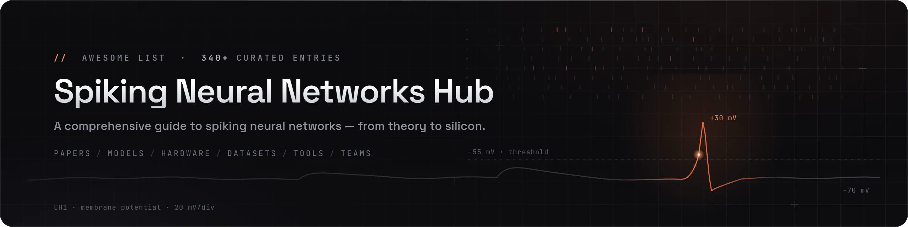

<div align="center">

<a href="https://github.com/haoran-zha/Awesome-Spiking-Neural-Networks-Hub"></a>

<h1>Awesome Spiking Neural Networks Hub</h1>

<p><em>A comprehensive, deeply-annotated guide to the world of Spiking Neural Networks (SNNs)</em><br>
<sub>papers · models · neuromorphic hardware · datasets · tools · research groups</sub></p>

<p>
<a href="https://awesome.re"></a>
<a href="https://github.com/haoran-zha/Awesome-Spiking-Neural-Networks-Hub/stargazers"></a>
<a href="https://github.com/haoran-zha/Awesome-Spiking-Neural-Networks-Hub/network/members"></a>

<a href="#contributing"></a>
<a href="LICENSE"></a>
</p>

<p><b>English</b> &nbsp;·&nbsp; <a href="README.zh-CN.md">中文</a> &nbsp;|&nbsp; <a href="TIMELINE.md">Timeline edition</a></p>

<p><b>420+</b> papers &amp; resources &nbsp;·&nbsp; <b>50+</b> seminal works &nbsp;·&nbsp; <b>42</b> research groups &nbsp;·&nbsp; <b>45+</b> open-source projects</p>

<p><b>Jump to</b> &nbsp;
<a href="#start-here">Start Here</a> ·
<a href="#1--foundations--neural-coding">Fundamentals</a> ·
<a href="#3--training-methods">Learning &amp; Models</a> ·
<a href="#6--neuromorphic-hardware">Hardware</a> ·
<a href="#7--applications">Applications</a> ·
<a href="#8--energy-robustness--security">Topics</a> ·
<a href="#10--datasets--benchmarks">Resources</a> ·
<a href="#13--research-groups--labs">Groups</a></p>

<sub>If this guide helps your work, please star the repo and <a href="#citation">cite it</a> — contributions are very welcome.</sub>

</div>

---

## What Is a Spiking Neural Network? (Read Me First)

Conventional deep networks (ANNs) pass **continuous numbers** between neurons at every layer, synchronously, every forward pass. A **Spiking Neural Network** instead communicates with **discrete, binary events — "spikes" — in time**, exactly like biological neurons. A spiking neuron integrates incoming current onto a *membrane potential*; when that potential crosses a threshold, it emits a single spike and resets. Nothing happens when there is no spike.

Three consequences make SNNs compelling:

- **Event-driven & sparse** → computation (and energy) is spent only when a spike occurs. On neuromorphic hardware this can mean *orders-of-magnitude* lower power than a GPU.
- **Temporal by construction** → information lives not just in *how many* spikes fire but in *when* they fire, giving a natural substrate for time-series, audio, and event-camera data.
- **Brain-inspired** → SNNs are often called the **"third generation"** of neural networks (after perceptrons and rate-based deep nets), bridging neuroscience and machine learning.

The central difficulty is that a spike is a **step function — non-differentiable** — so ordinary backpropagation does not directly apply. The whole field, in a sense, is a set of answers to *"how do we train these things?"* — which is why the [Training Methods](#3--training-methods) section is the heart of this list.

> This is an **awesome-style hub for the whole SNN field** — papers, models, hardware, datasets, tools, and research groups. Each entry carries a one-line "why it matters" note (English here; 中文 in the [Chinese edition](README.zh-CN.md)) so you can navigate without drowning.

---

## Start Here

**13 must-read landmarks that trace the field's arc** — from the "third generation" idea to today's spiking Transformers and large models. *(The ★ markers throughout the guide flag many more.)*

| Year | Landmark | Venue | Link |
|:---:|---|:---:|:---:|
| 1997 | **Networks of Spiking Neurons: The Third Generation** — *the founding idea* | Neural Networks | [paper](https://doi.org/10.1016/S0893-6080(97)00011-7) |
| 2014 | **TrueNorth** — *a million-neuron neuromorphic chip* | Science | [paper](https://www.science.org/doi/10.1126/science.1254642) |
| 2015 | **Unsupervised Learning with STDP** — *bio-plausible learning* | Front. Comput. Neurosci. | [paper](https://doi.org/10.3389/fncom.2015.00099) |
| 2018 | **Loihi** — *on-chip-learning neuromorphic processor* | IEEE Micro | [paper](https://ieeexplore.ieee.org/document/8259423) |
| 2018 | **STBP** — *spatio-temporal backprop, the training workhorse* | Front. Neurosci. | [paper](https://doi.org/10.3389/fnins.2018.00331) |
| 2020 | **e-prop** — *biologically plausible online learning* | Nature Comm. | [paper](https://doi.org/10.1038/s41467-020-17236-y) |
| 2021 | **SEW-ResNet** — *directly training 100+ layer SNNs* | NeurIPS | [paper](https://arxiv.org/abs/2102.04159) |
| 2022 | **QCFS** — *near-lossless ANN→SNN conversion* | ICLR | [paper](https://arxiv.org/abs/2303.04347) |
| 2023 | **Spikformer** — *the first spiking Transformer* | ICLR | [paper](https://arxiv.org/abs/2209.15425) |
| 2023 | **Spike-driven Transformer** — *pure spike-driven attention* | NeurIPS | [paper](https://arxiv.org/abs/2307.01694) |
| 2024 | **SpikeGPT** — *the first generative spiking LLM* | TMLR | [paper](https://arxiv.org/abs/2302.13939) |
| 2025 | **Darwin Monkey** — *first 2-billion-neuron neuromorphic computer* | ZJU | [link](https://www.zju.edu.cn/english/2025/0910/c19573a3079424/page.htm) |
| 2026 | **SpikingBrain** — *7B/76B spiking brain-inspired LLM* | TMLR | [paper](https://arxiv.org/abs/2509.05276) |

---

## Recent Updates

<details open>
<summary><b>Changelog</b> — newest first (click to collapse)</summary>

- **2026-10** — **Top-journal & conference catch-up.** Added 87 papers, led by the Nature / Science family (Nature Communications 21, Nature Electronics 11, Nature Machine Intelligence 8, Nature 7, Nature Computational Science 5, Nature Neuroscience 5, Science 4, Science Advances 2, plus Nature Materials / Nanotechnology / Photonics / Reviews) and NeurIPS 2025 · ICLR 2026 · ICML 2026 orals & spotlights; seven classics added with ★ (Neftci–Mostafa–Zenke surrogate gradients, Roy et al. Nature 2019, all-optical spiking networks, Markram 1997 and Song–Miller–Abbott 2000 STDP, Spaun, Brunel 2000); NIR added to §11; fixed two dead lab links (UESTC, Western Sydney).
- **2026-08** — **Darwin Monkey & summer sweep.** Added ZJU's **Darwin Monkey** (first 2B-neuron neuromorphic computer) ★ and DarwinWafer; a new **Photonic Spiking Hardware** subsection; NSLLM (NSR 2026) ★ plus six more spiking-LLM works; SpiNNaker2 chip paper (OJCAS 2026), SpikeRAM (ISSCC 2026), UniSpike (DAC 2026) and four Nature-family hardware works; CVPR / ACM MM / TNNLS / Nat. Comm. paper catch-ups; industry updates (SpiNNcloud, BrainChip AKD1500/AKD2500, Innatera, POLYN).
- **2026-07** — **2026 conference sweep.** Added the first CVPR 2026 (13) and ICML 2026 (11) entries, plus ECCV / IJCAI 2026, two TPAMI 2026 works and a Nature Communications 2026 neuromorphic training chip — each with its own one-line summary. SpikingBrain re-tagged **arXiv 2025 → TMLR 2026**.
- **2026-07** — **Audit & ecosystem update.** Fixed dead/outdated links and a moved lab affiliation; added six 2026 works, four major labs, and per-lab **latest-work (2024–2026)** tags across §13.
- **2026-07** — **Launched the Hub.** 340+ entries across **6 Parts**; new **Research Groups & Labs** (§13), **Model Zoo & Community** (§12), and a dedicated **Spiking Large Models & LLMs** section (§5).
- **2026-07** — **Visual overhaul.** New banner, "Start Here" table, and datasets/frameworks/model-zoo turned into tables.
- **2026-07** — **Coverage push.** Added SpikingBrain, Sorbet, SpikeCLIP, Spike2Former, SDiT; Darwin3, Intel Hala Point, IBM NorthPole, Lynxi / BrainChip / Innatera / Xylo / GrAI; plus foundational works (Mead 1990, Missing Memristor 2008, Tempotron 2006) and frameworks (SPAIC, SNNAX, BrainPy, CARLsim…).

> New paper / model / chip / dataset / tool? [Open a PR](#contributing) and add a line here.

</details>

---

## Table of Contents

**Part I · Fundamentals**
- [1 · Foundations & Neural Coding](#1--foundations--neural-coding)
- [2 · Neuron Models](#2--neuron-models)

**Part II · Learning & Models**
- [3 · Training Methods](#3--training-methods)
- [4 · Architectures](#4--architectures)
- [5 · Spiking Large Models & LLMs](#5--spiking-large-models--llms)

**Part III · Hardware & Systems**
- [6 · Neuromorphic Hardware](#6--neuromorphic-hardware)

**Part IV · Applications**
- [7 · Applications](#7--applications)

**Part V · Cross-Cutting Topics**
- [8 · Energy, Robustness & Security](#8--energy-robustness--security)
- [9 · Theory & Neuroscience](#9--theory--neuroscience)

**Part VI · Resources & Ecosystem**
- [10 · Datasets & Benchmarks](#10--datasets--benchmarks)
- [11 · Software & Frameworks](#11--software--frameworks)
- [12 · Model Zoo & Community](#12--model-zoo--community)
- [13 · Research Groups & Labs](#13--research-groups--labs)

**Meta:** [Contributing](#contributing) · [Citation](#citation) · [Star History](#star-history) · [License](#license--acknowledgements)

**Legend:** ★ = seminal / must-read · [paper] = paper · [code] = official code

---

## Part I · Fundamentals

### 1 · Foundations & Neural Coding

> **In one breath:** the roots of the field — from the first threshold neuron and the Nobel-winning Hodgkin–Huxley model to Maass's "third generation" framing — plus *neural coding*: **how a real-valued signal becomes spikes** (and back). Rate coding counts spikes over a window (simple, robust, slow); temporal/latency coding puts information in spike *timing* (fast, efficient, harder to train); rank-order and population codes sit in between. Your choice of code sets the ceiling on both accuracy and latency.

#### Historical Foundations

- A Logical Calculus of the Ideas Immanent in Nervous Activity (**Bull. Math. Biophysics 1943**) ★. \[[paper](https://doi.org/10.1007/BF02478259)\]
  > The McCulloch–Pitts threshold neuron — the conceptual seed of all artificial and spiking neurons.
- A Quantitative Description of Membrane Current and Its Application to Conduction and Excitation in Nerve (**J. Physiology 1952**) ★. \[[paper](https://doi.org/10.1113/jphysiol.1952.sp004764)\]
  > The Hodgkin–Huxley model — the Nobel-winning biophysical basis for all spiking-neuron dynamics.
- Networks of Spiking Neurons: The Third Generation of Neural Network Models (**Neural Networks 1997**) ★. \[[paper](https://doi.org/10.1016/S0893-6080(97)00011-7)\]
  > Maass's landmark defining SNNs as the computationally more powerful "third generation."
- Spiking Neuron Models: Single Neurons, Populations, Plasticity (**Cambridge Univ. Press 2002**) ★. \[[paper](https://doi.org/10.1017/CBO9780511815706)\]
  > Gerstner & Kistler's foundational textbook unifying IF, SRM, population, and plasticity theory.

#### Neural Coding & Encoding Schemes

- Spike-Based Strategies for Rapid Processing (**Neural Networks 2001**). \[[paper](https://doi.org/10.1016/S0893-6080(01)00083-1)\]
  > Thorpe et al.'s rank-order coding — firing *order* alone enables ultra-fast recognition.
- Rapid Neural Coding in the Retina with Relative Spike Latencies (**Science 2008**). \[[paper](https://www.science.org/doi/10.1126/science.1149639)\]
  > Biological evidence that relative first-spike latency carries robust, contrast-invariant information.
- Neural Coding in Spiking Neural Networks: A Comparative Study for Robust Neuromorphic Systems (**Front. Neurosci. 2021**). \[[paper](https://www.frontiersin.org/articles/10.3389/fnins.2021.638474/full)\]
  > Systematically benchmarks rate / temporal / phase / burst codes for accuracy and robustness.
- Deep Neural Networks with Weighted Spikes (**Neurocomputing 2018**). \[[paper](https://doi.org/10.1016/j.neucom.2018.05.087)\]
  > Phase/weighted-spike coding assigns time-dependent weights to spikes, cutting latency and spike count.
- Conversion of Analog to Spiking Neural Networks Using Sparse Temporal Coding (**IEEE ISCAS 2018**). \[[paper](https://doi.org/10.1109/ISCAS.2018.8351295)\]
  > Time-to-first-spike conversion that slashes operations versus rate coding at near-zero accuracy loss.
- T2FSNN: Deep Spiking Neural Networks with Time-to-First-Spike Coding (**DAC 2020**). \[[paper](https://arxiv.org/abs/2003.11741)\]
  > Brings TTFS coding to deep SNNs with kernel thresholds and early-firing for low latency/energy.
- Temporal Coding in Spiking Neural Networks with Alpha Synaptic Function (**ICASSP 2020**). \[[paper](https://arxiv.org/abs/1907.13223)\]
  > Enables exact backprop through precise spike times using an alpha-shaped synaptic response.
- Temporal-Coded Deep Spiking Neural Network with Easy Training and Robust Performance (**AAAI 2021**). \[[paper](https://ojs.aaai.org/index.php/AAAI/article/view/17329)\]
  > Argues non-leaky single-spike temporal coding is best for directly-trainable, robust deep SNNs.
- DIET-SNN: Direct Input Encoding with Leakage and Threshold Optimization (**IEEE TNNLS 2023**). \[[paper](https://arxiv.org/abs/2008.03658)\]
  > Feeds analog pixels directly and learns leak/threshold end-to-end, popularizing direct input encoding.
- Supervised Learning Based on Temporal Coding in Spiking Neural Networks (**IEEE TNNLS 2018**). \[[paper](https://doi.org/10.1109/TNNLS.2017.2726060)\]
  > Mostafa's exact gradient descent on the *time* of the first spike — a foundational temporal-coding training method.
- Optimized Spiking Neurons Can Classify Images with High Accuracy through Temporal Coding with Two Spikes (FS neurons) (**Nature Machine Intelligence 2021**). \[[paper](https://www.nature.com/articles/s42256-021-00311-4)\]
  > Few-spike (FS) neurons emulate ANN activations with ~2 spikes, giving high-accuracy, ultra-sparse temporal coding.
- Fast and Energy-Efficient Neuromorphic Deep Learning with First-Spike Times (**Nature Machine Intelligence 2021**). \[[paper](https://www.nature.com/articles/s42256-021-00388-x)\]\[[code](https://github.com/JulianGoeltz/fastAndDeep)\]
  > Rigorously derives a first-spike-time learning rule for LIF networks that needs only input and output spike times, enabling error backprop in hierarchical SNNs, emulated on BrainScaleS-2 to harness its speed and energy efficiency.
- Efficiently Training Time-to-First-Spike Spiking Neural Networks from Scratch (**ICML 2026**). \[[paper](https://arxiv.org/abs/2410.23619)\]\[[code](https://github.com/CheKaiWei/ETTFS)\]
  > Counters signal diminishing and vanishing gradients in from-scratch TTFS training via parameter initialization and training normalization, plus a temporal output decoder rewarding earlier firing and average pooling that preserves single-spike constraints.
- I2E: Real-Time Image-to-Event Conversion for High-Performance Spiking Neural Networks (**AAAI 2026**). \[[paper](https://ojs.aaai.org/index.php/AAAI/article/view/37179)\]\[[code](https://github.com/Ruichen0424/I2E)\]
  > Simulates microsaccadic eye movements with a highly parallelized convolution to turn static images into event streams over 300x faster than prior methods, enabling on-the-fly augmentation and synthetic-to-real SNN pre-training.

---

### 2 · Neuron Models

> **In one breath:** the neuron is the SNN's transistor. **LIF** (leaky integrate-and-fire) is the workhorse — cheap and good enough for deep learning. **Izhikevich** and **AdEx** buy richer spiking dynamics for little cost; **Hodgkin–Huxley** is biophysically exact but expensive. A modern trend is making neuron parameters (e.g., the membrane time constant) **learnable**, letting each neuron tune its own timescale.

- Lapicque's Introduction of the Integrate-and-Fire Model Neuron (1907) (**Brain Res. Bull. 1999**) ★. \[[paper](https://doi.org/10.1016/S0361-9230(99)00161-6)\]
  > Historical account crediting Lapicque (1907) with the original integrate-and-fire neuron.
- Simple Model of Spiking Neurons (**IEEE TNN 2003**) ★. \[[paper](https://doi.org/10.1109/TNN.2003.820440)\]
  > Izhikevich's two-variable model reproducing rich cortical firing patterns at integrate-and-fire cost.
- Which Model to Use for Cortical Spiking Neurons? (**IEEE TNN 2004**). \[[paper](https://doi.org/10.1109/TNN.2004.832719)\]
  > The famous chart trading biological fidelity against compute cost across neuron models — a selection guide.
- A Framework for Spiking Neuron Models: The Spike Response Model (**Handbook of Biol. Physics 2001**). \[[paper](https://www.sciencedirect.com/science/article/pii/S1383812101800154)\]
  > Formalizes the SRM, a kernel-based generalization of integrate-and-fire.
- Adaptive Exponential Integrate-and-Fire Model as an Effective Description of Neuronal Activity (**J. Neurophysiology 2005**). \[[paper](https://doi.org/10.1152/jn.00686.2005)\]
  > The AdEx model — an exponential spike term plus adaptation that accurately fits real neurons.
- Generalized Leaky Integrate-and-Fire Models Classify Multiple Neuron Types (**Nature Communications 2018**). \[[paper](https://www.nature.com/articles/s41467-017-02717-4)\]\[[code](https://github.com/AllenInstitute/GLIF_Teeter_et_al_2018)\]
  > Allen Institute's data-driven GLIF hierarchy fit to 645 real neurons across cell types.
- Incorporating Learnable Membrane Time Constant to Enhance Learning of SNNs (PLIF) (**ICCV 2021**) ★. \[[paper](https://openaccess.thecvf.com/content/ICCV2021/html/Fang_Incorporating_Learnable_Membrane_Time_Constant_To_Enhance_Learning_of_Spiking_ICCV_2021_paper.html)\]\[[code](https://github.com/fangwei123456/Parametric-Leaky-Integrate-and-Fire-Spiking-Neuron)\]
  > PLIF makes the membrane time constant learnable, boosting accuracy and easing initialization.
- GLIF: A Unified Gated Leaky Integrate-and-Fire Neuron for Spiking Neural Networks (**NeurIPS 2022**). \[[paper](https://openreview.net/forum?id=UmFSx2c4ubT)\]\[[code](https://github.com/Ikarosy/Gated-LIF)\]
  > Learnable gates fuse multiple bio-features per neuron, enlarging representational capacity.
- KLIF: An Optimized Spiking Neuron Unit for Tuning Surrogate Gradient Slope and Membrane Potential (**arXiv 2023**). \[[paper](https://arxiv.org/abs/2302.09238)\]
  > Adds a learnable scaling factor that dynamically shapes the surrogate-gradient curve during training.
- Parallel Spiking Neurons with High Efficiency and Ability to Learn Long-Term Dependencies (PSN) (**NeurIPS 2023**). \[[paper](https://arxiv.org/abs/2304.12760)\]\[[code](https://github.com/fangwei123456/Parallel-Spiking-Neuron)\]
  > Removes reset to reformulate neuronal dynamics for parallel (non-serial) simulation and long memory.
- TC-LIF: A Two-Compartment Spiking Neuron Model for Long-Term Sequential Modelling (**AAAI 2024**). \[[paper](https://ojs.aaai.org/index.php/AAAI/article/view/29625)\]\[[code](https://github.com/ZhangShimin1/TC-LIF)\]
  > Soma–dendrite two-compartment neuron designed to propagate gradients over long temporal gaps.
- CLIF: Complementary Leaky Integrate-and-Fire Neuron for Spiking Neural Networks (**ICML 2024**). \[[paper](https://proceedings.mlr.press/v235/huang24n.html)\]\[[code](https://github.com/HuuYuLong/Complementary-LIF)\]
  > A hyperparameter-free neuron that opens extra backprop paths to fight temporal vanishing gradients.
- Temporal Dendritic Heterogeneity Incorporated with SNNs for Learning Multi-Timescale Dynamics (DH-LIF) (**Nature Communications 2024**). \[[paper](https://www.nature.com/articles/s41467-023-44614-z)\]
  > Multi-branch dendritic neuron with learnable per-branch time constants for multi-timescale learning.
- PMSN: A Parallel Multi-compartment Spiking Neuron for Multi-scale Temporal Processing (**IEEE TNNLS 2026**). \[[paper](https://arxiv.org/abs/2408.14917)\]
  > PolyU's multi-compartment neuron with parallelizable multi-timescale dynamics — >10× training acceleration and +30% accuracy on Sequential CIFAR-10 vs LIF.
- Burst Spiking Neural Networks (BuSNN) (**arXiv 2026**). \[[paper](https://arxiv.org/abs/2607.11914)\]
  > BICLab argues SNN progress needs robustness, not just accuracy — burst-firing neurons with graded spikes plus a dynamic weight constraint.
- Neural Heterogeneity Promotes Robust Learning (**Nature Communications 2021**). \[[paper](https://www.nature.com/articles/s41467-021-26022-3)\]
  > Making neuronal time-constants diverse and *learnable* improves accuracy and robustness — a principled case for heterogeneity.
- Network Model with Internal Complexity Bridges Artificial Intelligence and Neuroscience (**Nature Computational Science 2024**). \[[paper](https://doi.org/10.1038/s43588-024-00674-9)\]\[[code](https://github.com/helx-20/complexity)\]
  > Proposes 'small models with internal complexity': the authors prove a network of Hodgkin–Huxley neurons can match the dynamics and performance of a larger LIF network, making richer neurons an alternative to scaling up.

---

<p align="right"><a href="#table-of-contents">↑ Back to top</a></p>

## Part II · Learning & Models

### 3 · Training Methods

> **In one breath — the field's central problem.** A spike is a non-differentiable step, so plain backprop fails. Three families answer this: **(1) Conversion** trains a normal ANN then maps it to an SNN (high accuracy, high latency); **(2) Surrogate-gradient direct training** pretends the spike has a smooth derivative and runs backprop-through-time (best accuracy-latency trade-off today); **(3) Bio-plausible local rules** like STDP learn from spike timing without global gradients (most brain-like, hardest to scale).

#### 3.1 ANN-to-SNN Conversion

> Train in the easy (ANN) world, deploy in the efficient (SNN) world. The art is matching an SNN's *firing rate* to an ANN's *activation* — via weight/threshold normalization — so almost no accuracy is lost, ideally at low latency.

- Spiking Deep Convolutional Neural Networks for Energy-Efficient Object Recognition (**IJCV 2015**) ★. \[[paper](https://doi.org/10.1007/s11263-014-0788-3)\]
  > The seminal work mapping a trained CNN to a spiking IF network via ReLU↔firing-rate correspondence — it launched the conversion paradigm.
- Fast-Classifying, High-Accuracy Spiking Deep Networks Through Weight and Threshold Balancing (**IJCNN 2015**) ★. \[[paper](https://doi.org/10.1109/IJCNN.2015.7280696)\]
  > Introduced weight normalization / threshold balancing that keeps firing rates in range, making conversion near-lossless.
- Conversion of Continuous-Valued Deep Networks to Efficient Event-Driven Networks (**Front. Neurosci. 2017**). \[[paper](https://doi.org/10.3389/fnins.2017.00682)\]\[[code](https://github.com/NeuromorphicProcessorProject/snn_toolbox)\]
  > Spiking equivalents of BatchNorm/max-pool/softmax/bias enabling accurate VGG/Inception conversion — ships the widely used SNN-Toolbox.
- Going Deeper in Spiking Neural Networks: VGG and Residual Architectures (**Front. Neurosci. 2019**) ★. \[[paper](https://doi.org/10.3389/fnins.2019.00095)\]
  > Scaled conversion to deep VGG-16 / ResNet on ImageNet with a Spike-Norm scheme, proving SNNs can go deep.
- Enabling Deep SNNs with Hybrid Conversion and Spike-Timing-Dependent Backpropagation (**ICLR 2020**). \[[paper](https://openreview.net/forum?id=B1xSperKvH)\]\[[code](https://github.com/nitin-rathi/hybrid-snn-conversion)\]
  > Initialize from a converted SNN, then fine-tune with spike-based backprop — cutting inference timesteps by an order of magnitude.
- RMP-SNN: Residual Membrane Potential Neuron for Deeper, High-Accuracy, Low-Latency SNNs (**CVPR 2020**). \[[paper](https://arxiv.org/abs/2003.01811)\]
  > "Soft reset" (residual membrane potential) removes a key source of conversion error for near-lossless deep SNNs.
- Optimal Conversion of Conventional ANNs to SNNs (**ICLR 2021**). \[[paper](https://openreview.net/forum?id=FZ1oTwcXchK)\]\[[code](https://github.com/Jackn0/snn_optimal_conversion_pipeline)\]
  > Decomposes conversion loss layer-wise and uses a rate-norm activation with optimal threshold/shift to shorten simulation length.
- A Free Lunch From ANN: Towards Efficient, Accurate SNN Calibration (**ICML 2021**). \[[paper](https://proceedings.mlr.press/v139/li21d.html)\]\[[code](https://github.com/yhhhli/SNN_Calibration)\]
  > Light-weight layer-by-layer calibration on a handful of samples, scaling to MobileNet/RegNet on ImageNet.
- Optimal ANN-SNN Conversion for High-Accuracy and Ultra-Low-Latency SNNs (QCFS) (**ICLR 2022**) ★. \[[paper](https://arxiv.org/abs/2303.04347)\]\[[code](https://github.com/putshua/ANN_SNN_QCFS)\]
  > Trains the ANN with a quantization-clip-floor-shift activation matching SNN dynamics — high accuracy in as few as 4 timesteps.
- Optimized Potential Initialization for Low-Latency Spiking Neural Networks (**AAAI 2022**). \[[paper](https://arxiv.org/abs/2202.01440)\]
  > Setting the initial membrane potential to half-threshold minimizes conversion error, enabling accuracy under 32 timesteps.
- Bridging the Gap Between ANNs and SNNs by Calibrating Offset Spikes (**ICLR 2023**). \[[paper](https://arxiv.org/abs/2302.10685)\]
  > Identifies "offset spikes" as the dominant residual error and fixes it by shifting the initial membrane potential.
- A Unified Optimization Framework of ANN-SNN Conversion (**ICML 2023**). \[[paper](https://proceedings.mlr.press/v202/jiang23a.html)\]\[[code](https://github.com/HaiyanJiang/SNN_Conversion_unified)\]
  > A SlipReLU unifies performance-loss and conversion-error views — first to reach usable accuracy at a *single* timestep.
- Reducing ANN-SNN Conversion Error via Residual Membrane Potential Alignment (**arXiv 2026**). \[[paper](https://arxiv.org/abs/2608.13952)\]
  > The PKU conversion lineage (QCFS authors) attacks low-timestep error with dynamic initial-potential tuning and residual-alignment regularization.

#### 3.2 Surrogate Gradient & Direct Training

> Replace the spike's undefined derivative with a smooth "surrogate" and backpropagate through time. This is where most SOTA accuracy on hard datasets now comes from.

- Error-Backpropagation in Temporally Encoded Networks of Spiking Neurons (SpikeProp) (**Neurocomputing 2002**) ★. \[[paper](https://doi.org/10.1016/S0925-2312(01)00658-0)\]
  > The first backprop rule for temporally-coded spiking neurons — ancestor of all gradient-based SNN training.
- Training Deep Spiking Neural Networks Using Backpropagation (**Front. Neurosci. 2016**). \[[paper](https://doi.org/10.3389/fnins.2016.00508)\]
  > Treats the membrane potential as a differentiable signal and spikes as noise, letting standard backprop train deep SNNs.
- Spatio-Temporal Backpropagation for Training High-Performance SNNs (STBP) (**Front. Neurosci. 2018**) ★. \[[paper](https://doi.org/10.3389/fnins.2018.00331)\]\[[code](https://github.com/yjwu17/STBP-for-training-SpikingNN)\]
  > Unrolls the SNN in space *and* time (BPTT) with a surrogate derivative — the workhorse recipe for modern direct training.
- Direct Training for Spiking Neural Networks: Faster, Larger, Better (NeuNorm) (**AAAI 2019**). \[[paper](https://arxiv.org/abs/1809.05793)\]
  > Adds neuron normalization (NeuNorm) and improved coding to scale STBP to larger nets and neuromorphic datasets.
- SLAYER: Spike Layer Error Reassignment in Time (**NeurIPS 2018**) ★. \[[paper](https://papers.nips.cc/paper/7415-slayer-spike-layer-error-reassignment-in-time)\]\[[code](https://github.com/bamsumit/slayerPytorch)\]
  > Back-propagates error through time with a temporal credit-assignment kernel, jointly learning weights and axonal delays.
- SuperSpike: Supervised Learning in Multilayer Spiking Neural Networks (**Neural Computation 2018**). \[[paper](https://doi.org/10.1162/neco_a_01086)\]\[[code](https://github.com/fzenke/pub2018superspike)\]
  > An online three-factor surrogate-gradient rule linking deep learning to biological plasticity.
- The Remarkable Robustness of Surrogate Gradient Learning for Instilling Complex Function in SNNs (**Neural Computation 2021**). \[[paper](https://doi.org/10.1162/neco_a_01367)\]\[[code](https://github.com/fzenke/randman)\]
  > Learning is robust to surrogate *shape* but sensitive to its *scale* — practical design guidance.
- Temporal Spike Sequence Learning via Backpropagation for Deep SNNs (TSSL-BP) (**NeurIPS 2020**). \[[paper](https://arxiv.org/abs/2002.10085)\]\[[code](https://github.com/stonezwr/TSSL-BP)\]
  > Splits credit assignment into inter- and intra-neuron dependencies for precise temporal learning in very few steps.
- Differentiable Spike: Rethinking Gradient-Descent for Training SNNs (Dspike) (**NeurIPS 2021**). \[[paper](https://proceedings.neurips.cc/paper/2021/hash/c4ca4238a0b923820dcc509a6f75849b-Abstract.html)\]
  > An adaptively-tunable family of differentiable surrogates that minimizes gradient mismatch.
- Training Feedback SNNs by Implicit Differentiation on the Equilibrium State (IDE) (**NeurIPS 2021**). \[[paper](https://arxiv.org/abs/2109.14247)\]\[[code](https://github.com/pkuxmq/IDE-FSNN)\]
  > Trains feedback SNNs via implicit differentiation of their equilibrium state — memory cost independent of timesteps.
- Sparse Spiking Gradient Descent (**NeurIPS 2021**). \[[paper](https://arxiv.org/abs/2105.08810)\]\[[code](https://github.com/npvoid/SparseSpikingBackprop)\]
  > Exploits spatiotemporal sparsity in the backward pass for up to 150× faster, 85% lower-memory training.
- Temporal Efficient Training of SNNs via Gradient Re-weighting (TET) (**ICLR 2022**) ★. \[[paper](https://arxiv.org/abs/2202.11946)\]\[[code](https://github.com/Gus-Lab/temporal_efficient_training)\]
  > A per-timestep loss compensating surrogate-gradient momentum loss — flatter minima, better generalization; now a default trick.
- Training High-Performance Low-Latency SNNs by Differentiation on Spike Representation (DSR) (**CVPR 2022**). \[[paper](https://arxiv.org/abs/2205.00459)\]\[[code](https://github.com/qymeng94/DSR)\]
  > Treats the firing-rate representation as a sub-differentiable map and trains through it, sidestepping non-differentiability.
- Online Training Through Time for Spiking Neural Networks (OTTT) (**NeurIPS 2022**). \[[paper](https://arxiv.org/abs/2210.04195)\]\[[code](https://github.com/pkuxmq/OTTT-SNN)\]
  > A constant-memory online alternative to BPTT with a three-factor Hebbian form suited to on-chip learning.
- RecDis-SNN: Rectifying Membrane Potential Distribution for Directly Training SNNs (**CVPR 2022**). \[[paper](https://openaccess.thecvf.com/content/CVPR2022/html/Guo_RecDis-SNN_Rectifying_Membrane_Potential_Distribution_for_Directly_Training_Spiking_Neural_CVPR_2022_paper.html)\]
  > A membrane-potential distribution loss that mitigates degeneration, saturation, and gradient mismatch.
- IM-Loss: Information Maximization Loss for Spiking Neural Networks (**NeurIPS 2022**). \[[paper](https://proceedings.neurips.cc/paper_files/paper/2022/hash/010c5ba0cafc743fece8be02e7adb8dd-Abstract-Conference.html)\]\[[code](https://github.com/yfguo91/IM-Loss-Information-Maximization-Loss-for-Spiking-Neural-Networks)\]
  > Maximizes activation information entropy to counter the loss caused by 0/1 spike quantization.
- RMP-Loss: Regularizing Membrane Potential Distribution for Spiking Neural Networks (**ICCV 2023**). \[[paper](https://arxiv.org/abs/2308.06787)\]
  > A loss pulling membrane potentials toward spike values, directly shrinking quantization error.
- Real Spike: Learning Real-valued Spikes for Spiking Neural Networks (**ECCV 2022**). \[[paper](https://arxiv.org/abs/2210.06686)\]\[[code](https://github.com/yfguo91/Real-Spike)\]
  > Learns real-valued spikes during training, re-parameterized back to binary at inference — capacity for free.
- Surrogate Module Learning: Reduce Gradient Error Accumulation in Training SNNs (**ICML 2023**). \[[paper](https://proceedings.mlr.press/v202/deng23d.html)\]
  > Surrogate modules create a shortcut path for more accurate gradients, curbing layer-wise gradient-error buildup.
- Towards Memory- and Time-Efficient Backpropagation for Training SNNs (SLTT) (**ICCV 2023**). \[[paper](https://arxiv.org/abs/2302.14311)\]\[[code](https://github.com/qymeng94/SLTT)\]
  > Shows temporal backprop contributes little; dropping those routes cuts memory >70% and training time >50%.
- A Tandem Learning Rule for Effective Training and Rapid Inference of Deep SNNs (**IEEE TNNLS 2023**). \[[paper](https://arxiv.org/abs/1907.01167)\]\[[code](https://github.com/deepspike/tandem_learning)\]
  > Couples an ANN and SNN via weight sharing — the ANN carries gradients while the SNN counts spikes.
- Advancing Spatiotemporal Representations in SNNs via Parametric Invertible Transformation (PIT) (**ICLR 2026**). \[[paper](https://openreview.net/forum?id=3JwNXQzxll)\]\[[code](https://github.com/YinsongYan/ICLR26)\]
  > Conjugates an invertible transform with neuron dynamics and corrects surrogate-gradient mismatch, expanding the usable binary-spike representation space.
- Scalable Training of Continuous-Time SNNs with Differentiable Spike-Time Discretization (DSTD) (**arXiv 2026**). \[[paper](https://arxiv.org/abs/2607.14672)\]
  > Makes exact spike-time (continuous-time, event-driven) training memory-tractable by mapping irregular spikes onto differentiable fixed time points.
- Accurate and Efficient Time-Domain Classification with Adaptive Spiking Recurrent Neural Networks (**Nature Machine Intelligence 2021**). \[[paper](https://doi.org/10.1038/s42256-021-00397-w)\]
  > Adaptive spiking neurons + surrogate-gradient RSNNs reach RNN-level accuracy on speech/gesture at far less compute.
- Surrogate Gradient Learning in Spiking Neural Networks: Bringing the Power of Gradient-Based Optimization to Spiking Neural Networks (**IEEE Signal Processing Magazine 2019**) ★. \[[paper](https://doi.org/10.1109/MSP.2019.2931595)\]
  > Neftci, Mostafa & Zenke's tutorial review that frames surrogate gradients — smooth stand-ins for the spike's derivative — as the flexible, efficient way to train SNNs with gradient descent.
- Accurate Online Training of Dynamical Spiking Neural Networks Through Forward Propagation Through Time (FPTT) (**Nature Machine Intelligence 2023**). \[[paper](https://www.nature.com/articles/s42256-023-00650-4)\]\[[code](https://github.com/byin-cwi/sFPTT)\]
  > Pairs Forward-Propagation Through Time with liquid time-constant spiking neurons to train recurrent SNNs online with low memory, learning exceedingly long sequences and directly training a deep SNN for joint object localization and recognition.
- High-Performance Deep Spiking Neural Networks with 0.3 Spikes per Neuron (**Nature Communications 2024**). \[[paper](https://www.nature.com/articles/s41467-024-51110-5)\]
  > Traces vanishing/exploding gradients in time-to-first-spike SNNs to ANN-style initialization; a constant membrane-potential slope at threshold makes training mirror a ReLU network, matching ANN accuracy with under 0.3 spikes per neuron.
- Efficient Event-Based Delay Learning in Spiking Neural Networks (**Nature Communications 2025**). \[[paper](https://www.nature.com/articles/s41467-025-65394-8)\]
  > Extends EventProp to exact gradients for weights and delays, supporting multiple spikes per neuron and recurrent SNNs. It uses less than half the memory of the state-of-the-art delay-learning method and runs up to 26× faster.
- DelGrad: Exact Event-Based Gradients for Training Delays and Weights on Spiking Neuromorphic Hardware (**Nature Communications 2025**). \[[paper](https://www.nature.com/articles/s41467-025-63120-y)\]\[[code](https://github.com/JulianGoeltz/fastAndDeep)\]
  > Computes exact event-based gradients for both synaptic weights and delays from spike times alone, and shows on the BrainScaleS-2 chip that learned delays improve accuracy, parameter efficiency and robustness to hardware noise.
- Training Deep Normalization-Free Spiking Neural Networks with Lateral Inhibition (**ICLR 2026**). \[[paper](https://arxiv.org/abs/2509.23253)\]\[[code](https://github.com/vwOvOwv/DeepEISNN)\]
  > Replaces standard SNN layers with cortical excitatory–inhibitory populations whose subtractive and divisive inhibition regulate activity, with E-I Init and E-I Prop stabilizing deep SNN training without normalization.
- Temporal Representation Enhancement (TRE): Learning to Forget Dominant Patterns for Enhanced Temporal Spiking Features (**CVPR 2026**). \[[paper](https://cvpr.thecvf.com/virtual/2026/poster/37392)\]
  > Counters redundancy from timestep-invariant supervision with a learning-to-forget scheme that accumulates class-specific contributions and dynamically suppresses dominant patterns, steering SNNs toward complementary temporal features.

#### 3.3 Biologically-Plausible / Local Learning

> **STDP** and friends: synapses strengthen or weaken based purely on the *relative timing* of pre- and post-synaptic spikes — local, unsupervised, and hardware-friendly, but historically hard to push to ImageNet scale.

- Synaptic Modifications in Cultured Hippocampal Neurons: Dependence on Spike Timing... (**J. Neuroscience 1998**) ★. \[[paper](https://doi.org/10.1523/JNEUROSCI.18-24-10464.1998)\]
  > Bi & Poo's landmark experiment quantifying STDP — the biological basis of local SNN learning rules.
- Regulation of Synaptic Efficacy by Coincidence of Postsynaptic APs and EPSPs (**Science 1997**) ★. \[[paper](https://doi.org/10.1126/science.275.5297.213)\]
  > Dual whole-cell recordings between neocortical pyramidal neurons show unitary EPSPs grow or shrink with the precise timing of postsynaptic APs. A founding STDP experiment alongside Bi & Poo.
- Competitive Hebbian Learning Through Spike-Timing-Dependent Synaptic Plasticity (**Nature Neuroscience 2000**) ★. \[[paper](https://www.nature.com/articles/nn0900_919)\]
  > Models show STDP itself produces Hebbian synaptic competition. Weights balance automatically, and inputs that fire the neuron with short latency or in correlated groups win while longer-latency inputs weaken.
- Unsupervised Learning of Digit Recognition Using STDP (**Front. Comput. Neurosci. 2015**) ★. \[[paper](https://doi.org/10.3389/fncom.2015.00099)\]\[[code](https://github.com/peter-u-diehl/stdp-mnist)\]
  > Diehl & Cook's STDP + lateral-inhibition network learns MNIST unsupervised (~95%) — the canonical bio-plausible baseline.
- STDP-Based Spiking Deep Convolutional Neural Networks for Object Recognition (**Neural Networks 2018**). \[[paper](https://doi.org/10.1016/j.neunet.2017.12.005)\]
  > Stacks STDP-trained conv layers with latency coding, showing local plasticity can learn deep hierarchical features.
- Bio-Inspired Digit Recognition Using Reward-Modulated STDP in Deep Conv Networks (**Pattern Recognition 2019**). \[[paper](https://arxiv.org/abs/1804.00227)\]\[[code](https://github.com/miladmozafari/SpykeTorch)\]
  > Combines unsupervised STDP with reward-modulated STDP (a three-factor rule) for reinforcement-driven feature learning.
- A Solution to the Learning Dilemma for Recurrent Networks of Spiking Neurons (e-prop) (**Nature Communications 2020**) ★. \[[paper](https://doi.org/10.1038/s41467-020-17236-y)\]\[[code](https://github.com/IGITUGraz/eligibility_propagation)\]
  > Local eligibility traces + top-down learning signals approximate BPTT without backward-in-time — enabling on-chip learning.
- Equilibrium Propagation: Bridging Energy-Based Models and Backpropagation (**Front. Comput. Neurosci. 2017**). \[[paper](https://doi.org/10.3389/fncom.2017.00024)\]
  > Computes exact gradients using only local, same-type computation across two phases — a biologically plausible backprop alternative.
- Training Spiking Neural Networks via Augmented Direct Feedback Alignment (**NeurIPS 2024**). \[[paper](https://arxiv.org/abs/2409.07776)\]
  > A gradient-free random-projection feedback-alignment rule avoiding weight transport, improving biological/hardware fit.
- Backpropagation-Free Spiking Neural Networks with the Forward-Forward Algorithm (**arXiv 2025**). \[[paper](https://arxiv.org/abs/2502.20411)\]
  > Adapts Hinton's Forward-Forward (two contrastive forward passes, layer-local goodness) to spiking neurons.
- Spike-Based Alignment Learning Solves the Weight Transport Problem (**Nature Communications 2026**). \[[paper](https://www.nature.com/articles/s41467-026-74460-8)\]
  > Bern/Heidelberg derive a spike-timing rule that aligns feedback weights locally — resolving weight transport for bio-plausible and on-chip credit assignment.
- The Tempotron: A Neuron That Learns Spike Timing-Based Decisions (**Nature Neuroscience 2006**) ★. \[[paper](https://doi.org/10.1038/nn1643)\]
  > Gütig & Sompolinsky's tempotron — a single neuron that learns to classify by the *timing* of its input spikes.
- Unsupervised Learning of Visual Features through Spike-Timing-Dependent Plasticity (**PLoS Comput. Biol. 2007**) ★. \[[paper](https://doi.org/10.1371/journal.pcbi.0030031)\]
  > Masquelier & Thorpe show STDP + latency coding self-organizes selective visual features — a landmark unsupervised result.
- Burst-Dependent Synaptic Plasticity Can Coordinate Learning in Hierarchical Circuits (Burstprop) (**Nature Neuroscience 2021**). \[[paper](https://doi.org/10.1038/s41593-021-00857-x)\]\[[code](https://github.com/apayeur/spikingburstprop)\]
  > When plasticity is gated by high-frequency spike bursts, higher-level pyramidal neurons can coordinate lower-level synapses; with short-term dynamics, apical dendritic activity and feedback plasticity, the rule solves deep-architecture tasks.
- Brain-Inspired Global-Local Learning Incorporated with Neuromorphic Computing (**Nature Communications 2022**). \[[paper](https://doi.org/10.1038/s41467-021-27653-2)\]
  > Meta-learns local synaptic plasticity together with top-down, error-driven supervision in a differentiable spiking model, outperforming single-rule learning on few-shot, continual and fault-tolerant tasks; co-designed for and run on Tianjic.
- The Combination of Hebbian and Predictive Plasticity Learns Invariant Object Representations in Deep Sensory Networks (**Nature Neuroscience 2023**). \[[paper](https://doi.org/10.1038/s41593-023-01460-y)\]\[[code](https://github.com/fmi-basel/latent-predictive-learning)\]
  > Latent predictive learning (LPL) adds predictive plasticity to Hebbian plasticity, giving a local rule that learns invariant object representations in deep networks, extends to spiking networks and reproduces STDP and metaplasticity.
- The Backpropagation Algorithm Implemented on Spiking Neuromorphic Hardware (**Nature Communications 2024**). \[[paper](https://www.nature.com/articles/s41467-024-53827-9)\]
  > Implements exact backpropagation entirely on Intel Loihi via synfire-gated dynamical information coordination; a three-layer spiking circuit learns MNIST and Fashion-MNIST with no computer in the loop.
- Co-Dependent Excitatory and Inhibitory Plasticity Accounts for Quick, Stable and Long-Lasting Memories in Biological Networks (**Nature Neuroscience 2024**). \[[paper](https://doi.org/10.1038/s41593-024-01597-4)\]\[[code](https://github.com/ejagnes/codependent_plasticity)\]
  > Co-dependent plasticity in spiking LIF neurons: inhibition gates excitatory plasticity and neighbouring excitatory activity sets LTP strength, so synaptic memories form quickly yet stay stable.
- Online Pseudo-Zeroth-Order Training of Neuromorphic Spiking Neural Networks (**ICLR 2026**). \[[paper](https://arxiv.org/abs/2407.12516)\]
  > Trains SNNs with a single noise-injected forward pass and direct top-down feedback, using a pseudo-zeroth-order formulation and momentum feedback to tame variance and avoid backprop's symmetric weights for on-chip learning.
- Model-Agnostic Linear-Memory Online Learning in Spiking Neural Networks (BrainTrace) (**Nature Communications 2026**). \[[paper](https://www.nature.com/articles/s41467-026-68453-w)\]\[[code](https://github.com/chaobrain/braintrace)\]
  > Compiles user-defined neuron and synapse dynamics into eligibility-trace online learning whose memory grows linearly with neuron count, and fits a connectome-constrained whole-brain Drosophila SNN to region-level activity.

#### 3.4 Efficiency: Pruning, Quantization, Distillation

> Making an already-efficient model *more* efficient: fewer timesteps, fewer weights, lower precision, and distilling knowledge from ANN teachers.

- Towards Ultra-Low-Latency SNNs for Vision and Sequential Tasks Using Temporal Pruning (**ECCV 2022**). \[[paper](https://doi.org/10.1007/978-3-031-20083-0_42)\]
  > Iteratively prunes timesteps during training, driving SNNs toward single-timestep inference.
- Constructing Deep SNNs from ANNs with Knowledge Distillation (**CVPR 2023**). \[[paper](https://arxiv.org/abs/2304.05627)\]
  > Uses an ANN teacher to distill feature/response knowledge into an SNN student, avoiding costly from-scratch training.
- TP-Spikformer: Token Pruned Spiking Transformer (**ICLR 2026**). \[[paper](https://openreview.net/forum?id=L5llQD0nMf)\]
  > Prunes low-information tokens without retraining across several spiking-Transformer families, reducing storage and compute while retaining competitive accuracy.
- Towards Lossless Memory-efficient Training of SNNs via Gradient Checkpointing and Spike Compression (**ICLR 2026**). \[[paper](https://openreview.net/forum?id=nrBJ0Uvj7c)\]\[[code](https://github.com/AllenYolk/snn-gradient-checkpointing)\]
  > Combines adaptive spatiotemporal checkpointing with lossless binary-spike compression for up to 8× lower training memory without accuracy loss.

> Also relevant: several low-timestep / low-memory training methods double as efficiency techniques — see **TET**, **SLTT**, **DSR** in [3.2](#32-surrogate-gradient--direct-training) and **DIET-SNN** in [Neural Coding](#1--foundations--neural-coding).

---

### 4 · Architectures

> **In one breath:** the network *shape*. The 2019–2021 breakthrough was getting **residual/BN tricks** to work in the spiking domain so SNNs could go deep; the 2023+ wave brought **spiking Transformers**, redesigning self-attention to run on spikes.

#### 4.1 Deep Spiking CNNs & ResNets

> Residual connections and spike-aware normalization (tdBN, BNTT, TEBN) are what let SNNs scale past a few layers without spikes vanishing or exploding.

- Spiking Deep Residual Networks (**IEEE TNNLS 2021**). \[[paper](https://arxiv.org/abs/1805.01352)\]
  > The original "Spiking ResNet" — scaled shortcuts + error compensation build the first >40-layer SNN matching ANN accuracy.
- Deep Residual Learning in Spiking Neural Networks (SEW-ResNet) (**NeurIPS 2021**) ★. \[[paper](https://arxiv.org/abs/2102.04159)\]\[[code](https://github.com/fangwei123456/Spike-Element-Wise-ResNet)\]
  > The spike-element-wise (SEW) block enables identity mapping and solves vanishing/exploding gradients — first directly-trained 100+ layer SNNs.
- Advancing Spiking Neural Networks Toward Deep Residual Learning (MS-ResNet) (**IEEE TNNLS 2024**). \[[paper](https://arxiv.org/abs/2112.08954)\]\[[code](https://github.com/Ariande1/MS-ResNet)\]
  > Membrane-potential (pre-activation) shortcuts preserve spike-driven computation and gradient-norm equality, scaling to 482 layers.
- Going Deeper with Directly-Trained Larger SNNs (STBP-tdBN) (**AAAI 2021**) ★. \[[paper](https://arxiv.org/abs/2011.05280)\]
  > Threshold-dependent BatchNorm (tdBN) balances firing rates across time, extending directly-trained SNNs from <10 to 50 layers.
- Revisiting Batch Normalization for Training Low-Latency Deep SNNs from Scratch (BNTT) (**Front. Neurosci. 2021**). \[[paper](https://arxiv.org/abs/2010.01729)\]\[[code](https://github.com/Intelligent-Computing-Lab-Panda/BNTT-Batch-Normalization-Through-Time)\]
  > Decouples BN parameters along the time axis to capture spike temporal dynamics and enable low-latency training from scratch.
- Temporal Effective Batch Normalization in Spiking Neural Networks (TEBN) (**NeurIPS 2022**). \[[paper](https://proceedings.neurips.cc/paper_files/paper/2022/hash/de2ad3ed44ee4e675b3be42aa0b615d0-Abstract-Conference.html)\]\[[code](https://github.com/ChaotengDuan/TEBN)\]
  > Rescales inputs with distinct learnable weights per time-step, smoothing temporal distributions and the optimization landscape.
- Membrane Potential Batch Normalization for Spiking Neural Networks (MPBN) (**ICCV 2023**). \[[paper](https://arxiv.org/abs/2308.08359)\]\[[code](https://github.com/yfguo91/MPBN)\]
  > A second BN on the membrane potential before firing, folded into the threshold by re-parameterization — zero inference cost.

#### 4.2 Spiking Transformers & Attention

> Self-attention, re-derived so that queries/keys/values are spikes and the expensive softmax is replaced by spike-friendly operations — bringing Transformer-level accuracy to the spiking world.

- Spikformer: When Spiking Neural Network Meets Transformer (**ICLR 2023**) ★. \[[paper](https://arxiv.org/abs/2209.15425)\]\[[code](https://github.com/ZK-Zhou/spikformer)\]
  > Introduces softmax-free Spiking Self-Attention (SSA) with spike-form Q/K/V — the first vision Transformer built directly in the spiking domain.
- Spike-driven Transformer (**NeurIPS 2023**) ★. \[[paper](https://arxiv.org/abs/2307.01694)\]\[[code](https://github.com/BICLab/Spike-Driven-Transformer)\]
  > A purely spike-driven Transformer whose attention uses only mask + sparse addition (linear complexity), cutting attention energy up to 87×.
- Spike-driven Transformer V2 (Meta-SpikeFormer) (**ICLR 2024**). \[[paper](https://arxiv.org/abs/2404.03663)\]\[[code](https://github.com/BICLab/Spike-Driven-Transformer-V2)\]
  > A meta spiking backbone unifying classification, detection, and segmentation, guiding next-gen neuromorphic chip design (80% ImageNet).
- Scaling Spike-driven Transformer with Efficient Spike Firing Approximation (V3) (**IEEE TPAMI 2025**). \[[paper](https://arxiv.org/abs/2411.16061)\]\[[code](https://github.com/BICLab/Spike-Driven-Transformer-V3)\]
  > Integer training + spike-driven inference plus a spike masked autoencoder scale SNNs to 86.2% on ImageNet.
- Spikformer V2: Join the High-Accuracy Club on ImageNet with an SNN Ticket (**arXiv 2024**). \[[paper](https://arxiv.org/abs/2401.02020)\]
  > A Spiking Convolutional Stem + self-supervised pretraining — among the first SNNs past 80% top-1 on ImageNet.
- QKFormer: Hierarchical Spiking Transformer using Q-K Attention (**NeurIPS 2024**). \[[paper](https://arxiv.org/abs/2403.16552)\]\[[code](https://github.com/zhouchenlin2096/QKFormer)\]
  > Linear-complexity binary Q-K attention + hierarchical pyramid — first directly-trained SNN past 85% top-1 on ImageNet.
- Spikingformer: A Key Foundation Model for Spiking Neural Networks (**AAAI 2026**). \[[paper](https://ojs.aaai.org/index.php/AAAI/article/view/37207)\]\[[code](https://github.com/TheBrainLab/Spikingformer)\]
  > Replaces Spikformer's non-spike residuals with a fully spike-driven design, removing integer-float multiplications for hardware friendliness.
- SpikingResformer: Bridging ResNet and Vision Transformer in SNNs (**CVPR 2024**). \[[paper](https://arxiv.org/abs/2403.14302)\]\[[code](https://github.com/xyshi2000/SpikingResformer)\]
  > Combines a ResNet-style multi-stage backbone with Dual Spike Self-Attention (DSSA) for high accuracy at fewer params/energy.
- Masked Spiking Transformer (**ICCV 2023**). \[[paper](https://openaccess.thecvf.com/content/ICCV2023/html/Wang_Masked_Spiking_Transformer_ICCV_2023_paper.html)\]\[[code](https://github.com/bic-L/Masked-Spiking-Transformer)\]
  > An ANN-to-SNN converted Transformer with Random Spike Masking that prunes redundant spikes to cut energy without accuracy loss.
- Spiking Transformer with Spatial-Temporal Attention (STAtten) (**CVPR 2025**). \[[paper](https://arxiv.org/abs/2409.19764)\]\[[code](https://github.com/Intelligent-Computing-Lab-Panda/STAtten)\]
  > Block-wise attention jointly integrating spatial and temporal information at the cost of spatial-only spiking attention.
- Neural Dynamics Self-Attention for Spiking Transformers (**ICLR 2026**). \[[paper](https://openreview.net/forum?id=jJedqisfOt)\]
  > Adds a local receptive-field bias and realizes attention through charge–fire–reset dynamics, avoiding explicit attention-matrix storage at inference.
- Ge²mS-T: Multi-Dimensional Grouping for Ultra-High Energy Efficiency in Spiking Transformer (**ACM MM 2026**). \[[paper](https://arxiv.org/abs/2604.08894)\]
  > PKU's multi-dimensional grouped computation plus an exponential-coding ExpG-IF neuron jointly balances memory, learning and energy (Oral).
- Rethinking Attention Locality in Spiking Transformers (**arXiv 2026**). \[[paper](https://arxiv.org/abs/2608.08541)\]
  > Mean-attention-distance analysis shows "local" spiking attention needn't be spatially local, and proposes region-contiguous attention as the fix.
- TIM: An Efficient Temporal Interaction Module for Spiking Transformer (**IJCAI 2024**). \[[paper](https://arxiv.org/abs/2401.11687)\]
  > A lightweight convolutional module injecting previous-timestep information into the attention matrix, strengthening temporal modeling.
- Temporal-wise Attention Spiking Neural Networks for Event Streams Classification (TA-SNN) (**ICCV 2021**). \[[paper](https://openaccess.thecvf.com/content/ICCV2021/html/Yao_Temporal-Wise_Attention_Spiking_Neural_Networks_for_Event_Streams_Classification_ICCV_2021_paper.html)\]\[[code](https://github.com/BICLab/TA-SNN)\]
  > Temporal-wise attention weights event frames and discards noisy ones — a landmark attention-SNN for event data.
- Attention Spiking Neural Networks (MA-SNN) (**IEEE TPAMI 2023**). \[[paper](https://arxiv.org/abs/2209.13929)\]\[[code](https://github.com/BICLab/Attention-SNN)\]
  > Multi-dimensional (temporal/channel/spatial) attention modulates membrane potentials, yielding sparser firing and higher accuracy.
- Bipolar Self-Attention for Spiking Transformers (**NeurIPS 2025**). \[[paper](https://proceedings.neurips.cc/paper_files/paper/2025/hash/9316cfcb0a81e53a1f35b4353f115571-Abstract-Conference.html)\]
  > Models homopolar and heteropolar Query-Key membrane-potential interactions via ternary matrix multiplication, and adds Shiftmax, a shift-based Softmax approximation that partly restores row-stochastic attention while staying fully spike-driven (Spotlight).
- Toward Relative Positional Encoding in Spiking Transformers (**NeurIPS 2025**). \[[paper](https://arxiv.org/abs/2501.16745)\]\[[code](https://github.com/microsoft/SeqSNN)\]
  > Approximates relative positional encoding with strictly binary spikes: Gray-PE encodes distances in Gray code (constant Hamming distance at power-of-two offsets), and Log-PE folds log-distance into the spiking attention map (Spotlight).
- SmoothSpike: Spiking Transformer with Learnable Hadamard Transformation (**ICML 2026**). \[[paper](https://proceedings.mlr.press/v306/zhou26ax.html)\]\[[code](https://github.com/CayleyZ/SmoothSpike)\]
  > Traces spiking Transformers' language-modeling gap to spike-saturation homogenization, smoothing pre-activations with a randomized Hadamard rotation made learnable via Newton–Schulz orthogonal updates and fused into weights at inference.

#### 4.3 Recurrent, Reservoir & Other

> Recurrent SNNs (LSNN), liquid state machines, spiking GNNs/autoencoders/GANs, and neural-architecture-searched SNNs.

**Recurrent & Reservoir**
- Long Short-Term Memory and Learning-to-Learn in Networks of Spiking Neurons (LSNN) (**NeurIPS 2018**) ★. \[[paper](https://arxiv.org/abs/1803.09574)\]\[[code](https://github.com/IGITUGraz/LSNN-official)\]
  > Adaptive-threshold (ALIF) neurons + BPTT learning-to-learn first matched LSTM-level temporal computing power.
- Real-Time Computing Without Stable States (Liquid State Machine) (**Neural Computation 2002**) ★. \[[paper](https://direct.mit.edu/neco/article/14/11/2531/6650)\]
  > The foundational Liquid State Machine / reservoir-computing model — a recurrent spiking circuit projects inputs into a high-dimensional readable state.

**Spiking Graph Neural Networks**
- Spiking Graph Convolutional Networks (SpikingGCN) (**IJCAI 2022**). \[[paper](https://arxiv.org/abs/2205.02767)\]\[[code](https://github.com/ZulunZhu/SpikingGCN)\]
  > Encodes graph convolution into spike trains end-to-end, bringing energy-efficient SNN inference to node/graph tasks.
- Scaling Up Dynamic Graph Representation Learning via Spiking Neural Networks (SpikeNet) (**AAAI 2023**). \[[paper](https://ojs.aaai.org/index.php/AAAI/article/view/26034)\]\[[code](https://github.com/EdisonLeeeee/SpikeNet)\]
  > Replaces RNNs with spiking neurons to scale temporal graph learning to millions of nodes at low compute.
- A Graph is Worth 1-bit Spikes: Graph Contrastive Learning Meets SNNs (SpikeGCL) (**ICLR 2024**). \[[paper](https://arxiv.org/abs/2305.19306)\]\[[code](https://github.com/EdisonLeeeee/SpikeGCL)\]
  > Learns binarized 1-bit graph representations via spiking contrastive learning — ~32× storage compression at comparable accuracy.
- Dynamic Spiking Graph Neural Networks (Dy-SIGN) (**AAAI 2024**). \[[paper](https://arxiv.org/abs/2401.05373)\]
  > Tackles information loss in dynamic spiking GNNs with implicit differentiation and information compensation.

**Spiking Generative Models**
- Spiking-GAN: A Spiking Generative Adversarial Network Using Time-to-First-Spike Coding (**IJCNN 2022**). \[[paper](https://arxiv.org/abs/2106.15420)\]
  > The first spike-based GAN, trained with temporal coding and BPTT for ultra-low-energy generation.
- Spiking Denoising Diffusion Probabilistic Models (SDDPM) (**WACV 2024**). \[[paper](https://arxiv.org/abs/2306.17046)\]\[[code](https://github.com/SageCao1125/SDDPM)\]
  > Brings diffusion models into SNNs with a Spiking U-Net backbone, matching/beating ANN DDPM on FID.
- SDiT: Spiking Diffusion Model with Transformer (**arXiv 2024**). \[[paper](https://arxiv.org/abs/2402.11588)\]
  > Replaces the diffusion U-Net with a spiking Transformer backbone for higher-quality, lower-cost SNN image generation.
- Spiking Generative Adversarial Network with Attention Scoring Decoding (**Neural Networks 2024**). \[[paper](https://arxiv.org/abs/2305.10246)\]
  > An attention-scoring decoder generates higher-fidelity images from spike features.
- Fully Spiking Variational Autoencoder (FSVAE) (**AAAI 2022**). \[[paper](https://arxiv.org/abs/2110.00375)\]
  > The first fully-spiking VAE — samples latent variables as autoregressive Bernoulli spike trains, generating images end-to-end in spikes.

**Neural Architecture Search for SNNs**
- Neural Architecture Search for Spiking Neural Networks (SNASNet) (**ECCV 2022**). \[[paper](https://arxiv.org/abs/2201.10355)\]\[[code](https://github.com/Intelligent-Computing-Lab-Panda/Neural-Architecture-Search-for-Spiking-Neural-Networks)\]
  > Training-free NAS selecting architectures by spike-activation diversity at initialization, plus temporal backward connections.
- AutoSNN: Towards Energy-Efficient Spiking Neural Networks (**ICML 2022**). \[[paper](https://arxiv.org/abs/2201.12738)\]\[[code](https://github.com/nabk89/AutoSNN)\]
  > Spike-aware architecture search whose fitness jointly optimizes accuracy and spike count.
- Differentiable Hierarchical and Surrogate Gradient Search for SNNs (SpikeDHS) (**NeurIPS 2022**). \[[paper](https://openreview.net/forum?id=Lr2Z85cdvB)\]\[[code](https://github.com/Huawei-BIC/SpikeDHS)\]
  > Jointly and differentiably searches cell/layer architecture and the surrogate-gradient function.
- Supervised Learning in Spiking Neural Networks with FORCE Training (**Nature Communications 2017**). \[[paper](https://doi.org/10.1038/s41467-017-01827-3)\]\[[code](https://modeldb.science/190565)\]
  > Applies FORCE training (recursive least-squares weight learning) directly to recurrent spiking networks, which learn to mimic dynamical systems, classify inputs, reproduce zebra-finch song, and store and replay a movie scene.
- A Long Short-Term Memory for AI Applications in Spike-Based Neuromorphic Hardware (**Nature Machine Intelligence 2022**). \[[paper](https://www.nature.com/articles/s42256-022-00480-w)\]\[[code](https://github.com/intel-nrc-ecosystem/models/tree/master/nxsdk_modules_ncl/lsnn)\]
  > Uses slow after-hyperpolarizing currents in spiking neurons to emulate LSTM units on Loihi, explained by filter-approximation theory, enabling sparse, energy-efficient time-series classification and question answering about text.
- A Framework for the General Design and Computation of Hybrid Neural Networks (**Nature Communications 2022**). \[[paper](https://doi.org/10.1038/s41467-022-30964-7)\]\[[code](https://github.com/IbrahimYang/Hybrid-neural-networks)\]
  > Proposes hybrid units, hand-designed or learned, as a general interface between SNN and ANN modules, demonstrated by hybrid sensing, modulation and reasoning networks for tracking, meta-continual learning and multimodal reasoning.
- Neuromorphic Visual Scene Understanding with Resonator Networks (**Nature Machine Intelligence 2024**). \[[paper](https://www.nature.com/articles/s42256-024-00848-0)\]\[[code](https://doi.org/10.5281/zenodo.10810900)\]
  > Factorizes visual scenes into object identity and pose with hierarchical resonator networks over complex-valued vector-symbolic codes, run on Loihi via multi-compartment spiking phasor neurons encoding phase in spike timing.
- Adaptive Spatiotemporal Neural Networks Through Complementary Hybridization (**Nature Communications 2024**). \[[paper](https://www.nature.com/articles/s41467-024-51641-x)\]
  > Hybridizes recurrent ANN and spiking neurons in one network trained by unified surrogate-gradient BPTT. Hessian-aware neuron selection tunes their ratio to trade accuracy, robustness and efficiency; the network is deployed on the TianjicX chip.
- Hybrid Neural Networks for Continual Learning Inspired by Corticohippocampal Circuits (CH-HNN) (**Nature Communications 2025**). \[[paper](https://www.nature.com/articles/s41467-025-56405-9)\]\[[code](https://github.com/qqish/CH-HNN)\]
  > An ANN infers similarities across episodes and emits modulation masks for an SNN that learns episode-specific memories, with metaplasticity curbing catastrophic forgetting without task IDs; deployed on quadruped and robotic-arm platforms.

---

### 5 · Spiking Large Models & LLMs

> **In one breath:** the fastest-moving frontier — spiking **language models** and **multimodal** models that bring Transformer/LLM-scale capability into the event-driven, energy-efficient spiking world. (Vision spiking Transformers live in [§4.2](#42-spiking-transformers--attention).)

- SpikeGPT: Generative Pre-trained Language Model with Spiking Neural Networks (**TMLR 2024**) ★. \[[paper](https://arxiv.org/abs/2302.13939)\]\[[code](https://github.com/ridgerchu/SpikeGPT)\]
  > The first large generative spiking language model (up to 260M params), linearizing attention for ~20× fewer operations.
- Spiking Convolutional Neural Networks for Text Classification (**ICLR 2023**). \[[paper](https://openreview.net/forum?id=pgU3k7QXuz0)\]\[[code](https://github.com/Lvchangze/snn)\]
  > A conversion-plus-fine-tuning recipe encoding word embeddings as spikes, matching ANN text classifiers with more robustness.
- SpikingBERT: Distilling BERT to Train Spiking Language Models Using Implicit Differentiation (**AAAI 2024**). \[[paper](https://ojs.aaai.org/index.php/AAAI/article/view/28975)\]
  > A spiking BERT trained via implicit-differentiation equilibrium + ANN-to-SNN distillation, bringing SNNs to NLU tasks.
- SpikeBERT: A Language Spikformer Learned from BERT with Knowledge Distillation (**arXiv 2023**). \[[paper](https://arxiv.org/abs/2308.15122)\]\[[code](https://github.com/Lvchangze/SpikeBERT)\]
  > Two-stage distillation from BERT into a Spikformer, matching BERT on English/Chinese text classification at far lower energy.
- SpikeLM: Towards General Spike-Driven Language Modeling via Elastic Bi-Spiking Mechanisms (**ICML 2024**). \[[paper](https://arxiv.org/abs/2406.03287)\]\[[code](https://github.com/Xingrun-Xing/SpikeLM)\]
  > A fully spike-driven mechanism handling both discriminative and generative language tasks with elastic bidirectional spikes.
- SpikeLLM: Scaling up Spiking Neural Networks to Large Language Models via Saliency-Based Spiking (**arXiv 2024**). \[[paper](https://arxiv.org/abs/2407.04752)\]
  > The first spiking LLM scaled to 7–70B params, using generalized IF neurons and saliency-based spiking to beat quantization baselines.
- SpikeZIP-TF: Conversion is All You Need for Transformer-based SNN (**ICML 2024**). \[[paper](https://arxiv.org/abs/2406.03470)\]\[[code](https://github.com/Intelligent-Computing-Research-Group/SpikeZIP-TF)\]
  > Losslessly converts quantized Transformers into SNNs, closing the accuracy gap with ANN Transformers on vision and language.
- SpikingBrain: Spiking Brain-inspired Large Models (**TMLR 2026**) ★. \[[paper](https://arxiv.org/abs/2509.05276)\]\[[code](https://github.com/BICLab/SpikingBrain-7B)\]
  > CAS (Li Guoqi & Bo Xu) 7B-linear / 76B-MoE spiking LLMs with adaptive spike coding — >100× TTFT speedup on 4M-token contexts, trained on domestic (MetaX) GPUs.
- SpikingBrain2.0: Brain-Inspired Foundation Models for Efficient Long-Context and Cross-Platform Inference (**arXiv 2026**). \[[paper](https://arxiv.org/abs/2604.22575)\]\[[code](https://github.com/BICLab/SpikingBrain2.0)\]
  > Extends the family to 5B language and vision-language models with dual sparse attention and INT8-spiking / FP8 paths, supporting 10M+ tokens and GPU or neuromorphic inference — 5B base/instruct/think and VL-5B weights open-sourced May 2026.
- Neuromorphic Spike-based Large Language Model (NSLLM) (**National Science Review 2026**) ★. \[[paper](https://academic.oup.com/nsr/article/13/4/nwaf551/8365570)\]
  > CAS-IA/BAAI/UCSC convert LLMs into MatMul-free spike-based models — a 1.5B NSLLM on an AMD VCK190 FPGA runs at ~13.8 W with 19.8× energy efficiency and 21.3× memory reduction vs an A800.
- Spike-driven Large Language Model (**arXiv 2026**). \[[paper](https://arxiv.org/abs/2604.16475)\]
  > Replaces dense MatMuls with sparse additions via a two-step γ-SQP spike encoding — ~7× lower energy and +4.2% accuracy over prior spike-based LLMs.
- SpikeMLLM: Spike-based Multimodal Large Language Models (**arXiv 2026**). \[[paper](https://arxiv.org/abs/2604.18610)\]
  > First spike-based multimodal-LLM framework — modality-specific temporal scales and temporally-compressed LIF cut timesteps to log₂(L)−1 at near-lossless accuracy.
- LAS: Loss-less ANN-SNN Conversion for Fully Spike-Driven Large Language Models (**AAAI 2026**). \[[paper](https://ojs.aaai.org/index.php/AAAI/article/view/37151)\]
  > Sichuan Univ. neurons handling activation outliers and nonlinear ops make LLM/VLM conversion loss-less across six language and two vision-language models.
- SpikeVLA: Vision-Language-Action Models with Spiking Neural Networks (**ICML 2026**). \[[paper](https://arxiv.org/abs/2606.27807)\]
  > First spiking vision-language-action framework — spiking vision encoder, multimodal spiking LM and population-coded action policy for embodied control.
- Neuromorphic Principles for Efficient Large Language Models on Intel Loihi 2 (**arXiv 2025**). \[[paper](https://arxiv.org/abs/2503.18002)\]
  > Intel Labs + UCSC run a 370M MatMul-free LLM on Loihi 2 — up to 3× throughput at 2× less energy than an edge GPU.
- Neuromorphic Diffusion Language Models (N-MDLM) (**IEEE SiPS 2026**). \[[paper](https://arxiv.org/abs/2607.24841)\]
  > KCL fuses block-diffusion LLMs with spike-based computation — multiple tokens per parameter access plus spike-induced channel sparsity.
- Sorbet: A Neuromorphic Hardware-Compatible Transformer-Based Spiking Language Model (**ICML 2025**). \[[paper](https://arxiv.org/abs/2409.15298)\]
  > Replaces softmax and LayerNorm with shift-based PTsoftmax/BSPN for a hardware-friendly spiking LM — ~27× energy savings vs BERT on GLUE.
- SpikeCLIP: A Contrastive Language-Image Pretrained Spiking Neural Network (**Neural Networks 2025**). \[[paper](https://arxiv.org/abs/2310.06488)\]\[[code](https://github.com/Lvchangze/SpikeCLIP)\]
  > A CLIP-style *multimodal* spiking model aligning image and text in spike space — extends SNNs to vision-language.

---

<p align="right"><a href="#table-of-contents">↑ Back to top</a></p>

## Part III · Hardware & Systems

### 6 · Neuromorphic Hardware

> **In one breath:** SNNs only pay off when the *chip* is event-driven too. **Digital** platforms (TrueNorth, Loihi, SpiNNaker, Tianjic) route spikes as packets and idle between them; **analog/in-memory** designs (BrainScaleS, memristor/RRAM crossbars) compute inside the memory to kill the von-Neumann data-movement cost. **Event cameras** (DVS) are the matching sensor.

#### Foundations of Neuromorphic Engineering

- Neuromorphic Electronic Systems (**Proceedings of the IEEE 1990**) ★. \[[paper](https://doi.org/10.1109/5.58356)\]
  > Carver Mead's founding manifesto — analog VLSI that mimics neural computation. The paper that named the field.
- A Silicon Neuron (**Nature 1991**) ★. \[[paper](https://www.nature.com/articles/354515a0)\]
  > Mahowald & Douglas's analog VLSI neuron reproducing real spiking dynamics — the first silicon neuron.
- Point-to-Point Connectivity Between Neuromorphic Chips Using Address Events (**IEEE TCAS-II 2000**). \[[paper](https://doi.org/10.1109/82.842110)\]
  > Boahen formalizes Address-Event Representation (AER) — the spike-as-packet protocol every neuromorphic chip now uses.
- Efficient Training of Neuromorphic Electronics (**Nature Electronics 2026**). \[[paper](https://www.nature.com/articles/s41928-026-01631-2)\]
  > A heavyweight review (Tang, Linares-Barranco, Indiveri et al.) of off-chip, on-chip and hybrid training strategies across digital, mixed-signal and emerging neuromorphic hardware.
- Towards Spike-Based Machine Intelligence with Neuromorphic Computing (**Nature 2019**) ★. \[[paper](https://www.nature.com/articles/s41586-019-1677-2)\]
  > Roy, Jaiswal & Panda's Nature Perspective surveys spike-based learning algorithms and event-driven neuromorphic hardware together, with particular emphasis on algorithm–hardware co-design for energy-efficient machine intelligence.
- Neuro-Inspired Computing Chips (**Nature Electronics 2020**). \[[paper](https://www.nature.com/articles/s41928-020-0435-7)\]
  > Tsinghua-led review of ANN and SNN chips. It proposes four benchmarks (computing density, energy efficiency, accuracy, on-chip learning), device-to-algorithm co-design for NVM-based chips, an EDA toolchain and a roadmap toward large-scale chips.
- Physics for Neuromorphic Computing (**Nature Reviews Physics 2020**). \[[paper](https://doi.org/10.1038/s42254-020-0208-2)\]
  > Perspective arguing that orders-of-magnitude efficiency gains need a revolution in hardware that harnesses physics, reviewing resistive-switching, photonic and spintronic routes toward low-power chips that learn and infer in real time.
- Opportunities for Neuromorphic Computing Algorithms and Applications (**Nature Computational Science 2022**). \[[paper](https://www.nature.com/articles/s43588-021-00184-y)\]
  > Argues neuromorphic research has focused mostly on hardware; reviews recent algorithms and applications, explains what makes neuromorphic computing attractive, and maps opportunities and challenges slowing progress.
- Neuromorphic Computing at Scale (**Nature 2025**). \[[paper](https://www.nature.com/articles/s41586-024-08253-8)\]
  > Kudithipudi, Schuman, Furber et al. map the road to large-scale neuromorphic systems: key features of scalable architectures, applications that gain from scale, open challenges, and the tooling and community ecosystem required.

#### Digital Neuromorphic Chips

- A Million Spiking-Neuron Integrated Circuit with a Scalable Communication Network (TrueNorth) (**Science 2014**) ★. \[[paper](https://www.science.org/doi/10.1126/science.1254642)\]
  > IBM's TrueNorth packs 1M neurons + 256M synapses into a 65 mW event-driven non-von-Neumann chip — the landmark large-scale digital neuromorphic silicon.
- Convolutional Networks for Fast, Energy-Efficient Neuromorphic Computing (TrueNorth) (**PNAS 2016**). \[[paper](https://www.pnas.org/doi/10.1073/pnas.1604850113)\]
  > Maps deep convnets onto TrueNorth at near-SOTA accuracy, 1,200–2,600 fps and tens of mW.
- Loihi: A Neuromorphic Manycore Processor with On-Chip Learning (**IEEE Micro 2018**) ★. \[[paper](https://ieeexplore.ieee.org/document/8259423)\]\[[code](https://github.com/lava-nc/lava)\]
  > Intel's 14 nm 128-core chip with programmable synaptic learning, dendritic compartments and delays — the leading on-chip-learning research platform.
- Taking Neuromorphic Computing to the Next Level with Loihi 2 (**Intel Tech Brief 2021**). \[[paper](https://www.intel.com/content/www/us/en/research/neuromorphic-computing-loihi-2-technology-brief.html)\]\[[code](https://github.com/lava-nc/lava)\]
  > Loihi 2 adds graded spikes, programmable neuron microcode and up to 1M neurons in 7 nm, paired with the open-source Lava framework.
- The SpiNNaker Project (**Proc. IEEE 2014**). \[[paper](https://doi.org/10.1109/JPROC.2014.2304638)\]\[[code](https://github.com/SpiNNakerManchester)\]
  > Manchester's massively-parallel ARM machine models spiking networks in biological real time via brain-inspired packet routing.
- SpiNNaker: A 1-W 18-Core System-on-Chip for Massively-Parallel Neural Simulation (**IEEE JSSC 2013**). \[[paper](https://doi.org/10.1109/JSSC.2013.2259038)\]
  > The 18-ARM-core GALS chip (100M transistors, 1 W) — physical building block of the million-core SpiNNaker machine.
- SpiNNaker 2: A 10-Million-Core Processor System for Brain Simulation and Machine Learning (**arXiv 2019**). \[[paper](https://arxiv.org/abs/1911.02385)\]
  > 22 nm FDSOI successor adding numerical accelerators and adaptive power management for both brain simulation and ML.
- The SpiNNaker2 Chip: A Many-Core Platform for Flexible and Scalable Brain-Inspired Computing (**IEEE OJCAS 2026**). \[[paper](https://arxiv.org/abs/2607.24396)\]
  > The definitive SpiNNaker2 chip paper — 152 ARM M4F processing elements with MAC/exp/log accelerators, up to 4.5 TOPS (2.7 TOPS/W) and >150k neurons per chip.
- Towards Artificial General Intelligence with Hybrid Tianjic Chip Architecture (**Nature 2019**) ★. \[[paper](https://www.nature.com/articles/s41586-019-1424-8)\]
  > Tsinghua's Tianjic unifies ANN and SNN paradigms on one reconfigurable many-core chip — famously demoed driving an autonomous bicycle.
- Darwin: A Neuromorphic Hardware Co-Processor Based on Spiking Neural Networks (**J. Systems Architecture 2017**). \[[paper](https://www.sciencedirect.com/science/article/abs/pii/S1383762117300231)\]
  > China's Darwin NPU (180 nm, 2,048 neurons, configurable delays) — an early low-power embedded SNN co-processor.
- Darwin3: A Large-Scale Neuromorphic Chip with a Novel ISA and On-Chip Learning (**National Science Review 2024**). \[[paper](https://arxiv.org/abs/2312.17582)\]
  > Zhejiang Univ. (Gang Pan) digital chip with a dedicated 10-instruction ISA and on-chip learning — up to ~2.35M neurons per chip.
- UniSpike: Accelerating SNNs on Neuromorphic Systems via Eliminating Address Redundancy (**DAC 2026**). \[[paper](https://arxiv.org/abs/2605.23796)\]
  > ZJU hardware–software co-design packing same-destination spikes into compact packets — 1.93× less NoC traffic and 1.77× speedup on many-core neuromorphic systems.
- ODIN: A 0.086 mm² 12.7 pJ/SOP 64k-Synapse 256-Neuron Online-Learning Digital SNN Processor (**IEEE TBCAS 2019**). \[[paper](https://arxiv.org/abs/1804.07858)\]\[[code](https://github.com/ChFrenkel/ODIN)\]
  > A tiny open-source 28 nm chip with SDSP on-chip learning and Izhikevich-capable neurons, setting synaptic-density/energy records.
- MorphIC: A 65-nm Quad-Core Binary-Weight Digital Neuromorphic Processor with Stochastic Online Learning (**IEEE TBCAS 2019**). \[[paper](https://arxiv.org/abs/1904.08513)\]
  > Frenkel's four-core follow-up to ODIN, maximizing synaptic density with binary weights and stochastic plasticity for edge learning.
- μBrain: An Event-Driven and Fully Synthesizable Architecture for Spiking Neural Networks (**Front. Neurosci. 2021**). \[[paper](https://www.frontiersin.org/articles/10.3389/fnins.2021.664208/full)\]
  > The first clockless, fully-synthesizable digital SNN chip (40 nm, sub-100 μW) for always-on near-sensor edge AI.
- SENeCA: Building a Fully Digital Neuromorphic Processor (**Front. Neurosci. 2023**). \[[paper](https://www.frontiersin.org/articles/10.3389/fnins.2023.1187252/full)\]
  > imec's flexible RISC-V + loop-buffer architecture balancing programmability and efficiency for diverse SNN + on-device learning.
- A Digital Neurosynaptic Core Using Embedded Crossbar Memory with 45 pJ per Spike in 45 nm (**IEEE CICC 2011**). \[[paper](https://doi.org/10.1109/CICC.2011.6055294)\]
  > Merolla et al.'s neurosynaptic core — the direct architectural precursor to IBM TrueNorth.
- ReckOn: A 28 nm Sub-mm² Task-Agnostic Spiking Recurrent Neural Network Processor Enabling On-Chip Learning over Second-Long Timescales (**IEEE ISSCC 2022**). \[[paper](https://arxiv.org/abs/2208.09759)\]
  > Frenkel & Indiveri's chip does e-prop-style on-chip learning of temporal tasks over second-long horizons at sub-mW power.
- SpikeRAM: An Event-Driven Spiking Compute-Near/In-Memory Processor Enabling Life-Long On-Chip Learning (**IEEE ISSCC 2026**). \[[paper](https://submissions.mirasmart.com/ISSCC2026/PDF/ISSCC2026AdvanceProgram.pdf)\]
  > HKUST (Guangzhou) + SynSense silicon pairing a neuromorphic sensor with 48.1 pW/synapse/bit compute-near-memory for lifelong on-chip learning.
- Algorithm–Hardware Co-Design of Neuromorphic Networks with Dual Memory Pathways (**Nature Machine Intelligence 2026**). \[[paper](https://www.nature.com/articles/s42256-026-01255-3)\]
  > Fast/slow dual-memory spiking networks co-designed with a custom chip — >4× throughput and ~5× energy efficiency with 40–60% fewer parameters.
- A System Hierarchy for Brain-Inspired Computing (**Nature 2020**). \[[paper](https://www.nature.com/articles/s41586-020-2782-y)\]
  > Tsinghua defines 'neuromorphic completeness' and pairs a Turing-complete software model with an abstract neuromorphic architecture. One toolchain then targets GPU, FPSA and Tianjic, demonstrated on bicycle driving, Boid flocking and QR decomposition.
- Advancing Neuromorphic Computing With Loihi: A Survey of Results and Outlook (**Proceedings of the IEEE 2021**). \[[paper](https://ieeexplore.ieee.org/document/9395703)\]
  > Surveys Loihi results. Conventional feedforward DNNs gain little, while networks exploiting recurrence, spike timing, plasticity and sparsity cut latency and energy by orders of magnitude on event processing, control, optimization and search.
- Spike-Based Dynamic Computing with Asynchronous Sensing-Computing Neuromorphic Chip (**Nature Communications 2024**). \[[paper](https://www.nature.com/articles/s41467-024-47811-6)\]
  > Diagnoses 'dynamic imbalance' in SNNs and adds attention-based dynamic computing so energy varies with input; on Speck, an asynchronous sensor-plus-processor chip (0.42 mW resting), real-time power reaches 0.70 mW.
- A Deterministic Neuromorphic Architecture with Scalable Time Synchronization (NeuroScale) (**Nature Communications 2025**). \[[paper](https://www.nature.com/articles/s41467-025-65268-z)\]
  > Replaces the global barrier synchronization of TrueNorth/Loihi-style chips with local, event-driven aperiodic synchronization between cores, keeping spiking execution deterministic while scaling better at large system sizes; prototyped on FPGA.

#### Analog & Mixed-Signal / Sub-threshold

- Neurogrid: A Mixed-Analog-Digital Multichip System for Large-Scale Neural Simulations (**Proc. IEEE 2014**) ★. \[[paper](https://doi.org/10.1109/JPROC.2014.2313565)\]
  > Boahen's 16-Neurocore board simulates a million subthreshold-analog neurons with billions of synapses in real time at just 3 W.
- A Wafer-Scale Neuromorphic Hardware System for Large-Scale Neural Modeling (BrainScaleS-1) (**IEEE ISCAS 2010**). \[[paper](https://doi.org/10.1109/ISCAS.2010.5536970)\]
  > Heidelberg's HICANN wafer-scale system emulates ~200k neurons per wafer at 10,000× biological speed via accelerated analog dynamics.
- The BrainScaleS-2 Accelerated Neuromorphic System with Hybrid Plasticity (**Front. Neurosci. 2022**). \[[paper](https://www.frontiersin.org/articles/10.3389/fnins.2022.795876/full)\]
  > Couples continuous-time analog neuron/synapse circuits with embedded SIMD processors for flexible on-chip hybrid plasticity.
- DYNAP-SE: A Scalable Multicore Architecture with Heterogeneous Memory for Dynamic Neuromorphic Async Processors (**IEEE TBCAS 2018**). \[[paper](https://doi.org/10.1109/TBCAS.2017.2759700)\]
  > Indiveri's subthreshold-analog chip introduces heterogeneous routing that solves the connectivity-scaling problem.
- ROLLS: A Reconfigurable On-Line Learning Spiking Neuromorphic Processor (256 Neurons, 128k Synapses) (**Front. Neurosci. 2015**). \[[paper](https://doi.org/10.3389/fnins.2015.00141)\]
  > A mixed-signal chip emulating real neuron/synapse physics with spike-based plasticity for fully on-chip online learning.
- DYNAP-CNN & Speck: Event-Driven Convolutional Neuromorphic Vision Processors (SynSense) (**2020**). \[[paper](https://www.synsense.ai/products/speck-2/)\]\[[code](https://github.com/synsense/sinabs)\]
  > Commercial sub-mW spiking-CNN processors (Speck integrates a DVS + DynapCNN on one SoC) for always-on event vision at μs latency.
- Synaptic and Neural Behaviours in a Standard Silicon Transistor (NS-RAM) (**Nature 2025**). \[[paper](https://www.nature.com/articles/s41586-025-08742-4)\]
  > Biases one unmodified commercial bulk-silicon transistor near punch-through so impact ionization makes it spike like a neuron or act as a synapse; a two-transistor NS-RAM cell tunes the response with 100% yield.
- A Neuromorphic Processor with On-Chip Learning for Beyond-CMOS Device Integration (**Nature Communications 2025**). \[[paper](https://www.nature.com/articles/s41467-025-61576-6)\]
  > TEXEL, a 180 nm mixed-signal chip pairing AdExLIF neurons with a bistable calcium-based local learning rule (STDP at low activity, Hebbian at high). It is built to integrate two- and three-terminal beyond-CMOS memory devices.

#### In-Memory / Memristive / RRAM & PCM Computing

- Nanoscale Memristor Device as Synapse in Neuromorphic Systems (**Nano Letters 2010**) ★. \[[paper](https://pubs.acs.org/doi/10.1021/nl904092h)\]
  > Jo & Lu experimentally demonstrated STDP in a single nanoscale memristor — launching memristive-synapse computing.
- Nanoelectronic Programmable Synapses Based on Phase-Change Materials (**Nano Letters 2011**). \[[paper](https://pubs.acs.org/doi/10.1021/nl201040y)\]
  > Continuous PCM resistance transitions emulate analog synaptic plasticity (STDP) at picojoule energy.
- Training and Operation of an Integrated Neuromorphic Network Based on Metal-Oxide Memristors (**Nature 2015**) ★. \[[paper](https://www.nature.com/articles/nature14441)\]
  > The first transistor-free memristor crossbar perceptron trained in situ — proof of integrated memristive neural networks.
- Stochastic Phase-Change Neurons (**Nature Nanotechnology 2016**). \[[paper](https://www.nature.com/articles/nnano.2016.70)\]
  > IBM realizes integrate-and-fire neurons in PCM devices whose intrinsic stochasticity enables population coding.
- Memristors with Diffusive Dynamics as Synaptic Emulators (**Nature Materials 2017**). \[[paper](https://www.nature.com/articles/nmat4756)\]
  > Ag-nanoparticle diffusive memristors reproduce Ca²⁺-like short-term synaptic dynamics — a biologically faithful analog synapse.
- Fully Memristive Neural Networks for Pattern Classification with Unsupervised Learning (**Nature Electronics 2018**). \[[paper](https://www.nature.com/articles/s41928-018-0023-2)\]
  > Integrates diffusive-memristor LIF neurons with nonvolatile memristor synapses into an all-memristive unsupervised network.
- Equivalent-Accuracy Accelerated Neural-Network Training Using Analogue Memory (**Nature 2018**). \[[paper](https://www.nature.com/articles/s41586-018-0180-5)\]
  > IBM's PCM+capacitor analog synapse hits software-equivalent training accuracy at ~100× better energy efficiency than GPUs.
- Fully Hardware-Implemented Memristor Convolutional Neural Network (**Nature 2020**). \[[paper](https://www.nature.com/articles/s41586-020-1942-4)\]
  > Tsinghua integrates eight memristor crossbars into a complete CNN with hybrid training — >100× more energy-efficient than GPUs.
- The Missing Memristor Found (**Nature 2008**) ★. \[[paper](https://www.nature.com/articles/nature06932)\]
  > HP Labs' physical realization of Chua's memristor — the device that launched the entire memristive-synapse field.
- Experimental Demonstration and Tolerancing of a Large-Scale Neural Network (165,000 Synapses) Using Phase-Change Memory (**IEEE TED 2015**). \[[paper](https://doi.org/10.1109/TED.2015.2439635)\]
  > IBM's Burr et al. train a 165k-synapse network on real PCM hardware — a landmark large-scale in-memory demonstration.
- Neuromorphic Computing with Nanoscale Spintronic Oscillators (**Nature 2017**). \[[paper](https://www.nature.com/articles/nature23011)\]
  > Uses a single spin-torque nano-oscillator to classify spoken digits — opening spintronics as a neuromorphic substrate.
- Deep Learning Incorporating Biologically Inspired Neural Dynamics and In-Memory Computing (**Nature Machine Intelligence 2020**). \[[paper](https://www.nature.com/articles/s42256-020-0187-0)\]
  > Woźniak et al.'s spiking neural units (SNUs) bring LIF dynamics into deep-learning layers deployable on in-memory hardware.
- Spiking Neural Networks with Fatigue Spike-Timing-Dependent Plasticity Learning Using Hybrid Memristor Arrays (**Nature Electronics 2026**). \[[paper](https://www.nature.com/articles/s41928-025-01554-4)\]
  > PKU (Yuchao Yang) pairs fatigue-prone dynamic memristors with hafnia 1T1R devices to realize fatigue-STDP in hardware for noise-resilient unsupervised learning.
- Bio-Plausible Reconfigurable Spiking Neuron for Neuromorphic Computing (**Science Advances 2025**). \[[paper](https://www.science.org/doi/10.1126/sciadv.adr6733)\]
  > ZJU + Westlake's Mott-memristor + ECRAM artificial neuron switches among diverse biological firing patterns purely by programming device states.
- Printed MoS₂ Memristive Nanosheet Networks for Spiking Neurons with Multi-Order Complexity (**Nature Nanotechnology 2026**). \[[paper](https://www.nature.com/articles/s41565-026-02149-6)\]
  > Northwestern's printed nanosheet spiking neurons (tunable to 20 kHz, >10⁶ cycles) even stimulate living mouse Purkinje cells — printed neurons talking to real ones.
- Learning Through Ferroelectric Domain Dynamics in Solid-State Synapses (**Nature Communications 2017**). \[[paper](https://doi.org/10.1038/ncomms14736)\]
  > Shows STDP in ferroelectric tunnel-junction synapses stems from inhomogeneous polarization switching, modelled as nucleation-dominated domain reversal; simulated arrays of these nanosynapses learn to recognize patterns autonomously, toward unsupervised SNN learning.
- Neuromorphic Computing with Multi-Memristive Synapses (**Nature Communications 2018**). \[[paper](https://doi.org/10.1038/s41467-018-04933-y)\]
  > Builds each synapse from several phase-change memory devices, with a global counter-based arbitration choosing which device to program; an experiment on over a million PCM devices learns temporal correlations with a spiking network.
- Biological Plausibility and Stochasticity in Scalable VO2 Active Memristor Neurons (**Nature Communications 2018**). \[[paper](https://doi.org/10.1038/s41467-018-07052-w)\]
  > Neurons built from nanoscale VO2 active memristors show all three classes of excitability and 23 types of biological spiking behaviour, are intrinsically stochastic, and chart a path toward all-memristor neuromorphic computers.
- Spike-Timing-Dependent Plasticity Learning of Coincidence Detection with Passively Integrated Memristive Circuits (**Nature Communications 2018**). \[[paper](https://doi.org/10.1038/s41467-018-07757-y)\]
  > Passively integrated (0T1R) metal-oxide memristors in a 20×20 crossbar act as synapses that learn by STDP to detect coincident input spikes, driving an analog leaky-integrate-and-fire silicon neuron.
- Third-Order Nanocircuit Elements for Neuromorphic Engineering (**Nature 2020**). \[[paper](https://www.nature.com/articles/s41586-020-2735-5)\]
  > Mott-transition and other electrophysical dynamics combine into one nanoscale third-order circuit element, the theoretical minimum for action potentials; transistorless networks of them compute spiking Boolean logic and analogue graph partitioning.
- Spiking Neurons with Spatiotemporal Dynamics and Gain Modulation for Monolithically Integrated Memristive Neural Networks (**Nature Communications 2020**). \[[paper](https://doi.org/10.1038/s41467-020-17215-3)\]\[[code](https://github.com/duanqingxi/NCOMMS-20-02976)\]
  > Volatile NbOx memristor neurons integrate inputs over space and time, solve XOR and perform multiplicative gain modulation; integrated with TaOx memristor synapses in one crossbar, they learn patterns online.
- Ion-Tunable Antiambipolarity in Mixed Ion–Electron Conducting Polymers Enables Biorealistic Organic Electrochemical Neurons (**Nature Materials 2023**). \[[paper](https://www.nature.com/articles/s41563-022-01450-8)\]
  > A ladder polymer's ion-tunable antiambipolarity emulates Na⁺/K⁺ channel dynamics in a conductance-based organic electrochemical neuron that spikes near 100 Hz, is chemically modulated, and stimulates a mouse vagus nerve in vivo.
- Firing Feature-Driven Neural Circuits with Scalable Memristive Neurons for Robotic Obstacle Avoidance (**Nature Communications 2024**). \[[paper](https://www.nature.com/articles/s41467-024-48399-7)\]
  > Builds Hodgkin–Huxley neurons from NbO2 threshold-switching memristors: one encodes input as mixed tonic spikes and bursts, two others decode bursts and spikes to steer a LiDAR robot around obstacles.
- Spintronic Neural Systems (**Nature Reviews Electrical Engineering 2024**). \[[paper](https://www.nature.com/articles/s44287-024-00107-9)\]
  > Reviews how magnetic-tunnel-junction device dynamics implement neuronal and synaptic functions — MTJ spiking neurons, MTJ-crossbar SNNs and stochastic-MTJ computing — through cross-layer device–circuit–system co-design.
- A Spiking Artificial Neuron Based on One Diffusive Memristor, One Transistor and One Resistor (**Nature Electronics 2025**). \[[paper](https://www.nature.com/articles/s41928-025-01488-x)\]
  > J. Joshua Yang's group vertically integrates a diffusive memristor, transistor and resistor into roughly one transistor's footprint, reproducing leaky integration, threshold firing, refractoriness, intrinsic plasticity and stochasticity at picojoule-per-spike energy.
- Resistive Memory-Based Zero-Shot Liquid State Machine for Multimodal Event Data Learning (**Nature Computational Science 2025**). \[[paper](https://doi.org/10.1038/s43588-024-00751-z)\]\[[code](https://github.com/MrLinNing/MemristorLSM)\]
  > Hardware-software co-design on a 40 nm resistive-memory in-memory computing macro: a fixed random liquid state machine serves as the spiking encoder beneath trainable ANN projections, enabling low-training-cost zero-shot multimodal event-data learning.
- Fully Memristive Spiking Neural Network for Energy-Efficient Graph Learning (**Science Advances 2025**). \[[paper](https://www.science.org/doi/10.1126/sciadv.adv2312)\]
  > Finds shortest paths in graphs by letting spikes travel simultaneously through a fully memristive SNN instead of arithmetic search, with estimated energy efficiency three to four orders of magnitude above FPGAs.
- A Biologically Inspired Artificial Neuron with Intrinsic Plasticity Based on Monolayer Molybdenum Disulfide (**Nature Electronics 2025**). \[[paper](https://www.nature.com/articles/s41928-025-01433-y)\]
  > Builds an integrate-and-fire neuron from a wafer-scale monolayer-MoS₂ DRAM cell and inverter whose membrane potential self-adjusts to mimic intrinsic plasticity, with light-adaptive sensing and temporal coding in a 3×3 photoreceptor array.
- Topology Optimization of Random Memristors for Input-Aware Dynamic SNN (PRIME) (**Science Advances 2025**). \[[paper](https://www.science.org/doi/10.1126/sciadv.ads5340)\]
  > Prunes and optimizes random memristive SNNs, inspired by structural plasticity, to absorb device programming variability, plus an input-aware early-stop policy; a 40 nm 256K-memristor chip matches software baselines at far higher energy efficiency.
- A Spiking Neural Network-in-Logic Architecture Based on Reconfigurable Molybdenum Disulfide Dual-Gate Transistors with Ferroelectric Gating (**Nature Electronics 2026**). \[[paper](https://www.nature.com/articles/s41928-026-01706-0)\]
  > Filters task-irrelevant inputs with in-device logic before SNN processing, using reconfigurable HZO-ferroelectric-gated MoS₂ dual-gate transistors that serve as logic, synapse or neuron elements to cut needless neuron activation.
- An End-to-End Memristive Hardware System Based on Single-Spike Coding for Human–Machine Interfaces (**Nature Electronics 2026**). \[[paper](https://www.nature.com/articles/s41928-025-01544-6)\]\[[code](https://github.com/pekjuntiw/single-spiking-hmi)\]
  > PKU replaces rate coding with single-spike timing: VO₂ memristor spiking circuits feed an HfO₂/TaOₓ memristor chip, enabling real-time sEMG vehicle control with under 1.5% accuracy degradation versus software.

#### Photonic Spiking Hardware

- Nonlinear Photonic Neuromorphic Chips for Spiking Reinforcement Learning (**Optica 2026**). \[[paper](https://doi.org/10.1364/OPTICA.578687)\]
  > Xidian's two-chip system (16×16 MZI mesh + DFB laser array) computes linear *and* nonlinear spiking operations fully optically — real-time RL at 320 ps latency.
- Accelerating Spiking Neural Networks with Photonic Reconfigurable Devices (**Nature Communications 2026**). \[[paper](https://www.nature.com/articles/s41467-026-72119-y)\]
  > Fudan's programmable photonic devices unify synapse and neuron functions — 1176× latency reduction and 239× energy savings at equal accuracy.
- Compact Photonic Spiking Neuron with Inherent Stochasticity for Probabilistic Computing (**Nature Communications 2026**). \[[paper](https://www.nature.com/articles/s41467-026-73070-8)\]
  > HUST's 1.5 μm² phase-change photonic neuron turns intrinsic switching stochasticity into Bayesian spiking computation with uncertainty estimates.
- All-Optical Spiking Neurosynaptic Networks with Self-Learning Capabilities (**Nature 2019**) ★. \[[paper](https://www.nature.com/articles/s41586-019-1157-8)\]
  > Phase-change (GST) photonic neurons and synapses form an all-optical spiking network that learns supervised or unsupervised; wavelength-division multiplexing makes it scalable, recognizing patterns directly in the optical domain.
- Photonics for Artificial Intelligence and Neuromorphic Computing (**Nature Photonics 2021**). \[[paper](https://www.nature.com/articles/s41566-020-00754-y)\]
  > Shastri, Prucnal et al. survey integrated photonic neuromorphic systems, including excitable lasers and resonators for spiking, and argue that their sub-nanosecond latency complements latency-limited neuromorphic electronics.
- Superconducting Optoelectronic Single-Photon Synapses (**Nature Electronics 2022**). \[[paper](https://www.nature.com/articles/s41928-022-00840-9)\]
  > NIST monolithically integrates superconducting nanowire single-photon detectors with Josephson junctions: synapses leakily integrate single-photon spikes with electronic weighting, time constants from hundreds of ns to ms, and >10 MHz input rates.
- Photonically Linked Three-Dimensional Neural Networks Based on Memristive Blinking Neurons (**Nature Electronics 2026**). \[[paper](https://www.nature.com/articles/s41928-025-01529-5)\]
  > Ag/PMMA/Ag memristive neurons emit a light pulse after integrating enough electrical spikes, linking stacked layers optically into a three-dimensional spiking network evaluated on speech and MNIST classification.

#### Event Cameras & Neuromorphic Sensors

- A 128×128 120 dB 15 μs Latency Asynchronous Temporal Contrast Vision Sensor (DVS) (**IEEE JSSC 2008**) ★. \[[paper](https://doi.org/10.1109/JSSC.2007.914337)\]
  > Lichtsteiner, Posch & Delbruck's Dynamic Vision Sensor — pixels asynchronously emit spikes on brightness change, founding event-based vision.
- A QVGA 143 dB Dynamic Range Frame-Free PWM Image Sensor (ATIS) (**IEEE JSSC 2011**). \[[paper](https://doi.org/10.1109/JSSC.2010.2085952)\]
  > Combines event-based change detection with per-pixel PWM absolute-intensity encoding, adding grayscale to event vision.
- A 240×180 130 dB 3 μs Latency Global-Shutter Spatiotemporal Vision Sensor (DAVIS) (**IEEE JSSC 2014**). \[[paper](https://doi.org/10.1109/JSSC.2014.2342715)\]
  > Outputs asynchronous DVS events + synchronous APS frames from a shared photodiode — the most widely used event-camera format.
- A 1280×720 Back-Illuminated Stacked Temporal-Contrast Event-Based Vision Sensor (**IEEE ISSCC 2020**). \[[paper](https://ieeexplore.ieee.org/document/9063149)\]
  > Sony/Prophesee scale event cameras to HD with the industry's smallest pixels and >124 dB HDR, enabling commercial deployment.
- AER EAR: A Matched Silicon Cochlea Pair with Address-Event Representation Interface (**IEEE TCAS-I 2007**). \[[paper](https://doi.org/10.1109/TCSI.2006.887979)\]
  > A binaural silicon cochlea modeling basilar-membrane filtering and emitting AER spikes — the auditory counterpart to the DVS.
- A Bioinspired Flexible Organic Artificial Afferent Nerve (**Science 2018**). \[[paper](https://www.science.org/doi/10.1126/science.aao0098)\]
  > Pressure sensors drive organic ring oscillators that encode touch as 0–100 Hz action potentials, and a synaptic transistor integrates them. The nerve distinguishes braille characters and forms a hybrid bioelectronic reflex arc that actuates muscles.
- An Artificial Spiking Afferent Nerve Based on Mott Memristors for Neurorobotics (**Nature Communications 2020**). \[[paper](https://doi.org/10.1038/s41467-019-13827-6)\]
  > An NbOx Mott-memristor spiking afferent nerve fires in proportion to stimulus intensity, then slows past an inflection point at noxious levels; paired with a passive piezoelectric sensor, it forms a power-free spiking mechanoreceptor.
- An Organic Artificial Spiking Neuron for In Situ Neuromorphic Sensing and Biointerfacing (**Nature Electronics 2022**). \[[paper](https://www.nature.com/articles/s41928-022-00859-y)\]
  > A compact neuron built from organic electrochemical transistors spikes in aqueous electrolytes. Ion and dopamine concentrations across physiological and pathological ranges modulate its firing, and an epithelial-cell biohybrid version reports barrier disruption in real time.
- Event-Based Vision: A Survey (**IEEE TPAMI 2022**). \[[paper](https://arxiv.org/abs/1904.08405)\]
  > The reference survey of event cameras: sensor principles and available devices, event-processing methods including spiking networks, low- to high-level vision tasks, and open challenges.
- Neuromorphic Sensorimotor Loop Embodied by Monolithically Integrated, Low-Voltage, Soft E-Skin (**Science 2023**). \[[paper](https://www.science.org/doi/10.1126/science.ade0086)\]
  > Bao's group monolithically integrates a low-voltage soft e-skin that combines multimodal sensing, neuromorphic pulse-train generation and closed-loop actuation. A solid-state synaptic transistor drives stronger actuation as pressure rises, mimicking the biological sensorimotor loop.
- Computational Event-Driven Vision Sensors for In-Sensor Spiking Neural Networks (**Nature Electronics 2023**). \[[paper](https://www.nature.com/articles/s41928-023-01055-2)\]
  > Each sensor pairs two opposite-polarity photodiodes (5 μs resolution) whose programmable photoresponsivity sets spike amplitude and polarity. The non-volatile multilevel responsivity serves as synaptic weights, forming an in-sensor SNN for motion recognition.
- Reconfigurable In-Sensor Processing Based on a Multi-Phototransistor–One-Memristor Array (**Nature Electronics 2024**). \[[paper](https://www.nature.com/articles/s41928-024-01280-3)\]\[[code](https://doi.org/10.5281/zenodo.13747890)\]
  > PKU pairs multiple phototransistors with one niobium-oxide memristor of reconfigurable dynamics, so a single in-sensor array feeds optical CNNs, RNNs or spiking networks for static, motion and colour image recognition.
- High-Order Dynamics in an Ultra-Adaptive Neuromorphic Vision Device (**Nature Nanotechnology 2025**). \[[paper](https://www.nature.com/articles/s41565-025-01984-3)\]
  > SUSTech's single two-terminal IxTyO/CuOx/Pd device, under light or electrical input, acts as retina-like spiking/graded neurons and cortex-like synapses and LIF neurons; its arrays run event- and frame-driven vision on traffic scenes.
- Amplitude-Controllable Event-Driven Organic Photosensors Based on Ionic-Mediated Inhibition (**Nature Materials 2026**). \[[paper](https://www.nature.com/articles/s41563-026-02747-8)\]\[[code](https://github.com/Daniel-chen-hku/event_driven_oect)\]
  > Blends an organic mixed ionic–electronic donor (PgBDT-T) with the Y6 acceptor: fast electron extraction gives excitatory photocurrent spikes, anion compensation suppresses later ones, and electrode bias programs spike amplitude within one layer.

#### Commercial & Large-Scale Platforms

- Intel Hala Point — 1.15B-neuron Loihi 2 system (**Intel 2024**). \[[link](https://newsroom.intel.com/artificial-intelligence/intel-builds-worlds-largest-neuromorphic-system)\]
  > 1,152 Loihi 2 chips → 1.15B neurons / 128B synapses across 140k cores at ~2.6 kW; Intel announced it in 2024 as the world's largest neuromorphic system.
- ZJU Darwin Monkey (悟空) — the first 2-billion-neuron neuromorphic computer (**Zhejiang University 2025**) ★. \[[link](https://www.zju.edu.cn/english/2025/0910/c19573a3079424/page.htm)\]
  > 960 Darwin3 chips in 15 blade servers deliver >2B spiking neurons / >100B synapses (macaque-brain scale) at ~2 kW — overtaking Hala Point as the largest dedicated-neuromorphic-chip system; runs a DeepSeek-based brain-inspired model on the Darwin brain-like OS.
- DarwinWafer: A Wafer-Scale Neuromorphic Chip (**arXiv 2025**). \[[paper](https://arxiv.org/abs/2509.16213)\]
  > ZJU bonds 64 Darwin3 chiplets onto a 300 mm silicon interposer — 0.15B neurons / 6.4B synapses per wafer at ~100 W (4.9 pJ/SOP), validated by mapping zebrafish and mouse whole-brain models.
- IBM NorthPole: Neural Inference at the Frontier of Energy, Space, and Time (**Science 2023**). \[[paper](https://www.science.org/doi/10.1126/science.adh1174)\]
  > A compute-in-memory brain-inspired inference chip that eliminates off-chip memory (not strictly spiking, but a landmark neuromorphic-adjacent design).
- **Lynxi KA200 / HP-300** — Commercial heterogeneous SNN/ANN brain-inspired chip and compute cards/servers supporting large-scale brain simulation. \[[info](https://www.lynxi.com/)\]\[[sdk](https://github.com/LynxiTech/BIDL)\]
  > 灵汐科技 — a commercial neuromorphic platform from China.
- **BrainChip Akida (AKD1000/1500)** — Commercial event-based neuromorphic SoC running fully on-chip spiking networks at sub-watt power. \[[info](https://brainchip.com/ai-for-iot-akida-spiking-neural-network-accelerators/)\]
  > AKD1500 (GlobalFoundries 22FDX, <300 mW) reached volume production in mid-2026; the Akida 2.0-based AKD2500 (TSMC 12 nm) is headed toward prototype silicon.
- **Innatera Spiking Neural Processor T1 / Pulsar** — Ultra-low-power analog/mixed-signal spiking neural MCU for always-on sensor-edge inference. \[[info](https://open-neuromorphic.org/neuromorphic-computing/hardware/snp-by-innatera/)\]
  > Pulsar moved into shipping products at CES 2026 (smart home, wearables, industrial IoT); the Synfire ecosystem program followed in March 2026.
- **SynSense Xylo** — Ultra-low-power (hundreds of μW) digital LIF-based spiking inference chip for audio and bio-signal sensing. \[[info](https://www.synsense.ai/products/xylo/)\]
- **GrAI Matter GrAIOne / GrAI VIP (NeuronFlow)** — Sparsity/event-driven neuromorphic edge SoCs exploiting temporal sparsity (acquired by Snap, 2023). \[[info](https://www.forbes.com/sites/karlfreund/2022/05/27/grai-matter-labs-brain-inspired-ai-for-the-edge/)\]
- **SpiNNcloud SpiNNaker2 systems** — TU Dresden spin-off turning SpiNNaker2 into commercially shipped platforms. \[[info](https://spinncloud.com/)\]
  > 2025 deployments at Sandia, UTSA (NSF "THOR" neuromorphic commons) and Leipzig University (656,640 cores, >10.5B neurons — billed as the largest neuromorphic supercomputer); the sparsity-focused SpiNNext successor is announced.
- **POLYN NeuroVoice (NASP)** — First silicon-proven clockless neuromorphic-analog chip: always-on voice-activity detection at ~34 μW with no ADC or clock (CES 2026 demos). \[[info](https://polyn.ai/polyn-technology-announces-first-silicon-implemented-nasp-chip/)\]

---

<p align="right"><a href="#table-of-contents">↑ Back to top</a></p>

## Part IV · Applications

### 7 · Applications

> **In one breath:** SNNs shine wherever **power and latency** dominate and data is **naturally temporal/sparse** — event-camera vision, always-on audio, robotics/control, and increasingly language models.

#### Event-Based Vision — Recognition & 3D

- A Low Power, Fully Event-Based Gesture Recognition System (**CVPR 2017**) ★. \[[paper](https://openaccess.thecvf.com/content_cvpr_2017/papers/Amir_A_Low_Power_CVPR_2017_paper.pdf)\]
  > IBM's end-to-end DVS + TrueNorth system recognizes gestures at <200 mW, and released the DVS128 Gesture dataset.
- Spiking PointNet: Spiking Neural Networks for Point Clouds (**NeurIPS 2023**). \[[paper](https://arxiv.org/abs/2310.06232)\]\[[code](https://github.com/DayongRen/Spiking-PointNet)\]
  > The first SNN for 3D point clouds — a "trained-less but learning-more" scheme that even surpasses its ANN counterpart.
- SpikePoint: An Efficient Point-based SNN for Event-Camera Action Recognition (**ICLR 2024**). \[[paper](https://arxiv.org/abs/2310.07189)\]
  > Processes raw event clouds directly (no frames), hitting SOTA action recognition at ~0.3% of ANN parameters.
- SVL: Empowering Spiking Neural Networks for Efficient 3D Open-World Understanding (**ICML 2026**). \[[paper](https://arxiv.org/abs/2505.17674)\]\[[code](https://github.com/bollossom/SVL)\]
  > Pretrains SNNs with label-free 3D–image–text alignment, folds offline text embeddings into weights for text-encoder-free inference, and introduces the first fully spike-driven point Transformer for zero-shot 3D classification and open-world QA.

#### Object Detection

- Spiking-YOLO: Spiking Neural Network for Energy-Efficient Object Detection (**AAAI 2020**) ★. \[[paper](https://ojs.aaai.org/index.php/AAAI/article/view/6787)\]
  > The first spiking object detector — channel-wise normalization + signed-neuron IF match Tiny-YOLO at ~280× less energy.
- Deep Directly-Trained Spiking Neural Networks for Object Detection (EMS-YOLO) (**ICCV 2023**). \[[paper](https://arxiv.org/abs/2307.11411)\]\[[code](https://github.com/BICLab/EMS-YOLO)\]
  > The first surrogate-gradient directly-trained SNN detector — a full-spike EMS-ResNet block reaches ANN-level mAP in only 4 timesteps.
- Integer-Valued Training and Spike-Driven Inference SNN for Object Detection (SpikeYOLO) (**ECCV 2024**). \[[paper](https://arxiv.org/abs/2407.20708)\]\[[code](https://github.com/BICLab/SpikeYOLO)\]
  > Trains with integer activations but infers spike-driven, hugely boosting SNN detection mAP on COCO/Gen1.
- Neuromorphic Object Detection: An In-Depth Study and Future Directions (**Proceedings of the IEEE 2026**). \[[paper](https://arxiv.org/abs/2607.23576)\]
  > The field's heavyweight survey + standardized benchmark of event-based object detection (Jianing Li, Guoqi Li, Bartolozzi, Benosman, Tian).

#### Optical Flow, Depth & Video Reconstruction

- EV-FlowNet: Self-Supervised Optical Flow Estimation for Event-Based Cameras (**RSS 2018**). \[[paper](https://arxiv.org/abs/1802.06898)\]\[[code](https://github.com/daniilidis-group/EV-FlowNet)\]
  > Pioneering self-supervised deep pipeline for event-camera optical flow, establishing the MVSEC evaluation protocol.
- Spike-FlowNet: Event-Based Optical Flow with Energy-Efficient Hybrid Neural Networks (**ECCV 2020**). \[[paper](https://arxiv.org/abs/2003.06696)\]\[[code](https://github.com/chan8972/Spike-FlowNet)\]
  > A hybrid SNN-ANN estimating optical flow from sparse events with large efficiency gains over pure ANNs.
- Fusion-FlowNet: Energy-Efficient Optical Flow via Sensor Fusion and Spiking-Analog Networks (**ICRA 2022**). \[[paper](https://arxiv.org/abs/2103.10592)\]
  > Fuses frames and events in a spiking-analog network for dense flow with far fewer parameters and energy.
- Adaptive-SpikeNet: Event-Based Optical Flow with Learnable Neuronal Dynamics (**ICRA 2023**). \[[paper](https://arxiv.org/abs/2209.11741)\]
  > A fully-spiking flow network whose learnable neuron dynamics overcome vanishing spikes and beat similarly-sized ANNs.
- StereoSpike: Depth Learning with a Spiking Neural Network (**IEEE Access 2022**). \[[paper](https://arxiv.org/abs/2109.13751)\]\[[code](https://github.com/urancon/StereoSpike)\]
  > The first fully-spiking network for large-scale dense depth regression from stereo events, generalizing better than its ANN version.
- Event-Based Video Reconstruction via Potential-Assisted Spiking Neural Network (EVSNN) (**CVPR 2022**). \[[paper](https://arxiv.org/abs/2201.10943)\]\[[code](https://github.com/LinZhu111/EVSNN)\]
  > The first fully-SNN framework reconstructing intensity video from events — ~19× more efficient than the ANN counterpart.
- Unsupervised Learning of a Hierarchical Spiking Neural Network for Optical Flow Estimation (**IEEE TPAMI 2020**). \[[paper](https://arxiv.org/abs/1807.10936)\]
  > Paredes-Vallés et al. — an STDP-trained hierarchical SNN that learns motion perception from raw events, a milestone for bio-plausible flow.
- Self-Supervised Learning of Event-Based Optical Flow with Spiking Neural Networks (**NeurIPS 2021**). \[[paper](https://arxiv.org/abs/2106.01862)\]\[[code](https://github.com/tudelft/ssl_e2vid)\]
  > Hagenaars et al. train deep SNNs self-supervised for dense event optical flow, closing much of the gap to ANN performance.

#### Tracking, Segmentation & Pose

- Spiking Transformers for Event-Based Single Object Tracking (STNet) (**CVPR 2022**). \[[paper](https://openaccess.thecvf.com/content/CVPR2022/html/Zhang_Spiking_Transformers_for_Event-Based_Single_Object_Tracking_CVPR_2022_paper.html)\]
  > Couples a Transformer (spatial) with an SNN (temporal) for event tracking, setting SOTA on FE240hz/EED/VisEvent.
- Accurate and Efficient Event-Based Semantic Segmentation Using Adaptive Spiking Encoder-Decoder (**IEEE TNNLS 2024**). \[[paper](https://arxiv.org/abs/2304.11857)\]
  > A deep spiking encoder-decoder delivering accurate, low-power semantic segmentation on event streams.
- Spike2Former: Efficient Spiking Transformer for High-Performance Image Segmentation (**AAAI 2025**). \[[paper](https://arxiv.org/abs/2412.14587)\]\[[code](https://github.com/BICLab/Spike2Former)\]
  > A spiking Mask2Former with normalized integer neurons setting new SNN segmentation SOTA (+12.7% mIoU on ADE20K).
- Event-Based Human Pose Tracking by Spiking Spatiotemporal Transformer (**arXiv 2023**). \[[paper](https://arxiv.org/abs/2303.09681)\]
  > A fully-spiking spatiotemporal transformer for 3D human pose tracking, exploiting temporal sparsity for efficiency.
- Deep Multi-Threshold Spiking-UNet for Image Processing (**arXiv 2023**). \[[paper](https://arxiv.org/abs/2307.10974)\]\[[code](https://github.com/SNNresearch/Spiking-UNet)\]
  > A spiking U-Net with multi-threshold neurons and a convert-then-finetune pipeline for segmentation/denoising at ~90% less inference time.
- SpikeMS: Deep Spiking Neural Network for Motion Segmentation (**IEEE/RSJ IROS 2021**). \[[paper](https://arxiv.org/abs/2105.06562)\]
  > The first deep SNN for event-based motion segmentation, with a spatio-temporal loss and strong low-power incremental prediction.

#### Autonomous Driving

- Autonomous Driving with Spiking Neural Networks (SAD) (**NeurIPS 2024**). \[[paper](https://arxiv.org/abs/2405.19687)\]\[[code](https://github.com/ridgerchu/SAD)\]
  > The first end-to-end SNN autonomous-driving stack (perception → prediction → planning), evaluated competitively on nuScenes.

#### Robotics & Neuromorphic Control

- Deep RL with Population-Coded Spiking Neural Network for Continuous Control (PopSAN) (**CoRL 2020**) ★. \[[paper](https://proceedings.mlr.press/v155/tang21a.html)\]\[[code](https://github.com/combra-lab/pop-spiking-deep-rl)\]
  > A population-coded spiking actor trained with DDPG, deployed on Loihi for continuous robot control at ~140× less energy.
- Neuromorphic Control of a Simulated 7-DOF Arm using Loihi (**Neuromorphic Comput. Eng. 2023**). \[[paper](https://iopscience.iop.org/article/10.1088/2634-4386/acb286)\]
  > A fully-spiking NEF controller performing operational-space position/orientation control of a 7-DOF arm on Loihi.
- Neuromorphic Control for Optic-Flow-Based Landing of MAVs using the Loihi Processor (**ICRA 2021**). \[[paper](https://arxiv.org/abs/2011.00534)\]
  > The first fully-embedded Loihi SNN on a flying drone, controlling thrust from optic-flow divergence for autonomous landing.
- Neuromorphic Adaptive Spiking CPG Towards Bio-Inspired Locomotion of Legged Robots (**Neurocomputing 2022**). \[[paper](https://arxiv.org/abs/2101.09709)\]
  > A spiking central pattern generator on SpiNNaker producing adaptive gaits from sensory feedback.
- VPRTempo: A Fast Temporally-Encoded SNN for Visual Place Recognition (**ICRA 2024**). \[[paper](https://arxiv.org/abs/2309.10225)\]\[[code](https://github.com/QVPR/VPRTempo)\]
  > A temporally-coded SNN for robot place recognition, trainable in minutes and running >50 Hz on CPU.
- Fully Neuromorphic Vision and Control for Autonomous Drone Flight (**Science Robotics 2024**) ★. \[[paper](https://www.science.org/doi/10.1126/scirobotics.adi0591)\]
  > An end-to-end event-camera → SNN → control loop flies a real quadrotor entirely on neuromorphic hardware — a headline real-world demonstration.
- SpikingNav: Robust Embodied Navigation with Spiking Neural Policies (**arXiv 2026**). \[[paper](https://arxiv.org/abs/2608.05078)\]
  > A spiking sensing encoder + spiking policy network keeps indoor navigation robust under visual corruptions — SNNs entering embodied AI.
- Fully Autonomous Neuromorphic Navigation and Dynamic Obstacle Avoidance (**NeurIPS 2025**). \[[paper](https://proceedings.neurips.cc/paper_files/paper/2025/hash/50ee6db59fca8643dc625829d4a0eab9-Abstract-Conference.html)\]
  > Combines a bio-inspired event-based avoidance module with a spiking CNN for pose correction, running fully onboard a quadrotor at 2.3 ms latency and dodging obstacles up to 10 m/s without target recognition.
- Type II Mechanoreceptors and Cuneate Spiking Neuronal Network Enable Touch Localization on a Large-Area E-Skin (**Nature Machine Intelligence 2025**). \[[paper](https://www.nature.com/articles/s42256-025-01076-w)\]
  > Localizes touch on a large-area fibre-Bragg-grating e-skin with a bioinspired two-layer spiking network, type II mechanoreceptor afferents feeding cuneate neurons, trained by unsupervised plasticity; two-point discrimination matches human forearm psychophysics.

#### Reinforcement Learning with Spikes

- Strategy and Benchmark for Converting Deep Q-Networks to Event-Driven SNNs (**AAAI 2021**). \[[paper](https://arxiv.org/abs/2009.14456)\]
  > Establishes conversion methods and benchmarks for spiking DQNs — an early landmark for neuromorphic deep RL.
- Human-Level Control through Directly-Trained Deep Spiking Q-Networks (DSQN) (**IEEE T-Cybernetics 2022**). \[[paper](https://arxiv.org/abs/2201.07211)\]\[[code](https://github.com/AptX395/Deep-Spiking-Q-Networks)\]
  > A directly-trained deep spiking Q-network using membrane potential as Q-value, beating ANN-DQN on most Atari games.
- Multiscale Dynamic Coding Improved Spiking Actor Network for Reinforcement Learning (MDC-SAN) (**AAAI 2022**). \[[paper](https://ojs.aaai.org/index.php/AAAI/article/view/19879)\]
  > Multiscale dynamic neuronal coding improves spiking actors, boosting continuous-control performance.
- Fully Spiking Actor Network with Intra-Layer Connections for Reinforcement Learning (**IEEE TNNLS 2024**). \[[paper](https://arxiv.org/abs/2401.05444)\]
  > A fully-spiking actor (no float matmuls) using non-spiking interneuron voltages, deployable on neuromorphic chips.
- Adaptive Surrogate Gradients for Sequential Reinforcement Learning in Spiking Neural Networks (**NeurIPS 2025**). \[[paper](https://arxiv.org/abs/2510.24461)\]\[[code](https://github.com/korneelf1/SpikingCrazyflie)\]
  > Shows shallower or scheduled surrogate-gradient slopes boost spiking-RL training and deployment 2.1x, and bootstraps past the warm-up period with a privileged guiding policy for real-world drone position control (Oral).

#### Audio & Speech

- Benchmarking Keyword Spotting Efficiency on Neuromorphic Hardware (**NICE 2019**). \[[paper](https://arxiv.org/abs/1812.01739)\]
  > A spiking keyword spotter on Loihi beats CPU/GPU/edge devices on energy-per-inference at equal accuracy.
- A Surrogate-Gradient Spiking Baseline for Speech Command Recognition (sparch) (**Front. Neurosci. 2022**). \[[paper](https://www.frontiersin.org/articles/10.3389/fnins.2022.865897/full)\]\[[code](https://github.com/idiap/sparch)\]
  > A strong, reproducible surrogate-gradient SNN baseline and toolkit for SHD/SSC/Google Speech Commands.
- Learning Delays in SNNs using Dilated Convolutions with Learnable Spacings (**ICLR 2024**). \[[paper](https://openreview.net/forum?id=4r2ybzJnmN)\]\[[code](https://github.com/Thvnvtos/SNN-delays)\]
  > Learns synaptic delays via dilated convolutions, achieving SOTA on the SHD/SSC spiking-audio benchmarks.

#### Other Domains — Time-Series, Bio-Signals, Security, RecSys

- Efficient and Effective Time-Series Forecasting with Spiking Neural Networks (**ICML 2024**). \[[paper](https://arxiv.org/abs/2402.01533)\]\[[code](https://github.com/microsoft/SeqSNN)\]
  > A spiking framework with tailored temporal encoding making SNNs competitive for time-series forecasting.
- A Convolutional Spiking Neural Network with Adaptive Coding for Motor-Imagery Classification (**Neurocomputing 2023**). \[[paper](https://www.sciencedirect.com/science/article/abs/pii/S0925231223005933)\]
  > Applies convolutional SNNs with adaptive spike coding to EEG motor-imagery brain–computer-interface decoding.
- Spiking Neural Network Decoders of Finger Forces from High-Density Intramuscular Microelectrode Arrays (**Nature Communications 2026**). \[[paper](https://www.nature.com/articles/s41467-026-74243-1)\]
  > INI Zurich + Imperial decode individual finger forces from motor-unit activity — a concrete neuromorphic-prosthetics milestone.
- Improved Spiking Neural Networks for EEG Classification and Epilepsy/Seizure Detection (**Integr. Comput.-Aided Eng. 2007**). \[[paper](https://journals.sagepub.com/doi/10.3233/ICA-2007-14301)\]
  > An early landmark applying multi-spike SNNs to EEG epilepsy/seizure detection with high accuracy.
- An Efficient Intrusion Detection Model Based on Convolutional Spiking Neural Network (**Scientific Reports 2024**). \[[paper](https://www.nature.com/articles/s41598-024-57691-x)\]
  > A convolutional SNN for network intrusion detection, leveraging spike sparsity for efficient anomaly/attack spotting.
- Rapid Online Learning and Robust Recall in a Neuromorphic Olfactory Circuit (**Nature Machine Intelligence 2020**). \[[paper](https://www.nature.com/articles/s42256-020-0159-4)\]\[[code](https://github.com/intel-nrc-ecosystem/models/tree/master/nxsdk_modules_ncl/epl)\]
  > Runs a spike-timing-based circuit modelled on the mammalian olfactory bulb on Intel's Loihi, learning odourants online in one shot and identifying them despite strong interference, with adult neurogenesis enabling lifelong learning.
- An Electronic Neuromorphic System for Real-Time Detection of High Frequency Oscillations (HFO) in Intracranial EEG (**Nature Communications 2021**). \[[paper](https://doi.org/10.1038/s41467-021-23342-2)\]
  > Puts an iEEG recording headstage (amplifier, filters, delta-modulator spike encoders) and a multicore SNN on one mixed-signal die, detecting epileptic high-frequency oscillations in real time at sub-milliwatt power.
- Solving Sparse Finite Element Problems on Neuromorphic Hardware (NeuroFEM) (**Nature Machine Intelligence 2025**). \[[paper](https://www.nature.com/articles/s42256-025-01143-2)\]\[[code](https://github.com/sandialabs/NeuroFEM)\]
  > Turns the large sparse linear systems of the finite element method into a recurrent spiking network adapted from a motor-cortex model, solving Poisson and linear-elasticity PDEs on Loihi 2 with near-ideal scaling.

---

<p align="right"><a href="#table-of-contents">↑ Back to top</a></p>

## Part V · Cross-Cutting Topics

### 8 · Energy, Robustness & Security

> Quantifying the energy story honestly, plus how SNNs behave under adversarial attack and how to defend them.

#### Energy Efficiency & Benchmarking

- Rethinking the Performance Comparison Between SNNs and ANNs (**Neural Networks 2020**). \[[paper](https://doi.org/10.1016/j.neunet.2019.09.005)\]
  > Systematically compares SNN vs ANN accuracy, operations and energy — clarifying when spike sparsity yields real gains.
- Benchmarking Neuromorphic Hardware and Its Energy Expenditure (**Front. Neurosci. 2022**). \[[paper](https://www.frontiersin.org/articles/10.3389/fnins.2022.873935/full)\]
  > Proposes fair methodology/metrics for neuromorphic energy, exposing pitfalls in SNN-vs-ANN efficiency claims.
- Benchmarks for Progress in Neuromorphic Computing (**Nature Machine Intelligence 2019**). \[[paper](https://www.nature.com/articles/s42256-019-0097-1)\]
  > Intel's Mike Davies argues neuromorphic computing must quantify its advantages with shared benchmarks and target practical applications to become mainstream.
- Neuromorphic Scaling Advantages for Energy-Efficient Random Walk Computations (**Nature Electronics 2022**). \[[paper](https://www.nature.com/articles/s41928-021-00705-7)\]
  > Sandia maps random walks, as discrete-time Markov chains, onto spiking neurons on TrueNorth and Loihi for Monte Carlo diffusion and jump-diffusion, arguing energy-efficient neuromorphic computing beyond AI.

#### Adversarial Robustness (Defenses)

- Inherent Adversarial Robustness of Deep SNNs: Discrete Input Encoding and Non-linear Activations (**ECCV 2020**). \[[paper](https://doi.org/10.1007/978-3-030-58526-6_24)\]
  > Poisson input discretization + LIF leak give SNNs higher gradient-attack robustness than equivalent ANNs.
- HIRE-SNN: Harnessing the Inherent Robustness of Energy-Efficient Deep SNNs by Training with Crafted Input Noise (**ICCV 2021**). \[[paper](https://arxiv.org/abs/2110.11417)\]
  > Trains with temporally-crafted single-step input noise to boost adversarial robustness while keeping low latency/energy.
- SNN-RAT: Robustness-Enhanced SNN through Regularized Adversarial Training (**NeurIPS 2022**). \[[paper](https://proceedings.neurips.cc/paper_files/paper/2022/hash/9cf904c86cc5f9ac95646c07d2cfa241-Abstract-Conference.html)\]
  > Derives a Lipschitz constant for spike representations and regularizes it during adversarial training.
- Toward Robust Spiking Neural Network Against Adversarial Perturbation (**NeurIPS 2022**). \[[paper](https://arxiv.org/abs/2205.01625)\]
  > Introduces S-IBP/S-CROWN linear-relaxation verification — the first certified robustness bounds for SNNs.
- HoSNN: Adversarially-Robust Homeostatic SNNs with Adaptive Firing Thresholds (**arXiv 2023**). \[[paper](https://arxiv.org/abs/2308.10373)\]
  > Threshold-adapting homeostatic (TA-LIF) neurons self-stabilize under perturbation without adversarial training.
- Robust Spiking Neural Networks Against Adversarial Attacks (**ICLR 2026**). \[[paper](https://openreview.net/forum?id=qTqAL2t8Aa)\]
  > Identifies threshold-neighboring neurons as a principal attack surface and guards their membrane-potential margin with threshold-aware optimization.
- Robust Spiking Neural Networks by Temporal Mutual Information (**CVPR 2026**). \[[paper](https://openaccess.thecvf.com/content/CVPR2026/html/Xu_Robust_Spiking_Neural_Networks_by_Temporal_Mutual_Information_CVPR_2026_paper.html)\]
  > ZJU (Gang Pan) derives a temporal mutual-information regularizer from an information-bottleneck analysis, improving robustness across architectures and attacks.

#### Adversarial Attacks

- DVS-Attacks: Adversarial Attacks on Dynamic Vision Sensors for SNNs (**IJCNN 2021**). \[[paper](https://arxiv.org/abs/2107.00415)\]\[[code](https://github.com/albertomarchisio/DVS-Attacks)\]
  > Stealthy perturbations on event streams, dropping DVS-Gesture accuracy >20%, with DVS noise filters as partial defenses.
- Adversarial Attacks on Spiking Convolutional Networks for Event-Based Vision (SpikeFool) (**Front. Neurosci. 2022**). \[[paper](https://www.frontiersin.org/articles/10.3389/fnins.2022.1068193/full)\]
  > Sparse gradient-based attacks that fool event-driven spiking CNNs on real DVS data.
- Securing Deep SNNs against Adversarial Attacks through Inherent Structural Parameters (**DATE 2021**). \[[paper](https://arxiv.org/abs/2012.05321)\]
  > Studies how SNN structural hyperparameters (thresholds, leak, timesteps) modulate — and can be tuned for — adversarial resilience.
- Time Is All It Takes: Spike-Retiming Attacks on Event-Driven Spiking Neural Networks (**ICLR 2026**). \[[paper](https://arxiv.org/abs/2602.03284)\]\[[code](https://github.com/yuyi-sd/Spike-Retiming-Attacks)\]
  > Retimes existing spikes under per-spike jitter, total-delay and tamper-count budgets while preserving spike counts and amplitudes, exposing a stealthy timing-only attack surface that current defenses struggle to counter.

#### Privacy & Security

- On the Privacy Risks of Spiking Neural Networks: A Membership Inference Analysis (**UAI 2025**). \[[paper](https://arxiv.org/abs/2502.13191)\]
  > Shows SNNs are as vulnerable as ANNs to membership inference, with leakage growing with latency T.

---

### 9 · Theory & Neuroscience

> Expressivity, information-theoretic views, dynamical-systems and predictive-coding perspectives on why (and when) spikes compute well.

- Expressivity of Spiking Neural Networks (**arXiv 2023**). \[[paper](https://arxiv.org/abs/2308.08218)\]
  > Proves the number of linear regions of an integrate-and-fire neuron grows exponentially with input dimension, exceeding ReLU.
- On the Intrinsic Structures of Spiking Neural Networks (**JMLR 2024**). \[[paper](https://jmlr.org/papers/volume25/23-1526/23-1526.pdf)\]
  > A theoretical study of how spiking-specific structures (temporal reset, thresholds) shape SNN approximation and generalization.
- Spiking Neural Networks: A Theoretical Framework for Universal Approximation and Training (**arXiv 2025**). \[[paper](https://arxiv.org/abs/2509.21920)\]
  > Shows LIF SNNs with threshold-reset dynamics can approximate any continuous function by encoding values in spike timing.
- Predictive Coding of Dynamical Variables in Balanced Spiking Networks (**PLOS Comp. Biol. 2013**) ★. \[[paper](https://doi.org/10.1371/journal.pcbi.1003258)\]
  > Classic theory: balanced spiking networks implement arbitrary linear dynamical systems by spiking only to reduce a representation error.
- PC-SNN: Predictive Coding-Based Local Hebbian Plasticity Learning in SNNs (**arXiv 2022**). \[[paper](https://arxiv.org/abs/2211.15386)\]
  > Trains SNNs with local Hebbian predictive-coding updates that approximate backprop without global error transport.
- Entropy, Mutual Information, and Systematic Measures of Structured Spiking Neural Networks (**J. Theoretical Biology 2020**). \[[paper](https://www.sciencedirect.com/science/article/abs/pii/S002251932030165X)\]
  > Develops entropy/mutual-information measures linking network structure to information flow and dynamics.
- Neural Dynamics as Sampling: A Model for Stochastic Computation in Recurrent Networks of Spiking Neurons (**PLoS Comput. Biol. 2011**) ★. \[[paper](https://journals.plos.org/ploscompbiol/article?id=10.1371/journal.pcbi.1002211)\]
  > Buesing et al. show spiking networks can perform probabilistic inference by *sampling* — a foundational Bayesian view of spikes.
- Neural Sampling from Cognitive Maps Enables Goal-Directed Imagination and Planning (**Nature Machine Intelligence 2026**). \[[paper](https://www.nature.com/articles/s42256-026-01254-4)\]
  > Maass, Rong Zhao et al.: spiking networks sample from learned cognitive maps to imagine and plan toward novel goals using only local plasticity.
- Dynamics of Sparsely Connected Networks of Excitatory and Inhibitory Spiking Neurons (**J. Comput. Neurosci. 2000**) ★. \[[paper](https://link.springer.com/article/10.1023/A:1008925309027)\]
  > Analytically maps the states of sparse excitatory-inhibitory integrate-and-fire networks (synchronous regular, asynchronous irregular, fast and slow oscillatory), which switch with external input rate and E/I balance. The classic reference for spiking-network dynamics.
- A Large-Scale Model of the Functioning Brain (**Science 2012**) ★. \[[paper](https://doi.org/10.1126/science.1225266)\]
  > Builds Spaun with the Neural Engineering Framework: a 2.5-million-neuron spiking brain model that sees only image sequences and answers by drawing with a modeled arm across eight tasks.
- A Drosophila Computational Brain Model Reveals Sensorimotor Processing (**Nature 2024**). \[[paper](https://www.nature.com/articles/s41586-024-07763-9)\]\[[code](https://github.com/philshiu/Drosophila_brain_model)\]
  > A Brian2 leaky integrate-and-fire model of the entire adult fly brain, wired from the connectome and predicted neurotransmitters, predicts feeding and grooming circuit activity; optogenetic and behavioural experiments confirmed many predictions.
- Simulation and Assimilation of the Digital Human Brain (**Nature Computational Science 2024**). \[[paper](https://doi.org/10.1038/s43588-024-00731-3)\]\[[code](https://github.com/DTB-consortium/Digital_twin_brain-open)\]
  > The Digital Brain platform simulates MRI-constrained spiking networks at human-brain scale (up to 86 billion neurons and 47.8 trillion synapses on 14,012 GPUs) and, via assimilation, reproduces resting-state BOLD signals.
- Automated Customization of Large-Scale Spiking Network Models to Neuronal Population Activity (**Nature Computational Science 2024**). \[[paper](https://doi.org/10.1038/s43588-024-00688-3)\]\[[code](https://github.com/ShenghaoWu/SpikingNetworkOptimization)\]
  > SNOPS automatically customizes large-scale spiking network models to reproduce population-wide covariability in neural recordings, replacing heuristic tuning and revealing previously unknown limitations of spiking models on macaque visual and prefrontal cortex data.
- Dynamic and Selective Engrams Emerge with Memory Consolidation (**Nature Neuroscience 2024**). \[[paper](https://doi.org/10.1038/s41593-023-01551-w)\]
  > An adaptive LIF spiking network with triplet STDP and inhibitory plasticity predicts engrams turn from unselective to selective during consolidation via inhibitory plasticity; mouse dentate-gyrus experiments largely support this.
- Random Spiking Neural Networks Are Stable and Spectrally Simple (**ICLR 2026**). \[[paper](https://arxiv.org/abs/2511.00904)\]
  > Analyzes discrete-time LIF classifiers via Boolean Fourier analysis, showing wide networks are stable on average as their spectrum concentrates on low frequencies, and introduces spectral simplicity to show random SNNs favor simple functions.
- TDSNNs: Competitive Topographic Deep Spiking Neural Networks for Visual Cortex Modeling (**AAAI 2026**). \[[paper](https://ojs.aaai.org/index.php/AAAI/article/view/37208)\]
  > Adds a spatio-temporal constraints loss so deep spiking networks self-organize cortex-like topographic maps, keeping ImageNet top-1 accuracy where the topographic ANN TopoNet drops 3%, with higher brain-likeness.

---

<p align="right"><a href="#table-of-contents">↑ Back to top</a></p>

## Part VI · Resources & Ecosystem

### 10 · Datasets & Benchmarks

> The event-native datasets (DVS-converted or camera-recorded) and audio/temporal benchmarks the field measures itself on.

**Neuromorphic Vision**

| Dataset | Scale / Content | Task | Links |
|---|---|---|---|
| **N-MNIST / N-Caltech101** | MNIST & Caltech101 via a moving ATIS camera (saccades) | Classification (entry-level) | [paper](https://www.frontiersin.org/articles/10.3389/fnins.2015.00437/full) · [data](https://www.garrickorchard.com/datasets/n-mnist) |
| **CIFAR10-DVS** | 10,000 event streams from moving CIFAR-10 | Classification | [paper](https://www.frontiersin.org/journals/neuroscience/articles/10.3389/fnins.2017.00309/full) |
| **N-CARS** | 24k real urban 100 ms samples (car / background) | Classification | [paper](https://arxiv.org/abs/1803.07913) · [data](https://www.prophesee.ai/2018/03/13/dataset-n-cars/) |
| **ASL-DVS** | 100,800 real DVS clips, 24 ASL handshapes | Classification (graph) | [paper](https://arxiv.org/abs/1908.06648) · [code](https://github.com/PIX2NVS/NVS2Graph) |
| **ES-ImageNet** | ~1.3M ImageNet images → events, 1,000 classes | Classification (large-scale) | [paper](https://www.frontiersin.org/articles/10.3389/fnins.2021.726582/full) · [code](https://github.com/lyh983012/ES-imagenet-master) |
| **DVS128 Gesture** | 11 gestures, 29 subjects, 3 lightings | Gesture recognition | [paper](https://openaccess.thecvf.com/content_cvpr_2017/html/Amir_A_Low_Power_CVPR_2017_paper.html) · [data](https://research.ibm.com/interactive/dvsgesture/) |
| **HARDVS** | 300 classes, 107,646 sequences (DAVIS346) | Action recognition (large-scale) | [paper](https://arxiv.org/abs/2211.09648) · [code](https://github.com/Event-AHU/HARDVS) |
| **Prophesee GEN1** | 39 h driving, 25.5M boxes | Detection | [paper](https://arxiv.org/abs/2001.08499) · [code](https://github.com/prophesee-ai/prophesee-automotive-dataset-toolbox) |
| **Prophesee 1Mpx** | 14 h @1280×720, ~25M boxes | Detection (HD) | [paper](https://proceedings.neurips.cc/paper/2020/hash/c213877427b46fa96cff6c39e837ccee-Abstract.html) · [code](https://github.com/prophesee-ai/prophesee-automotive-dataset-toolbox) |
| **MVSEC** | Stereo DAVIS + LiDAR/IMU/GPS | Depth / flow / SLAM | [paper](https://arxiv.org/abs/1801.10202) · [data](https://daniilidis-group.github.io/mvsec/) |
| **DDD17 / DDD20** | 12+ h / 51+ h DAVIS driving + controls | End-to-end driving | [paper](https://arxiv.org/abs/2005.08605) · [code](https://github.com/SensorsINI/ddd20-utils) |
| **DSEC** | Large stereo event driving + LiDAR/GPS | Depth / flow / SLAM | [paper](https://arxiv.org/abs/2103.06011) · [data](https://dsec.ifi.uzh.ch/) |
| **Event-Camera Dataset & Simulator** | Reference DVS/DAVIS set + ESIM simulator | Pose / VO / SLAM | [paper](https://arxiv.org/abs/1610.08336) · [data](https://rpg.ifi.uzh.ch/davis_data.html) |

**Neuromorphic Audio & Speech**

| Dataset | Content | Links |
|---|---|---|
| **Spiking Heidelberg Digits (SHD)** | ~10k spoken digits → 700-channel spikes (inner-ear model) | [paper](https://doi.org/10.1109/TNNLS.2020.3044364) · [data](https://zenkelab.org/resources/spiking-heidelberg-datasets-shd/) |
| **Spiking Speech Commands (SSC)** | Spike-encoded Google Speech Commands (35 classes) | [paper](https://doi.org/10.1109/TNNLS.2020.3044364) · [data](https://zenkelab.org/resources/spiking-heidelberg-datasets-shd/) |
| **N-TIDIGITS** | 64-channel silicon-cochlea spike responses, 111 speakers | [paper](https://www.frontiersin.org/articles/10.3389/fnins.2018.00023/full) |

**Benchmark Suites**

| Suite | What | Links |
|---|---|---|
| **NeuroBench** | Standardized tasks & metrics to fairly benchmark neuromorphic algorithms/systems | [paper](https://arxiv.org/abs/2304.04640) · [code](https://github.com/NeuroBench/neurobench) |

---

### 11 · Software & Frameworks

> PyTorch/JAX libraries for training SNNs, event-data tooling, and vendor stacks for deploying to neuromorphic chips.

**Deep-SNN Training (PyTorch / JAX)**

| Library | What it's for | Links |
|---|---|---|
| **[SpikingJelly](https://github.com/fangwei123456/spikingjelly)** | PyTorch full-stack SNN framework (data → train → deploy), fused CUDA neurons; de-facto platform — 2.0 line (Triton kernels, FlexSN) in dev since 2026-07 | [paper](https://www.science.org/doi/10.1126/sciadv.adi1480) |
| **[snnTorch](https://github.com/jeshraghian/snntorch)** | Spiking neurons as recurrent units in PyTorch; superb tutorials — 1.0.0 stable landed 2026-06 | [paper](https://arxiv.org/abs/2109.12894) |
| **[Norse](https://github.com/norse/norse)** | Sparse, event-driven bio-inspired primitives in PyTorch | — |
| **[BindsNET](https://github.com/BindsNET/bindsnet)** | ML-oriented SNN simulation on PyTorch (STDP / RL) | [paper](https://www.frontiersin.org/journals/neuroinformatics/articles/10.3389/fninf.2018.00089/full) |
| **[SpykeTorch](https://github.com/miladmozafari/SpykeTorch)** | Convolutional SNNs, ≤1 spike/neuron; STDP / R-STDP | [paper](https://www.frontiersin.org/articles/10.3389/fnins.2019.00625/full) |
| **[Spyx](https://github.com/kmheckel/spyx)** | JAX SNNs, JIT-compiled surrogate-gradient training | [paper](https://arxiv.org/abs/2402.18994) |
| **[SPAIC](https://github.com/zju-bmi-lab/SPAIC)** | Spike-based AI computing platform (ZJU); neuroscience frontend + PyTorch backend | — |
| **[SNNAX](https://github.com/PGI15/snnax)** | JAX + Equinox SNNs (Jülich); autodiff + JIT | — |
| **[jaxsnn](https://github.com/electronicvisions/jaxsnn)** | Event-driven gradient training in JAX (EventProp); BrainScaleS-2 in-the-loop | — |
| **[ANNarchy](https://github.com/ANNarchy/ANNarchy)** | Code-generation simulator (rate + spiking) → C++/CUDA | — |

**Computational-Neuroscience Simulators**

| Library | What it's for | Links |
|---|---|---|
| **[Nengo](https://github.com/nengo/nengo)** / **[NengoDL](https://github.com/nengo/nengo-dl)** | Large-scale functional brain models (NEF); backend-agnostic, TF-trainable | [paper](https://www.frontiersin.org/articles/10.3389/fninf.2013.00048/full) |
| **[Brian2](https://github.com/brian-team/brian2)** | Equation-based simulator with runtime code generation | [paper](https://elifesciences.org/articles/47314) |
| **[NEST](https://github.com/nest/nest-simulator)** | Large heterogeneous spiking point-neuron nets, laptop → supercomputer | — |
| **[GeNN](https://github.com/genn-team/genn)** | GPU code-generation SNN simulator (CUDA / HIP) | [paper](https://www.nature.com/articles/srep18854) |
| **[BrainPy](https://github.com/brainpy/BrainPy)** | JAX brain-dynamics programming (spiking / rate / ODE-SDE) | [paper](https://elifesciences.org/articles/86365) |
| **[BrainCog](https://github.com/BrainCog-X/Brain-Cog)** | SNN brain-inspired cognitive-intelligence engine (CAS) | [paper](https://arxiv.org/abs/2207.08533) |
| **[CARLsim](https://github.com/UCI-CARL/CARLsim6)** | C++/CUDA large-scale biologically-detailed SNN sim + online learning | [paper](https://ieeexplore.ieee.org/document/9892644/) |
| **[PyNN](https://github.com/NeuralEnsemble/PyNN)** | Simulator-independent Python API (NEST / NEURON / Brian / SpiNNaker) | [paper](https://doi.org/10.3389/neuro.11.011.2008) |

**Neuromorphic-Hardware Deployment & Data Tooling**

| Tool | What it's for | Links |
|---|---|---|
| **[Lava](https://github.com/lava-nc/lava)** | Intel's framework to develop/deploy across CPUs & Loihi | — |
| **[NIR](https://github.com/neuromorphs/NIR)** | Neuromorphic Intermediate Representation — one shared instruction set to move SNNs across simulators and chips (Loihi 2, SpiNNaker2, Speck, Xylo …) | [paper](https://www.nature.com/articles/s41467-024-52259-9) |
| **[Rockpool](https://github.com/synsense/rockpool)** / **[Sinabs](https://github.com/synsense/sinabs)** | SynSense libs to train & deploy onto DynapCNN / Speck | — |
| **[Tonic](https://github.com/neuromorphs/tonic)** | "TorchVision for events" — event vision/audio datasets & transforms | — |
| **[v2e](https://github.com/SensorsINI/v2e)** | Video frames → realistic DVS events (no camera needed) | [paper](https://openaccess.thecvf.com/content/CVPR2021W/EventVision/html/Hu_v2e_From_Video_Frames_to_Realistic_DVS_Events_CVPRW_2021_paper.html) |
| **[snn_toolbox](https://github.com/NeuromorphicProcessorProject/snn_toolbox)** | De-facto ANN→SNN conversion toolbox → pyNN/Brian2/SpiNNaker/Loihi | — |
| **[N2D2](https://github.com/CEA-LIST/N2D2)** | CEA-List CAD to design/quantize/deploy DNNs to embedded, with spiking sim | — |
| **[Whetstone](https://github.com/sandialabs/Whetstone)** | Sandia Keras add-on "sharpening" activations to single-step spikes | — |

---

### 12 · Model Zoo & Community

> **In one breath:** notable open-source **model implementations** you can build on, plus sibling awesome-lists and communities that keep the field discoverable. (Training frameworks live in [§11 · Software & Frameworks](#11--software--frameworks); star counts are approximate, ~2025–2026.)

**Landmark Model Implementations**

| Repo | What | Stars |
|---|---|:--:|
| **[BICLab/SpikingBrain-7B](https://github.com/BICLab/SpikingBrain-7B)** | Spiking brain-inspired 7B LLM (CAS, 2025) | ~1.3k |
| **[ridgerchu/SpikeGPT](https://github.com/ridgerchu/SpikeGPT)** | Generative pre-trained spiking language model | ~910 |
| **[ZK-Zhou/spikformer](https://github.com/ZK-Zhou/spikformer)** | Spikformer (ICLR 2023) — launched spiking Transformers | ~410 |
| **[BICLab/Spike-Driven-Transformer](https://github.com/BICLab/Spike-Driven-Transformer)** | Spike-driven Transformer (NeurIPS 2023) | ~315 |
| **[BICLab/SpikeYOLO](https://github.com/BICLab/SpikeYOLO)** | Integer-training + spike-driven detector (ECCV 2024) | ~250 |
| **[BICLab/Spike-Driven-Transformer-V2](https://github.com/BICLab/Spike-Driven-Transformer-V2)** | Meta-SpikeFormer (ICLR 2024) | ~230 |
| **[BICLab/EMS-YOLO](https://github.com/BICLab/EMS-YOLO)** | Directly-trained deep SNN detector (ICCV 2023) | ~195 |
| **[fangwei123456/Spike-Element-Wise-ResNet](https://github.com/fangwei123456/Spike-Element-Wise-ResNet)** | SEW-ResNet (NeurIPS 2021) | ~195 |
| **[zhouchenlin2096/QKFormer](https://github.com/zhouchenlin2096/QKFormer)** | Hierarchical Q-K spiking Transformer (NeurIPS 2024) | ~150 |
| **[TheBrainLab/Spikingformer](https://github.com/TheBrainLab/Spikingformer)** | Fully spike-driven Transformer (AAAI 2026) | ~145 |
| **[BICLab/Spike-Driven-Transformer-V3](https://github.com/BICLab/Spike-Driven-Transformer-V3)** | Scaling spike-driven Transformers (T-PAMI 2025) | ~115 |
| **[Intelligent-Computing-Lab-Panda/STAtten](https://github.com/Intelligent-Computing-Lab-Panda/STAtten)** | Spatial-temporal spiking attention (CVPR 2025) | ~80 |
| **[brain-intelligence-lab/temporal_efficient_training](https://github.com/brain-intelligence-lab/temporal_efficient_training)** | TET (ICLR 2022) | ~75 |
| **[stonezwr/TSSL-BP](https://github.com/stonezwr/TSSL-BP)** | Temporal spike-sequence learning backprop (NeurIPS 2020) | ~70 |
| **[combra-lab/pop-spiking-deep-rl](https://github.com/combra-lab/pop-spiking-deep-rl)** | Population-coded spiking deep RL (PopSAN) | ~70 |
| **[putshua/ANN_SNN_QCFS](https://github.com/putshua/ANN_SNN_QCFS)** | Optimal ANN-SNN conversion, QCFS (ICLR 2022) | ~44 |
| **[Lvchangze/SpikeBERT](https://github.com/Lvchangze/SpikeBERT)** | Language Spikformer distilled from BERT | ~31 |

**Awesome Lists & Paper Collections**

| Repo | What | Stars |
|---|---|:--:|
| **[TheBrainLab/Awesome-Spiking-Neural-Networks](https://github.com/TheBrainLab/Awesome-Spiking-Neural-Networks)** | Broad SNN paper list (papers, code, sites) | ~805 |
| **[AXYZdong/awesome-snn-conference-paper](https://github.com/AXYZdong/awesome-snn-conference-paper)** | Top-conf/journal SNN papers + code, by year | ~460 |
| **[coderonion/awesome-snn](https://github.com/coderonion/awesome-snn)** | Collection of public SNN projects | ~235 |
| **[open-neuromorphic/awesome-neuromorphic-hw](https://github.com/open-neuromorphic/awesome-neuromorphic-hw)** | Neuromorphic-hardware papers (ASIC/FPGA) | ~215 |
| **[yfguo91/Awesome-Spiking-Neural-Networks](https://github.com/yfguo91/Awesome-Spiking-Neural-Networks)** | Curated SNN resource list | ~150 |
| **[vvvityaaa/awesome-spiking-neural-networks](https://github.com/vvvityaaa/awesome-spiking-neural-networks)** | Materials on SNNs, the "3rd generation" | ~70 |

**Communities & Tooling**

| Repo | What | Stars |
|---|---|:--:|
| **[fzenke/spytorch](https://github.com/fzenke/spytorch)** | The classic surrogate-gradient learning tutorial | ~360 |
| **[open-neuromorphic/open-neuromorphic](https://github.com/open-neuromorphic/open-neuromorphic)** | Global community hub for the neuromorphic ecosystem | ~315 |
| **[prophesee-ai/openeb](https://github.com/prophesee-ai/openeb)** | Open SDK for event-based vision hardware | ~295 |
| **[SpiNNakerManchester/sPyNNaker](https://github.com/SpiNNakerManchester/sPyNNaker)** | PyNN on the million-core SpiNNaker machine | ~117 |
| **[electronicvisions/hxtorch](https://github.com/electronicvisions/hxtorch)** | PyTorch interface to BrainScaleS-2 analog hardware | ~17 |

---

### 13 · Research Groups & Labs

> **In one breath:** who drives the field. A curated, non-ranking map of active SNN / neuromorphic labs — their focus, signature contributions, **latest work (2024–2026)**, and homepages — so you know whose papers and code to follow. Coverage favors groups with identifiable SNN or neuromorphic outputs and remains open to additions.

#### China

- **Li Guoqi (李国齐)** — Institute of Automation, CAS (CASIA) — brain-inspired computing, spiking large models, spike-driven Transformers. \[[homepage](https://casialiguoqi.github.io/)\]\[[scholar](https://scholar.google.com/citations?user=qCfE--MAAAAJ)\]\[[github](https://github.com/BICLab)\]
  > CASIA's core SNN PI (institute directed by Bo Xu 徐波), heading the BICLab group behind the Spike-driven Transformer (NeurIPS 2023) and the SpikingBrain-7B/76B large-model series. **Latest:** SpikingBrain 7B/76B spiking LLMs (arXiv 2025); Spike2Former segmentation (AAAI 2025).
- **Shi Luping (施路平)** — Tsinghua University (CBICR) — brain-inspired computing, hybrid neuromorphic chips, AGI. \[[homepage](https://faculty.dpi.tsinghua.edu.cn/shiluping/en/index.htm)\]
  > Founder-director of Tsinghua's Center for Brain-Inspired Computing Research; led the hybrid **Tianjic 天机** chip (Nature 2019 cover) unifying SNN and ANN on one substrate. **Latest:** CBICR perspective on general-purpose brain-inspired computing (Nature Electronics 2024).
- **Huang Tiejun (黄铁军)** — Peking University / BAAI — spike camera, brain-inspired vision, retina-like sensors. \[[homepage](https://cfcs.pku.edu.cn/english/people/faculty/tiejunhuang/index.htm)\]\[[scholar](https://scholar.google.com/citations?user=knvEK4AAAAAJ)\]\[[github](https://github.com/spikecv/spikecv)\]
  > PKU professor and BAAI Director; proposed the spike (Vidar) vision model and ultra-high-speed spike cameras, and leads the open-source SpikeCV platform. **Latest:** low-light scene reconstruction from spike-camera streams (2025).
- **Tian Yonghong (田永鸿)** — Peking University — neuromorphic vision, spike camera, SpikingJelly. \[[homepage](https://www.pkuml.org/staff/yhtian.html)\]\[[scholar](https://scholar.google.com/citations?user=fn6hJx0AAAAJ)\]\[[github](https://github.com/fangwei123456/spikingjelly)\]
  > Boya Distinguished Professor and IEEE Fellow whose group develops the widely used **SpikingJelly** framework and spike-camera high-speed reconstruction. **Latest:** efficient train-from-scratch time-to-first-spike SNNs (2024).
- **Yu Zhaofei (余肇飞)** — Peking University — SNN learning, neural coding, SpikingJelly. \[[homepage](https://www.ai.pku.edu.cn/en/info/1459/2031.htm)\]\[[scholar](https://scholar.google.com/citations?user=qaUgD50AAAAJ)\]\[[github](https://github.com/fangwei123456/spikingjelly)\]
  > Corresponding author of SpikingJelly, known for PLIF neurons and SEW-ResNet for training very deep spiking networks. **Latest:** efficient high-speed spike-camera reconstruction (AAAI 2025).
- **Zeng Yi (曾毅)** — Institute of Automation, CAS (CASIA) — brain-inspired cognitive intelligence, brain simulation, AI ethics. \[[homepage](https://www.brain-cog.network/)\]\[[github](https://github.com/BrainCog-X/Brain-Cog)\]
  > Leads CASIA's Brain-inspired Cognitive Intelligence Lab and the **BrainCog** engine for brain-inspired AI and multi-scale brain simulation. **Latest:** STEP unified spiking-transformer evaluation platform (2025).
- **Pan Gang (潘纲)** — Zhejiang University — neuromorphic chips, brain-machine interfaces. \[[homepage](https://person.zju.edu.cn/en/gpan)\]\[[scholar](https://scholar.google.com/citations?user=NWqnXNEAAAAJ)\]
  > Director of ZJU's State Key Lab of Brain-Machine Intelligence; co-developed the **Darwin 达尔文** chip series (Darwin3) and Darwin neuromorphic computers. **Latest:** Darwin Monkey — the first 2B-neuron neuromorphic computer (2025); DarwinWafer wafer-scale chip (2025); UniSpike co-design (DAC 2026) and TMI-robustness (CVPR 2026).
- **Zhang Youhui (张悠慧)** — Tsinghua University — neuromorphic completeness, brain-inspired computing systems & compilers. \[[homepage](https://www.cs.tsinghua.edu.cn/csen/info/1300/4375.htm)\]
  > Proposed "neuromorphic completeness" and a system/software hierarchy for brain-inspired computing (Nature 2020).
- **Zhang Malu (张马路) / Qu Hong (瞿宏)** — UESTC — SNN learning algorithms, temporal coding, ANN-to-SNN conversion. \[[homepage](https://yjsjy.uestc.edu.cn/gmis/jcsjgl/dsfc/dsgrjj/20675)\]
  > An active SNN-algorithm group publishing at AAAI/ICLR/TNNLS on efficient, quantized and temporally-coded spiking networks. **Latest:** Sub-bit SNNs & Saccadic-attention spiking ViT (ICLR 2025).
- **Liu Ming (刘明)** — Institute of Microelectronics, CAS (IMECAS) — memristor/RRAM devices, artificial synapses, compute-in-memory. \[[homepage](http://english.ime.cas.cn/)\]
  > CAS academician leading RRAM/memristor research for artificial synapses and in-memory hardware underpinning neuromorphic systems.
- **Lynxi Technologies (灵汐科技)** — Beijing (Tsinghua CBICR lineage) — brain-inspired neuromorphic chips, hybrid SNN+DNN. \[[homepage](https://www.lynxi.com/)\]\[[lineage](https://www.tsinghua.edu.cn/info/1177/105980.htm)\]
  > China's leading neuromorphic-chip company, known for the heterogeneous SNN+DNN chip KA200.
- **Huawei Noah's Ark Lab (华为诺亚方舟)** — Huawei AI research — efficient deep learning, brain-inspired/spiking models. \[[homepage](https://www.noahlab.com.hk/)\]\[[github](https://github.com/huawei-noah)\]
  > Huawei's flagship AI lab; has published spiking work such as SNN-MLP (CVPR 2022).

#### International — Americas

- **Kaushik Roy** — Purdue University (Nanoelectronics Research Lab) — energy-efficient neuromorphic, ANN-to-SNN conversion, in-memory computing, robustness. \[[homepage](https://engineering.purdue.edu/NRL/Group)\]\[[scholar](https://scholar.google.com/citations?user=to4P8KgAAAAJ)\]
  > A highly cited researcher in neuromorphic/ML hardware — ANN-to-SNN conversion, spike-based backprop, and spintronic/in-memory devices. **Latest:** SpiDR compute-in-memory SNN accelerator (2025); TSkips temporal-delay SNNs (TMLR 2025).
- **Mike Davies** — Intel Labs (Neuromorphic Computing Lab) — Loihi chips, Lava software. \[[homepage](https://www.intel.com/content/www/us/en/research/neuromorphic-computing.html)\]\[[github](https://github.com/lava-nc)\]
  > Director of Intel's Neuromorphic Computing Lab and INRC, leading Loihi / Loihi 2 and the open-source Lava framework. **Latest:** Loihi 2 online continual learning, ~6,600× lower energy vs GPU (2025).
- **Dharmendra Modha** — IBM Research — brain-inspired chips, digital neuromorphic architectures. \[[homepage](https://modha.org/)\]
  > IBM Fellow and Chief Scientist for Brain-inspired Computing, architect of **TrueNorth** (2014) and **NorthPole** (2023). **Latest:** NorthPole 3B-param LLM inference at sub-1 ms/token (HPEC 2024).
- **Kwabena Boahen** — Stanford University (Brains in Silicon) — analog neuromorphic hardware, dendritic computing. \[[homepage](https://bioengineering.stanford.edu/people/kwabena-boahen)\]
  > Built **Neurogrid**, a mixed-analog platform emulating a million neurons in real time; now pursues dendrite-inspired computing. **Latest:** dendrocentric FeFET "nanodendrite" device for spatiotemporal sequences (IEDM 2023).
- **Gert Cauwenberghs** — UC San Diego (Integrated Systems Neuroengineering Lab) — micropower VLSI, neuron–silicon interfaces, event-driven biomedical systems. \[[homepage](https://jacobsschool.ucsd.edu/node/3271)\]
  > A neuromorphic-engineering pioneer spanning adaptive silicon neurons, brain–machine interfaces, and large-scale trainable neuromorphic platforms. **Latest:** HiAER-Spike, a 160 M-neuron reconfigurable event-driven system (2025).
- **Priyadarshini Panda** — University of Southern California (Intelligent Computing Lab; formerly Yale) — SNN training, hardware–algorithm co-design, robustness. \[[homepage](https://sites.usc.edu/intelligentcomputinglab/)\]\[[lineage](https://sites.usc.edu/intelligentcomputinglab/members/principal-investigator/)\]\[[scholar](https://scholar.google.com/citations?user=qA5WsYUAAAAJ)\]\[[github](https://github.com/Intelligent-Computing-Lab-Panda)\]
  > Known for BNTT, neural architecture search for SNNs, and adversarial robustness of spiking networks. **Latest:** STAtten spatial-temporal spiking attention (CVPR 2025).
- **Jason Eshraghian** — UC Santa Cruz (Neuromorphic Computing Group) — snnTorch, spiking LLMs, memristive hardware. \[[homepage](https://ncg.ucsc.edu/)\]\[[github](https://github.com/jeshraghian/snntorch)\]
  > Developer of the widely used **snnTorch** library and co-author of SpikeGPT. **Latest:** neuromorphic spike-based LLM framework (Nat. Sci. Review 2025).
- **Chris Eliasmith** — University of Waterloo (Centre for Theoretical Neuroscience) — Neural Engineering Framework, Nengo. \[[homepage](https://uwaterloo.ca/centre-for-theoretical-neuroscience/)\]\[[github](https://github.com/nengo)\]
  > Creator of the NEF and **Nengo**; built Spaun, presented in 2012 as the then-largest functional spiking brain model; co-founded Applied Brain Research. **Latest:** NEF spiking controller coordinating arm reaching + locomotion (2026).
- **Catherine Schuman** — University of Tennessee, Knoxville (TENNLab) — neuromorphic computing, evolutionary SNN optimization. \[[homepage](https://catherineschuman.com/)\]\[[github](https://github.com/TENNLab-UTK)\]
  > Known for evolutionary optimization (EONS) of spiking networks and the 2022 Nature roadmap on neuromorphic computing. **Latest:** lead author on "Neuromorphic computing at scale" (Nature 2025).

#### International — Europe

- **Giacomo Indiveri** — Institute of Neuroinformatics, UZH & ETH Zurich — mixed-signal neuromorphic circuits, DYNAP processors. \[[homepage](https://www.ini.uzh.ch/en)\]\[[scholar](https://scholar.google.com/citations?user=kdHjCAMAAAAJ)\]
  > Director of INI; pioneering subthreshold analog neuromorphic circuits and the DYNAP family of spiking processors. **Latest:** mixed-signal on-chip feedback-control optimizer for SNNs (2026).
- **Tobi Delbruck** — Institute of Neuroinformatics, UZH & ETH Zurich — event cameras (DVS), event-driven vision. \[[homepage](https://sensors.ini.ch/people/tobi-delbruck)\]\[[github](https://github.com/SensorsINI/jaer)\]
  > Co-inventor of the Dynamic Vision Sensor (DVS) event camera and creator of the open-source jAER software. **Latest:** physically realistic, efficient DVS pixel model (2025).
- **Shih-Chii Liu** — Institute of Neuroinformatics, UZH & ETH Zurich — neuromorphic audio sensors, event-driven deep learning. \[[homepage](https://sensors.ini.ch/people/shih-chii-liu)\]\[[scholar](https://scholar.google.com/citations?user=XYkPvZUAAAAJ)\]
  > Leads neuromorphic auditory sensing (silicon cochlea) and low-power event-driven deep networks. **Latest:** lightweight on-device adaptation of speech-enhancement models (2026).
- **Steve Furber** — University of Manchester — massively-parallel neuromorphic computing (SpiNNaker). \[[homepage](https://research.manchester.ac.uk/en/persons/steve.furber)\]\[[github](https://github.com/SpiNNakerManchester)\]
  > ARM co-designer leading **SpiNNaker**, a million-core platform simulating spiking networks at biological real time. **Latest:** SpiNNaker2 heterogeneous platform for real-time robotics (2026).
- **Wulfram Gerstner** — EPFL (Laboratory of Computational Neuroscience) — spiking-neuron models, network dynamics, STDP and multi-factor plasticity. \[[homepage](https://lcnwww.epfl.ch/gerstner/)\]
  > Co-author of the foundational *Spiking Neuron Models* textbook and a central theorist of the spike-response model and learning rules. **Latest:** self-supervised local learning rules recovering data's hidden hierarchy (2026).
- **Wolfgang Maass** — TU Graz — computational neuroscience theory, LSNN, e-prop. \[[homepage](http://www.igi.tugraz.at/maass/)\]\[[scholar](https://scholar.google.com/citations?user=2WpvdH0AAAAJ)\]\[[github](https://github.com/IGITUGraz)\]
  > Foundational SNN theorist (with Robert Legenstein) — liquid state machines, LSNN, and the e-prop online learning rule. **Latest:** fast learning without synaptic plasticity in SNNs (Sci. Reports 2024).
- **Friedemann Zenke** — Friedrich Miescher Institute, Basel — surrogate-gradient learning, spiking network theory. \[[homepage](https://zenkelab.org/)\]\[[scholar](https://scholar.google.com/citations?user=_IxvO8QAAAAJ)\]\[[github](https://github.com/fzenke/spytorch)\]
  > Pioneer of surrogate-gradient training — author of SuperSpike and the widely taught SpyTorch tutorials. **Latest:** prospective neurons for teaching-signal synchronization in deep nets (2025).
- **Johannes Schemmel** — Heidelberg University (Electronic Vision(s)) — accelerated analog neuromorphic hardware (BrainScaleS). \[[homepage](https://www.kip.uni-heidelberg.de/vision/)\]\[[github](https://github.com/electronicvisions)\]
  > Chief architect of the **BrainScaleS** analog/mixed-signal wafer-scale neuromorphic systems. **Latest:** BrainScaleS-2 multi-chip interconnect scaling analog substrates (2025).
- **Timothée Masquelier** — CNRS / CerCo, Toulouse — STDP, rank-order coding, biologically plausible spiking vision. \[[homepage](https://cerco.cnrs.fr/pagesp/tim/home.htm)\]\[[scholar](https://scholar.google.com/citations?user=fkzUZ-oAAAAJ)\]
  > CNRS Research Director (with Simon Thorpe) — STDP-based unsupervised feature learning and rank-order / temporal coding. **Latest:** DelRec — learning delays in recurrent SNNs (2025).
- **Emre Neftci** — Forschungszentrum Jülich & RWTH Aachen — surrogate gradients, local learning, neuromorphic training. \[[homepage](https://www.fz-juelich.de/profile/neftci_e)\]\[[scholar](https://scholar.google.com/citations?user=yYT6jtkAAAAJ)\]\[[github](https://github.com/nmi-lab)\]
  > Leader in surrogate-gradient and biologically plausible local learning; co-developed event-driven random backprop. **Latest:** sparse axonal/dendritic delays for competitive keyword-spotting SNNs (2026).
- **Charlotte Frenkel** — TU Delft — efficient on-chip learning, digital neuromorphic chip design. \[[homepage](https://chfrenkel.github.io/)\]\[[scholar](https://scholar.google.com/citations?user=Lf6_Zl0AAAAJ)\]\[[github](https://github.com/ChFrenkel)\]
  > Designer of the open-source **ODIN** and **ReckOn** processors — sub-µW on-chip online learning via a hardware-friendly e-prop. **Latest:** TESS spatially/temporally-local on-chip learning rule (2025).
- **Chiara Bartolozzi** — Italian Institute of Technology (IIT), Genoa — event-driven perception, neuromorphic robotics (iCub). \[[homepage](https://edpr.iit.it/)\]\[[github](https://github.com/event-driven-robotics)\]
  > Leads IIT's Event-Driven Perception for Robotics group; event-camera perception on the iCub humanoid. **Latest:** spiking ring-attractor for proprioceptive joint-state estimation (2026).
- **Sander Bohte** — CWI & University of Amsterdam — SNN learning, adaptive spiking neurons, efficient temporal coding. \[[homepage](https://homepages.cwi.nl/~sbohte/)\]\[[scholar](https://scholar.google.com/citations?user=zHlebkUAAAAJ)\]
  > Author of the seminal **SpikeProp** algorithm and adaptive spiking neuron models for accurate few-spike deep SNNs. **Latest:** SpikingGamma — surrogate-gradient-free, temporally precise online training (2026).
- **Thomas Nowotny** — University of Sussex — GPU-accelerated SNN simulation. \[[homepage](https://profiles.sussex.ac.uk/p206151-thomas-nowotny)\]\[[github](https://github.com/genn-team/genn)\]
  > Leads development of **GeNN**, a widely used GPU-based spiking-network simulator (with James Knight). **Latest:** structural-plasticity framework for GPU-accelerated sparse SNNs (2025).
- **Bipin Rajendran** — King's College London — neuromorphic hardware, in-memory computing, PCM synapses. \[[homepage](https://www.kcl.ac.uk/people/bipin-rajendran)\]\[[scholar](https://scholar.google.com/citations?user=QDEeC8EAAAAJ)\]
  > Works on phase-change-memory synapses and in-memory computing for SNNs, with early PCM-based spiking supervised learning. **Latest:** neuromorphic wireless split computing with resonate-and-fire neurons (2025).

#### International — Asia-Pacific

- **Arindam Basu** — City University of Hong Kong — low-power neuromorphic hardware, edge spiking systems, in-memory computing. \[[homepage](https://scholars.cityu.edu.hk/en/persons/arinbasu/)\]\[[scholar](https://scholar.google.com/citations?user=Ton5pYMAAAAJ)\]
  > Ultra-low-power neuromorphic circuits and edge spiking systems (e.g., in-memory spike detection); IEEE Fellow. **Latest:** NeuDW-CIM 0.8-pJ/SOP neuromorphic compute-in-memory macro (2026).
- **Jibin Wu** — Hong Kong Polytechnic University (MIND Lab) — SNN learning, foundation models, speech and continual learning. \[[homepage](https://www.jibinwu.com/)\]
  > Develops tandem/surrogate learning and spiking sequence models, bridging brain-inspired algorithms with speech and efficient foundation models. **Latest:** Neuromorphic Sequential Arena benchmark & IML-Spikeformer speech (2025); SpikingBrain co-author.
- **Gregory Cohen** — Western Sydney University (International Centre for Neuromorphic Systems) — event sensing, neuromorphic systems and space applications. \[[homepage](https://researchers.westernsydney.edu.au/en/persons/gregory-cohen/)\]
  > Directs ICNS, integrating event-based sensors, algorithms and hardware into end-to-end neuromorphic systems. **Latest:** LAND — longitudinal analysis of neuromorphic datasets (2026).

#### Companies & Neuromorphic Startups

- **SynSense (时识科技)** — Zurich, Switzerland & Chengdu, China (INI/ETH spin-off) — ultra-low-power event-driven neuromorphic processors. \[[homepage](https://www.synsense.ai/)\]\[[lineage](https://services.ini.uzh.ch/admin/modules/uzh/spinoffs)\]\[[github](https://github.com/synsense)\]
  > Co-founded by Giacomo Indiveri and Ning Qiao 乔宁; makes Speck, DYNAP-CNN, Xylo chips plus the open-source Rockpool/Sinabs toolchains. **Latest:** SpikeRAM lifelong-learning processor (ISSCC 2026); pivoting toward invasive BCI via the Mindsense JV (2026).
- **BrainChip** — Laguna Hills (USA) / Perth (Australia) — event-driven edge-AI neuromorphic processor with on-chip learning. \[[homepage](https://brainchip.com/)\]
  > Maker of the commercial **Akida** processor IP — event-based inference and on-chip incremental learning at the edge.
- **Innatera** — Delft, Netherlands (TU Delft spin-off) — analog-mixed-signal spiking neural processor for the sensor edge. \[[homepage](https://www.innatera.com/)\]\[[lineage](https://www.innatera.com/about-us/)\]
  > Builds the Spiking Neural Processor (T1) and the Pulsar neuromorphic MCU for sub-mW always-on sensing.

---

<p align="right"><a href="#table-of-contents">↑ Back to top</a></p>

## Contributing

Contributions are very welcome — this is a **living** list. See **[CONTRIBUTING.md](CONTRIBUTING.md)** for the full guide.

- **Add a paper:** append to the right section using
  `- Paper Title (**Venue Year**). \[[paper](url)\]\[[code](url)\]` and a one-line
  English `> …` note, then mirror the entry with a Chinese note in [README.zh-CN.md](README.zh-CN.md).
- **Add a dataset/tool/chip**, fix a wrong venue, or improve an explanation.
- Please keep entries in rough importance/chronological order and open a PR with a short description. For large additions, open an issue first.

---

## Citation

```bibtex
@misc{awesomesnn2026,
  title  = {Awesome Spiking Neural Networks: A Curated Guide},
  author = {haoran-zha},
  year   = {2026},
  howpublished = {\url{https://github.com/haoran-zha/Awesome-Spiking-Neural-Networks-Hub}}
}
```

---

## Star History

<a href="https://star-history.com/#haoran-zha/Awesome-Spiking-Neural-Networks-Hub&Date">
  
</a>

---

## Contributors

Thanks to everyone helping keep this guide comprehensive and accurate — PRs of new papers, models, chips, datasets, tools, and research groups are always welcome!

<a href="https://github.com/haoran-zha/Awesome-Spiking-Neural-Networks-Hub/graphs/contributors">
  
</a>

---

## License & Acknowledgements

Released under the [MIT License](LICENSE). Curated with inspiration from the broader neuromorphic community and sibling `Awesome-*` lists. If we missed or miscredited a paper, please open a PR — accuracy and completeness are the whole point.
