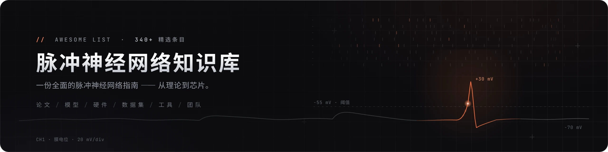

<div align="center">

<a href="https://github.com/haoran-zha/Awesome-Spiking-Neural-Networks-Hub"></a>

<h1>Awesome 脉冲神经网络知识库（Spiking Neural Networks Hub）</h1>

<p><em>一份全面、带深度注解的脉冲神经网络（Spiking Neural Networks, SNN）知识库</em><br>
<sub>论文 · 模型 · 神经形态硬件 · 数据集 · 工具 · 研究团队</sub></p>

<p>
<a href="https://awesome.re"></a>
<a href="https://github.com/haoran-zha/Awesome-Spiking-Neural-Networks-Hub/stargazers"></a>
<a href="https://github.com/haoran-zha/Awesome-Spiking-Neural-Networks-Hub/network/members"></a>

<a href="#贡献指南"></a>
<a href="LICENSE"></a>
</p>

<p><a href="README.md">English</a> &nbsp;·&nbsp; <b>中文</b> &nbsp;|&nbsp; <a href="TIMELINE.zh-CN.md">时间线版</a></p>

<p><b>420+</b> 论文与资源 &nbsp;·&nbsp; <b>50+</b> 篇奠基工作 &nbsp;·&nbsp; <b>42</b> 研究团队 &nbsp;·&nbsp; <b>45+</b> 开源项目</p>

<p><b>快速跳转</b> &nbsp;
<a href="#必读入门">必读</a> ·
<a href="#1--基础与神经编码">基础</a> ·
<a href="#3--训练方法">学习与模型</a> ·
<a href="#6--神经形态硬件">硬件</a> ·
<a href="#7--应用">应用</a> ·
<a href="#8--能耗鲁棒性与安全">专题</a> ·
<a href="#10--数据集与基准">资源</a> ·
<a href="#13--研究团队与实验室">团队</a></p>

<sub>如果本指南对你有帮助，欢迎 Star 本仓库并<a href="#引用">引用</a>——非常欢迎贡献。</sub>

</div>

---

## 什么是脉冲神经网络？（先读这一节）

传统深度网络（ANN）在每一层之间、每一次前向传播中，同步地传递**连续的数值**。而**脉冲神经网络**则像生物神经元一样，用**离散的、二值的、带时间信息的事件——"脉冲（spike）"**来通信。脉冲神经元把输入电流不断累积到自身的*膜电位*上；一旦膜电位越过阈值，就发放一个脉冲并复位；没有脉冲时，什么都不发生。

正是这一点带来了三个诱人的特性：

- **事件驱动、稀疏** → 只有在脉冲发生时才产生计算（和能耗）。在神经形态芯片上，这可能意味着比 GPU 低**几个数量级**的功耗。
- **天生带时间维度** → 信息不仅藏在"发放了多少脉冲"里，还藏在"何时发放"里，天然适合时间序列、音频和事件相机数据。
- **类脑** → SNN 常被称作神经网络的**"第三代"**（在感知机、基于发放率的深度网络之后），连接着神经科学与机器学习。

它最核心的难点在于：脉冲是一个**阶跃函数——不可微**，因此普通的反向传播无法直接使用。可以说，整个领域在很大程度上就是在回答*"这东西到底该怎么训练？"*——这也是为什么[训练方法](#3--训练方法)是本清单的重中之重。

> 这是一份覆盖整个 SNN 领域的 awesome 知识库——论文、模型、硬件、数据集、工具与研究团队。每个条目都配有一句"为什么重要"注解（此处为中文，英文见 [English edition](README.md)），帮你不迷路。

---

## 必读入门

**13 篇必读里程碑，串起领域主线** —— 从"第三代神经网络"的提出，到今天的脉冲 Transformer 与大模型。*（正文中的 ★ 标记还有更多。）*

| 年份 | 里程碑 | 会议/期刊 | 链接 |
|:---:|---|:---:|:---:|
| 1997 | **Networks of Spiking Neurons: The Third Generation** —— *奠基思想* | Neural Networks | [paper](https://doi.org/10.1016/S0893-6080(97)00011-7) |
| 2014 | **TrueNorth** —— *百万神经元类脑芯片* | Science | [paper](https://www.science.org/doi/10.1126/science.1254642) |
| 2015 | **Unsupervised Learning with STDP** —— *生物可塑性学习* | Front. Comput. Neurosci. | [paper](https://doi.org/10.3389/fncom.2015.00099) |
| 2018 | **Loihi** —— *支持片上学习的神经形态处理器* | IEEE Micro | [paper](https://ieeexplore.ieee.org/document/8259423) |
| 2018 | **STBP** —— *时空反向传播，直接训练主力* | Front. Neurosci. | [paper](https://doi.org/10.3389/fnins.2018.00331) |
| 2020 | **e-prop** —— *生物可行的在线学习* | Nature Comm. | [paper](https://doi.org/10.1038/s41467-020-17236-y) |
| 2021 | **SEW-ResNet** —— *直接训练百层以上 SNN* | NeurIPS | [paper](https://arxiv.org/abs/2102.04159) |
| 2022 | **QCFS** —— *近乎无损的 ANN→SNN 转换* | ICLR | [paper](https://arxiv.org/abs/2303.04347) |
| 2023 | **Spikformer** —— *首个脉冲 Transformer* | ICLR | [paper](https://arxiv.org/abs/2209.15425) |
| 2023 | **Spike-driven Transformer** —— *纯脉冲驱动注意力* | NeurIPS | [paper](https://arxiv.org/abs/2307.01694) |
| 2024 | **SpikeGPT** —— *首个生成式脉冲大模型* | TMLR | [paper](https://arxiv.org/abs/2302.13939) |
| 2025 | **达尔文猴（Darwin Monkey）** —— *首台 20 亿神经元类脑计算机* | 浙江大学 | [link](https://www.zju.edu.cn/english/2025/0910/c19573a3079424/page.htm) |
| 2026 | **SpikingBrain** —— *7B/76B 类脑脉冲大模型* | TMLR | [paper](https://arxiv.org/abs/2509.05276) |

---

## 最近更新

<details open>
<summary><b>更新日志</b> —— 最新在前（点击折叠）</summary>

- **2026-10** —— **顶刊与顶会补录。** 新增 87 篇论文，以 Nature / Science 系列为主（Nature Communications 21 篇、Nature Electronics 11 篇、Nature Machine Intelligence 8 篇、Nature 7 篇、Nature Computational Science 5 篇、Nature Neuroscience 5 篇、Science 4 篇、Science Advances 2 篇，另有 Nature Materials / Nanotechnology / Photonics / Reviews），并补充 NeurIPS 2025、ICLR 2026、ICML 2026 的 Oral 与 Spotlight 论文；新增七篇经典并标 ★（Neftci–Mostafa–Zenke 代理梯度综述、Roy 等 Nature 2019、全光脉冲网络、Markram 1997 与 Song–Miller–Abbott 2000 的 STDP 工作、Spaun、Brunel 2000）；§11 新增 NIR；修复两个失效的团队链接（电子科大、西悉尼大学）。
- **2026-08** —— **达尔文猴与夏季扫库。** 新增浙大**达尔文猴**（首台 20 亿神经元类脑计算机）★ 与 DarwinWafer；新设**光子脉冲硬件**小节；NSLLM（NSR 2026）★ 等 7 项脉冲大模型工作；SpiNNaker2 芯片论文（OJCAS 2026）、SpikeRAM（ISSCC 2026）、UniSpike（DAC 2026）及 4 篇 Nature 系硬件论文；补录 CVPR / ACM MM / TNNLS / Nat. Comm. 论文；产业动态（SpiNNcloud、BrainChip AKD1500/AKD2500、Innatera、POLYN）。
- **2026-07** —— **2026 会议扫库。** 首次收录 CVPR 2026（13 篇）与 ICML 2026（11 篇），另补 ECCV / IJCAI 2026、TPAMI 2026 两篇及 Nature Communications 2026 的神经形态训练芯片，每篇均配一句话说明。SpikingBrain 标注由 **arXiv 2025 升级为 TMLR 2026**。
- **2026-07** —— **审校与生态更新。** 修复失效/过期链接和一处已迁移的团队归属；新增 6 篇 2026 年工作、4 个重要实验室，并为 §13 各团队补充**近期成果（2024–2026）**标注。
- **2026-07** —— **知识库上线。** 6 大 Part、340+ 条目；新增 **研究团队与实验室**（§13）、**模型库与社区**（§12），以及独立的 **脉冲大模型与 LLM** 章节（§5）。
- **2026-07** —— **视觉改版。** 全新 banner、"必读入门"表，并把数据集/框架/模型库转为表格。
- **2026-07** —— **内容扩充。** 新增 SpikingBrain、Sorbet、SpikeCLIP、Spike2Former、SDiT；Darwin3、Intel Hala Point、IBM NorthPole、灵汐/BrainChip/Innatera/Xylo/GrAI；以及奠基工作（Mead 1990、Missing Memristor 2008、Tempotron 2006）与框架（SPAIC、SNNAX、BrainPy、CARLsim…）。

> 有新的论文/模型/芯片/数据集/工具？[提交 PR](#贡献指南) 并在此加一行。

</details>

---

## 目录

**第一部分 · 基础**
- [1 · 基础与神经编码](#1--基础与神经编码)
- [2 · 神经元模型](#2--神经元模型)

**第二部分 · 学习与模型**
- [3 · 训练方法](#3--训练方法)
- [4 · 网络架构](#4--网络架构)
- [5 · 脉冲大模型与 LLM](#5--脉冲大模型与-llm)

**第三部分 · 硬件与系统**
- [6 · 神经形态硬件](#6--神经形态硬件)

**第四部分 · 应用**
- [7 · 应用](#7--应用)

**第五部分 · 交叉专题**
- [8 · 能耗、鲁棒性与安全](#8--能耗鲁棒性与安全)
- [9 · 理论与神经科学](#9--理论与神经科学)

**第六部分 · 资源与生态**
- [10 · 数据集与基准](#10--数据集与基准)
- [11 · 软件与框架](#11--软件与框架)
- [12 · 模型库与社区](#12--模型库与社区)
- [13 · 研究团队与实验室](#13--研究团队与实验室)

**其他：** [贡献指南](#贡献指南) · [引用](#引用) · [Star 增长曲线](#star-增长曲线) · [许可](#许可与致谢)

**图例：** ★ = 奠基 / 必读 · [paper] = 论文 · [code] = 官方代码

---

## 第一部分 · 基础

### 1 · 基础与神经编码

> **一句话：** 领域的根基——从最早的阈值神经元、诺奖级的 Hodgkin–Huxley 模型，到 Maass 的"第三代"提法；再加上*神经编码*：**如何把一个实数信号变成脉冲**（以及反过来）。发放率编码在一个时间窗内数脉冲个数（简单、鲁棒、但慢）；时间/延迟编码把信息放在脉冲*发放的时刻*里（快、省、但难训练）；秩序编码和群体编码介于两者之间。编码方式的选择直接决定了精度与延迟的上限。

#### 历史基础

- A Logical Calculus of the Ideas Immanent in Nervous Activity (**Bull. Math. Biophysics 1943**) ★. \[[paper](https://doi.org/10.1007/BF02478259)\]
  > McCulloch–Pitts 阈值神经元，是人工神经元与脉冲神经元的思想源头。
- A Quantitative Description of Membrane Current and Its Application to Conduction and Excitation in Nerve (**J. Physiology 1952**) ★. \[[paper](https://doi.org/10.1113/jphysiol.1952.sp004764)\]
  > Hodgkin–Huxley 模型（诺奖成果），是一切生物物理脉冲动力学的基础。
- Networks of Spiking Neurons: The Third Generation of Neural Network Models (**Neural Networks 1997**) ★. \[[paper](https://doi.org/10.1016/S0893-6080(97)00011-7)\]
  > Maass 的里程碑论文，定义 SNN 为计算能力更强的"第三代神经网络"。
- Spiking Neuron Models: Single Neurons, Populations, Plasticity (**Cambridge Univ. Press 2002**) ★. \[[paper](https://doi.org/10.1017/CBO9780511815706)\]
  > Gerstner 与 Kistler 的奠基性教材，统一了 IF、SRM、群体与可塑性理论。

#### 神经编码与编码方案

- Spike-Based Strategies for Rapid Processing (**Neural Networks 2001**). \[[paper](https://doi.org/10.1016/S0893-6080(01)00083-1)\]
  > Thorpe 等提出的排序编码，仅凭放电先后顺序即可实现超快识别。
- Rapid Neural Coding in the Retina with Relative Spike Latencies (**Science 2008**). \[[paper](https://www.science.org/doi/10.1126/science.1149639)\]
  > 生物学证据：相对首脉冲潜伏期能稳健、抗对比度地编码信息。
- Neural Coding in Spiking Neural Networks: A Comparative Study for Robust Neuromorphic Systems (**Front. Neurosci. 2021**). \[[paper](https://www.frontiersin.org/articles/10.3389/fnins.2021.638474/full)\]
  > 系统对比率编码、时间、相位与突发编码在精度与鲁棒性上的表现。
- Deep Neural Networks with Weighted Spikes (**Neurocomputing 2018**). \[[paper](https://doi.org/10.1016/j.neucom.2018.05.087)\]
  > 相位/加权脉冲编码按时间相位赋予脉冲不同权重，降低延迟与发放数。
- Conversion of Analog to Spiking Neural Networks Using Sparse Temporal Coding (**IEEE ISCAS 2018**). \[[paper](https://doi.org/10.1109/ISCAS.2018.8351295)\]
  > 基于首脉冲时间的转换，相比率编码大幅减少运算而几乎不损精度。
- T2FSNN: Deep Spiking Neural Networks with Time-to-First-Spike Coding (**DAC 2020**). \[[paper](https://arxiv.org/abs/2003.11741)\]
  > 将首脉冲时间编码引入深度 SNN，配合核阈值与提前发放实现低延迟低能耗。
- Temporal Coding in Spiking Neural Networks with Alpha Synaptic Function (**ICASSP 2020**). \[[paper](https://arxiv.org/abs/1907.13223)\]
  > 借助 alpha 型突触响应，实现对精确脉冲时刻的解析反向传播。
- Temporal-Coded Deep Spiking Neural Network with Easy Training and Robust Performance (**AAAI 2021**). \[[paper](https://ojs.aaai.org/index.php/AAAI/article/view/17329)\]
  > 论证非泄漏单脉冲时间编码最利于直接训练且鲁棒的深度 SNN。
- DIET-SNN: Direct Input Encoding with Leakage and Threshold Optimization (**IEEE TNNLS 2023**). \[[paper](https://arxiv.org/abs/2008.03658)\]
  > 直接输入模拟像素并端到端学习泄漏与阈值，推广了"直接输入编码"范式。
- Supervised Learning Based on Temporal Coding in Spiking Neural Networks (**IEEE TNNLS 2018**). \[[paper](https://doi.org/10.1109/TNNLS.2017.2726060)\]
  > Mostafa 对"首脉冲时刻"做精确梯度下降，是时间编码训练的奠基方法之一。
- Optimized Spiking Neurons Can Classify Images with High Accuracy through Temporal Coding with Two Spikes (FS neurons) (**Nature Machine Intelligence 2021**). \[[paper](https://www.nature.com/articles/s42256-021-00311-4)\]
  > 少脉冲（FS）神经元用约 2 个脉冲即可模拟 ANN 激活，实现高精度、超稀疏的时间编码。
- Fast and Energy-Efficient Neuromorphic Deep Learning with First-Spike Times (**Nature Machine Intelligence 2021**). \[[paper](https://www.nature.com/articles/s42256-021-00388-x)\]\[[code](https://github.com/JulianGoeltz/fastAndDeep)\]
  > 严格推导 LIF 网络中首脉冲时间的学习规则，仅依赖输入与输出脉冲时刻即可在层级脉冲网络中实现误差反传，并在 BrainScaleS-2 神经形态系统上运行，发挥其速度与能效优势。
- Efficiently Training Time-to-First-Spike Spiking Neural Networks from Scratch (**ICML 2026**). \[[paper](https://arxiv.org/abs/2410.23619)\]\[[code](https://github.com/CheKaiWei/ETTFS)\]
  > 以参数初始化与训练归一化缓解从零训练 TTFS 网络时的信号衰减与梯度消失，配合聚合时序脉冲、鼓励更早发放的输出解码器，并以保持单脉冲约束的平均池化取代最大池化。
- I2E: Real-Time Image-to-Event Conversion for High-Performance Spiking Neural Networks (**AAAI 2026**). \[[paper](https://ojs.aaai.org/index.php/AAAI/article/view/37179)\]\[[code](https://github.com/Ruichen0424/I2E)\]
  > 以高度并行的卷积模拟微眼跳，将静态图像转换为事件流，速度较以往方法快 300 倍以上，支持在线数据增强及“合成预训练—真实微调”的 SNN 训练。

---

### 2 · 神经元模型

> **一句话：** 神经元就是 SNN 的"晶体管"。**LIF**（泄漏积分发放）是主力——便宜、且对深度学习足够好；**Izhikevich** 与 **AdEx** 用很小的代价换来更丰富的发放动态；**Hodgkin–Huxley** 生物学上最精确但也最昂贵。近年的一个趋势是把神经元参数（如膜时间常数）**变成可学习的**，让每个神经元自己调节时间尺度。

- Lapicque's Introduction of the Integrate-and-Fire Model Neuron (1907) (**Brain Res. Bull. 1999**) ★. \[[paper](https://doi.org/10.1016/S0361-9230(99)00161-6)\]
  > 考证并追溯了 Lapicque 在 1907 年提出的最初积分-发放神经元。
- Simple Model of Spiking Neurons (**IEEE TNN 2003**) ★. \[[paper](https://doi.org/10.1109/TNN.2003.820440)\]
  > Izhikevich 双变量模型，以积分-发放的代价再现丰富皮层放电模式。
- Which Model to Use for Cortical Spiking Neurons? (**IEEE TNN 2004**). \[[paper](https://doi.org/10.1109/TNN.2004.832719)\]
  > 著名的神经元模型对比图，权衡生物真实性与计算成本，指导选型。
- A Framework for Spiking Neuron Models: The Spike Response Model (**Handbook of Biol. Physics 2001**). \[[paper](https://www.sciencedirect.com/science/article/pii/S1383812101800154)\]
  > 正式提出脉冲响应模型（SRM），用核函数将积分-发放神经元一般化。
- Adaptive Exponential Integrate-and-Fire Model as an Effective Description of Neuronal Activity (**J. Neurophysiology 2005**). \[[paper](https://doi.org/10.1152/jn.00686.2005)\]
  > AdEx 模型，加入指数发放项与自适应，能精确拟合真实神经元行为。
- Generalized Leaky Integrate-and-Fire Models Classify Multiple Neuron Types (**Nature Communications 2018**). \[[paper](https://www.nature.com/articles/s41467-017-02717-4)\]\[[code](https://github.com/AllenInstitute/GLIF_Teeter_et_al_2018)\]
  > Allen 研究所的数据驱动 GLIF 层级模型，拟合 645 个真实神经元并区分细胞类型。
- Incorporating Learnable Membrane Time Constant to Enhance Learning of SNNs (PLIF) (**ICCV 2021**) ★. \[[paper](https://openaccess.thecvf.com/content/ICCV2021/html/Fang_Incorporating_Learnable_Membrane_Time_Constant_To_Enhance_Learning_of_Spiking_ICCV_2021_paper.html)\]\[[code](https://github.com/fangwei123456/Parametric-Leaky-Integrate-and-Fire-Spiking-Neuron)\]
  > PLIF 让膜时间常数可学习，提升精度并降低对初始化的敏感度。
- GLIF: A Unified Gated Leaky Integrate-and-Fire Neuron for Spiking Neural Networks (**NeurIPS 2022**). \[[paper](https://openreview.net/forum?id=UmFSx2c4ubT)\]\[[code](https://github.com/Ikarosy/Gated-LIF)\]
  > 用可学习门控融合多种生物特性，扩大单个神经元的表达空间。
- KLIF: An Optimized Spiking Neuron Unit for Tuning Surrogate Gradient Slope and Membrane Potential (**arXiv 2023**). \[[paper](https://arxiv.org/abs/2302.09238)\]
  > 引入可学习缩放因子，训练中动态调整代理梯度曲线的斜率与宽度。
- Parallel Spiking Neurons with High Efficiency and Ability to Learn Long-Term Dependencies (PSN) (**NeurIPS 2023**). \[[paper](https://arxiv.org/abs/2304.12760)\]\[[code](https://github.com/fangwei123456/Parallel-Spiking-Neuron)\]
  > 去除复位以将神经元动力学改写为可并行形式，加速训练并学习长时依赖。
- TC-LIF: A Two-Compartment Spiking Neuron Model for Long-Term Sequential Modelling (**AAAI 2024**). \[[paper](https://ojs.aaai.org/index.php/AAAI/article/view/29625)\]\[[code](https://github.com/ZhangShimin1/TC-LIF)\]
  > 胞体-树突双腔室神经元，专为在长时间间隔上传播梯度而设计。
- CLIF: Complementary Leaky Integrate-and-Fire Neuron for Spiking Neural Networks (**ICML 2024**). \[[paper](https://proceedings.mlr.press/v235/huang24n.html)\]\[[code](https://github.com/HuuYuLong/Complementary-LIF)\]
  > 无超参的互补型神经元，开辟额外反传路径以缓解时间维梯度消失。
- Temporal Dendritic Heterogeneity Incorporated with SNNs for Learning Multi-Timescale Dynamics (DH-LIF) (**Nature Communications 2024**). \[[paper](https://www.nature.com/articles/s41467-023-44614-z)\]
  > 多树突分支神经元，各分支时间常数可学习，捕捉多时间尺度动态。
- PMSN: A Parallel Multi-compartment Spiking Neuron for Multi-scale Temporal Processing (**IEEE TNNLS 2026**). \[[paper](https://arxiv.org/abs/2408.14917)\]
  > 港理工的多腔室神经元，动力学可跨时间尺度并行化——较 LIF 训练加速 10 倍以上，Sequential CIFAR-10 精度提升 30%。
- Burst Spiking Neural Networks (BuSNN) (**arXiv 2026**). \[[paper](https://arxiv.org/abs/2607.11914)\]
  > BICLab 主张 SNN 的进步不止于精度更在于鲁棒性——带分级脉冲的爆发式（burst）神经元配合动态权重约束。
- Neural Heterogeneity Promotes Robust Learning (**Nature Communications 2021**). \[[paper](https://www.nature.com/articles/s41467-021-26022-3)\]
  > 让神经元的时间常数多样且可学习，能提升精度与鲁棒性——为"异质性"提供了有原则的证据。
- Network Model with Internal Complexity Bridges Artificial Intelligence and Neuroscience (**Nature Computational Science 2024**). \[[paper](https://doi.org/10.1038/s43588-024-00674-9)\]\[[code](https://github.com/helx-20/complexity)\]
  > 提出“内部复杂的小模型”路线：作者证明由 Hodgkin–Huxley 神经元构成的网络可在动力学与性能上等价于更大的 LIF 网络，使更丰富的神经元成为扩大网络规模之外的另一条路径。

---

<p align="right"><a href="#目录">↑ 回到顶部</a></p>

## 第二部分 · 学习与模型

### 3 · 训练方法

> **一句话——全领域的核心难题。** 脉冲是不可微的阶跃函数，普通反向传播失效。三大流派给出了答案：**(1) 转换法**先训练一个普通 ANN，再映射成 SNN（精度高、延迟高）；**(2) 代理梯度直接训练**假装脉冲有一条平滑的导数，再做时间上的反向传播（当前精度-延迟折中最好）；**(3) 生物可塑性局部规则**（如 STDP）仅凭脉冲时序学习、无需全局梯度（最像大脑，但最难做大）。

#### 3.1 ANN 到 SNN 转换

> 在简单的 ANN 世界里训练，在高效的 SNN 世界里部署。关键手艺在于让 SNN 的*发放率*去匹配 ANN 的*激活值*——通过权重/阈值归一化——从而几乎不损失精度，最好还能低延迟。

- Spiking Deep Convolutional Neural Networks for Energy-Efficient Object Recognition (**IJCV 2015**) ★. \[[paper](https://doi.org/10.1007/s11263-014-0788-3)\]
  > 最早把训练好的 CNN 搬到脉冲网络，用"发放率≈ReLU 激活"开创了 ANN 转 SNN 这条路线。
- Fast-Classifying, High-Accuracy Spiking Deep Networks Through Weight and Threshold Balancing (**IJCNN 2015**) ★. \[[paper](https://doi.org/10.1109/IJCNN.2015.7280696)\]
  > 提出权重归一化/阈值平衡，让各层发放率不饱和，使转换几乎无损且低延迟。
- Conversion of Continuous-Valued Deep Networks to Efficient Event-Driven Networks (**Front. Neurosci. 2017**). \[[paper](https://doi.org/10.3389/fnins.2017.00682)\]\[[code](https://github.com/NeuromorphicProcessorProject/snn_toolbox)\]
  > 给出 BN、最大池化、softmax、偏置的脉冲等价实现，并开源常用的 SNN 工具箱。
- Going Deeper in Spiking Neural Networks: VGG and Residual Architectures (**Front. Neurosci. 2019**) ★. \[[paper](https://doi.org/10.3389/fnins.2019.00095)\]
  > 把转换法扩展到深层 VGG-16/ResNet 并首次在 ImageNet 上验证，证明脉冲网络也能做深。
- Enabling Deep SNNs with Hybrid Conversion and Spike-Timing-Dependent Backpropagation (**ICLR 2020**). \[[paper](https://openreview.net/forum?id=B1xSperKvH)\]\[[code](https://github.com/nitin-rathi/hybrid-snn-conversion)\]
  > 先用转换得到好初始权重，再用脉冲反传微调，把推理时间步数量级式压缩。
- RMP-SNN: Residual Membrane Potential Neuron for Deeper, High-Accuracy, Low-Latency SNNs (**CVPR 2020**). \[[paper](https://arxiv.org/abs/2003.01811)\]
  > 用"软复位"保留超阈值的剩余膜电位，消除硬复位带来的转换误差，近乎无损。
- Optimal Conversion of Conventional ANNs to SNNs (**ICLR 2021**). \[[paper](https://openreview.net/forum?id=FZ1oTwcXchK)\]\[[code](https://github.com/Jackn0/snn_optimal_conversion_pipeline)\]
  > 将转换误差逐层分解，配合发放率归一化激活与最优阈值/偏移，显著缩短仿真步数。
- A Free Lunch From ANN: Towards Efficient, Accurate SNN Calibration (**ICML 2021**). \[[paper](https://proceedings.mlr.press/v139/li21d.html)\]\[[code](https://github.com/yhhhli/SNN_Calibration)\]
  > 只需少量样本做逐层"校准"即可修正转换误差，推广到 MobileNet/RegNet 等大模型。
- Optimal ANN-SNN Conversion for High-Accuracy and Ultra-Low-Latency SNNs (QCFS) (**ICLR 2022**) ★. \[[paper](https://arxiv.org/abs/2303.04347)\]\[[code](https://github.com/putshua/ANN_SNN_QCFS)\]
  > 训练 ANN 时用 QCFS 激活来贴合脉冲量化特性，仅需 4 步即可高精度。
- Optimized Potential Initialization for Low-Latency Spiking Neural Networks (**AAAI 2022**). \[[paper](https://arxiv.org/abs/2202.01440)\]
  > 把初始膜电位设为半阈值能最小化转换误差，使 SNN 在 32 步以内也高精度。
- Bridging the Gap Between ANNs and SNNs by Calibrating Offset Spikes (**ICLR 2023**). \[[paper](https://arxiv.org/abs/2302.10685)\]
  > 指出"多发/少发一个脉冲"的偏移是转换残余误差主因，通过平移初始膜电位加以校正。
- A Unified Optimization Framework of ANN-SNN Conversion (**ICML 2023**). \[[paper](https://proceedings.mlr.press/v202/jiang23a.html)\]\[[code](https://github.com/HaiyanJiang/SNN_Conversion_unified)\]
  > 用 SlipReLU 统一"性能损失"与"转换误差"两种视角，首次实现单步可用的高性能转换。
- Reducing ANN-SNN Conversion Error via Residual Membrane Potential Alignment (**arXiv 2026**). \[[paper](https://arxiv.org/abs/2608.13952)\]
  > 北大转换一脉（QCFS 作者团队）以动态初始膜电位与残差对齐正则，进一步压低小时间步下的转换误差。

#### 3.2 代理梯度与直接训练

> 用一条平滑的"代理"曲线替代脉冲那个无定义的导数，再做时间上的反向传播（BPTT）。当前在困难数据集上的多数 SOTA 都出自这里。

- Error-Backpropagation in Temporally Encoded Networks of Spiking Neurons (SpikeProp) (**Neurocomputing 2002**) ★. \[[paper](https://doi.org/10.1016/S0925-2312(01)00658-0)\]
  > 为时间编码脉冲神经元推导出首个类反传规则，是所有梯度训练 SNN 方法的鼻祖。
- Training Deep Spiking Neural Networks Using Backpropagation (**Front. Neurosci. 2016**). \[[paper](https://doi.org/10.3389/fnins.2016.00508)\]
  > 把膜电位当作可微信号、脉冲跳变视为噪声，让标准反传能直接训练深层 SNN。
- Spatio-Temporal Backpropagation for Training High-Performance SNNs (STBP) (**Front. Neurosci. 2018**) ★. \[[paper](https://doi.org/10.3389/fnins.2018.00331)\]\[[code](https://github.com/yjwu17/STBP-for-training-SpikingNN)\]
  > 在空间与时间两个维度展开做 BPTT 并用近似梯度，奠定当今直接训练 SNN 的标准框架。
- Direct Training for Spiking Neural Networks: Faster, Larger, Better (NeuNorm) (**AAAI 2019**). \[[paper](https://arxiv.org/abs/1809.05793)\]
  > 提出神经元归一化 NeuNorm 并改进编码，让 STBP 能训练更大网络。
- SLAYER: Spike Layer Error Reassignment in Time (**NeurIPS 2018**) ★. \[[paper](https://papers.nips.cc/paper/7415-slayer-spike-layer-error-reassignment-in-time)\]\[[code](https://github.com/bamsumit/slayerPytorch)\]
  > 用时间信用分配核在时间轴上反传误差，可同时学习权重与轴突延迟。
- SuperSpike: Supervised Learning in Multilayer Spiking Neural Networks (**Neural Computation 2018**). \[[paper](https://doi.org/10.1162/neco_a_01086)\]\[[code](https://github.com/fzenke/pub2018superspike)\]
  > 推导出可在线运行的三因子近似梯度规则，把多层 SNN 训练与生物可塑性联系起来。
- The Remarkable Robustness of Surrogate Gradient Learning for Instilling Complex Function in SNNs (**Neural Computation 2021**). \[[paper](https://doi.org/10.1162/neco_a_01367)\]\[[code](https://github.com/fzenke/randman)\]
  > 系统验证替代函数形状影响不大、但尺度很关键，为如何选替代梯度提供实证指南。
- Temporal Spike Sequence Learning via Backpropagation for Deep SNNs (TSSL-BP) (**NeurIPS 2020**). \[[paper](https://arxiv.org/abs/2002.10085)\]\[[code](https://github.com/stonezwr/TSSL-BP)\]
  > 将误差分配拆成神经元间与神经元内两类依赖，实现少步数下的高精度时序学习。
- Differentiable Spike: Rethinking Gradient-Descent for Training SNNs (Dspike) (**NeurIPS 2021**). \[[paper](https://proceedings.neurips.cc/paper/2021/hash/c4ca4238a0b923820dcc509a6f75849b-Abstract.html)\]
  > 提出可自适应演化的可微替代函数族 Dspike，训练中更好地逼近真实梯度。
- Training Feedback SNNs by Implicit Differentiation on the Equilibrium State (IDE) (**NeurIPS 2021**). \[[paper](https://arxiv.org/abs/2109.14247)\]\[[code](https://github.com/pkuxmq/IDE-FSNN)\]
  > 将反馈 SNN 的平均发放率视为不动点方程，用隐式微分求梯度，显存不随时间步增长。
- Sparse Spiking Gradient Descent (**NeurIPS 2021**). \[[paper](https://arxiv.org/abs/2105.08810)\]\[[code](https://github.com/npvoid/SparseSpikingBackprop)\]
  > 利用脉冲的时空稀疏性做稀疏反传，训练最高加速 150 倍、显存降约 85%。
- Temporal Efficient Training of SNNs via Gradient Re-weighting (TET) (**ICLR 2022**) ★. \[[paper](https://arxiv.org/abs/2202.11946)\]\[[code](https://github.com/Gus-Lab/temporal_efficient_training)\]
  > 对每个时间步都加监督损失以弥补替代梯度的"动量损失"，收敛更平坦、泛化更好，已成常用技巧。
- Training High-Performance Low-Latency SNNs by Differentiation on Spike Representation (DSR) (**CVPR 2022**). \[[paper](https://arxiv.org/abs/2205.00459)\]\[[code](https://github.com/qymeng94/DSR)\]
  > 把脉冲的发放率表示看成次可微映射并对其求导训练，绕开不可微问题，低延迟高精度。
- Online Training Through Time for Spiking Neural Networks (OTTT) (**NeurIPS 2022**). \[[paper](https://arxiv.org/abs/2210.04195)\]\[[code](https://github.com/pkuxmq/OTTT-SNN)\]
  > 常数显存、无需展开时间的在线训练法，梯度呈三因子 Hebbian 形式，利于片上学习。
- RecDis-SNN: Rectifying Membrane Potential Distribution for Directly Training SNNs (**CVPR 2022**). \[[paper](https://openaccess.thecvf.com/content/CVPR2022/html/Guo_RecDis-SNN_Rectifying_Membrane_Potential_Distribution_for_Directly_Training_Spiking_Neural_CVPR_2022_paper.html)\]
  > 用膜电位分布损失矫正分布偏移，缓解退化、饱和与梯度失配。
- IM-Loss: Information Maximization Loss for Spiking Neural Networks (**NeurIPS 2022**). \[[paper](https://proceedings.neurips.cc/paper_files/paper/2022/hash/010c5ba0cafc743fece8be02e7adb8dd-Abstract-Conference.html)\]\[[code](https://github.com/yfguo91/IM-Loss-Information-Maximization-Loss-for-Spiking-Neural-Networks)\]
  > 以最大化脉冲所携带的信息熵为目标，减小 0/1 量化造成的信息损失。
- RMP-Loss: Regularizing Membrane Potential Distribution for Spiking Neural Networks (**ICCV 2023**). \[[paper](https://arxiv.org/abs/2308.06787)\]
  > 加入正则损失把膜电位向脉冲取值聚拢，直接减小量化误差，几乎不增加推理开销。
- Real Spike: Learning Real-valued Spikes for Spiking Neural Networks (**ECCV 2022**). \[[paper](https://arxiv.org/abs/2210.06686)\]\[[code](https://github.com/yfguo91/Real-Spike)\]
  > 训练时用实值脉冲增强表达、推理时重参数化折回二值脉冲，精度提升而不增加推理成本。
- Surrogate Module Learning: Reduce Gradient Error Accumulation in Training SNNs (**ICML 2023**). \[[paper](https://proceedings.mlr.press/v202/deng23d.html)\]
  > 引入替代模块搭建"捷径"回传更准的梯度，抑制逐层累积的梯度误差。
- Towards Memory- and Time-Efficient Backpropagation for Training SNNs (SLTT) (**ICCV 2023**). \[[paper](https://arxiv.org/abs/2302.14311)\]\[[code](https://github.com/qymeng94/SLTT)\]
  > 发现时间维反传贡献很小，剪掉这些路径使显存降 70% 以上、训练时间降 50% 以上。
- A Tandem Learning Rule for Effective Training and Rapid Inference of Deep SNNs (**IEEE TNNLS 2023**). \[[paper](https://arxiv.org/abs/1907.01167)\]\[[code](https://github.com/deepspike/tandem_learning)\]
  > 让 ANN 与 SNN 共享权重"串联"训练，用 ANN 传梯度、SNN 数脉冲，大幅降低推理开销。
- Advancing Spatiotemporal Representations in SNNs via Parametric Invertible Transformation (PIT) (**ICLR 2026**). \[[paper](https://openreview.net/forum?id=3JwNXQzxll)\]\[[code](https://github.com/YinsongYan/ICLR26)\]
  > 将可逆变换与神经元动力学共轭结合，并校正代理梯度失配，扩展二值脉冲可用的时空表征空间。
- Scalable Training of Continuous-Time SNNs with Differentiable Spike-Time Discretization (DSTD) (**arXiv 2026**). \[[paper](https://arxiv.org/abs/2607.14672)\]
  > 把不规则脉冲映射到可微的固定时间点，使精确脉冲时刻（连续时间、事件驱动）训练的显存开销可控。
- Accurate and Efficient Time-Domain Classification with Adaptive Spiking Recurrent Neural Networks (**Nature Machine Intelligence 2021**). \[[paper](https://doi.org/10.1038/s42256-021-00397-w)\]
  > 自适应脉冲神经元 + 替代梯度循环 SNN，在语音/手势上达 RNN 级精度且计算量低 1–3 个数量级。
- Surrogate Gradient Learning in Spiking Neural Networks: Bringing the Power of Gradient-Based Optimization to Spiking Neural Networks (**IEEE Signal Processing Magazine 2019**) ★. \[[paper](https://doi.org/10.1109/MSP.2019.2931595)\]
  > Neftci、Mostafa 与 Zenke 的教程式综述，将代理梯度（以平滑函数替代脉冲的导数）确立为用梯度下降训练 SNN 的灵活高效途径。
- Accurate Online Training of Dynamical Spiking Neural Networks Through Forward Propagation Through Time (FPTT) (**Nature Machine Intelligence 2023**). \[[paper](https://www.nature.com/articles/s42256-023-00650-4)\]\[[code](https://github.com/byin-cwi/sFPTT)\]
  > 将前向传播穿越时间（FPTT）与液态时间常数脉冲神经元结合，以低内存开销在线训练循环 SNN，可学习超长序列，并直接训练深层 SNN 完成目标定位与识别。
- High-Performance Deep Spiking Neural Networks with 0.3 Spikes per Neuron (**Nature Communications 2024**). \[[paper](https://www.nature.com/articles/s41467-024-51110-5)\]
  > 揭示首脉冲时间（TTFS）SNN 沿用标准 ANN 初始化时的梯度消失/爆炸问题；令膜电位在阈值处斜率恒定，使训练轨迹与 ReLU 网络等价，以每神经元不足 0.3 个脉冲达到 ANN 同等精度。
- Efficient Event-Based Delay Learning in Spiking Neural Networks (**Nature Communications 2025**). \[[paper](https://www.nature.com/articles/s41467-025-65394-8)\]
  > 将 EventProp 扩展为可同时对权重与延迟求精确梯度，支持每神经元多脉冲与循环 SNN；内存占用不到当前最优延迟学习方法的一半，速度最高快 26 倍。
- DelGrad: Exact Event-Based Gradients for Training Delays and Weights on Spiking Neuromorphic Hardware (**Nature Communications 2025**). \[[paper](https://www.nature.com/articles/s41467-025-63120-y)\]\[[code](https://github.com/JulianGoeltz/fastAndDeep)\]
  > 仅依据脉冲时刻即可精确计算突触权重与延迟的事件驱动梯度；在 BrainScaleS-2 芯片上的实验表明，学习延迟可提升精度、参数效率以及对硬件噪声的鲁棒性。
- Training Deep Normalization-Free Spiking Neural Networks with Lateral Inhibition (**ICLR 2026**). \[[paper](https://arxiv.org/abs/2509.23253)\]\[[code](https://github.com/vwOvOwv/DeepEISNN)\]
  > 以模拟皮层的兴奋性—抑制性神经元群取代标准 SNN 层，借减性与除性抑制调控神经活动，并以 E-I Init 与 E-I Prop 稳定无归一化深层 SNN 的训练。
- Temporal Representation Enhancement (TRE): Learning to Forget Dominant Patterns for Enhanced Temporal Spiking Features (**CVPR 2026**). \[[paper](https://cvpr.thecvf.com/virtual/2026/poster/37392)\]
  > 针对各时间步一致监督带来的表征冗余，提出“学会遗忘”范式：跨时间累积类别贡献并动态抑制主导模式，引导 SNN 学习互补的时间特征。

#### 3.3 生物可塑性 / 局部学习

> **STDP** 及其同类：突触的增强或减弱只取决于前后神经元脉冲的*相对时序*——局部、无监督、且硬件友好，但历史上很难推到 ImageNet 规模。

- Synaptic Modifications in Cultured Hippocampal Neurons: Dependence on Spike Timing... (**J. Neuroscience 1998**) ★. \[[paper](https://doi.org/10.1523/JNEUROSCI.18-24-10464.1998)\]
  > Bi 与 Poo 通过实验量化了脉冲时序依赖可塑性（STDP），是所有局部 SNN 学习规则的生物学根基。
- Regulation of Synaptic Efficacy by Coincidence of Postsynaptic APs and EPSPs (**Science 1997**) ★. \[[paper](https://doi.org/10.1126/science.275.5297.213)\]
  > 通过新皮层锥体神经元的双细胞全细胞记录，发现单位 EPSP 随突触后动作电位的精确时序而增强或减弱——与 Bi & Poo 并列为 STDP 的奠基性实验。
- Competitive Hebbian Learning Through Spike-Timing-Dependent Synaptic Plasticity (**Nature Neuroscience 2000**) ★. \[[paper](https://www.nature.com/articles/nn0900_919)\]
  > 模型表明 STDP 本身即可产生 Hebbian 突触竞争：突触强度自动平衡，以短潜伏期或相关成组方式驱动放电的输入胜出并增强，长潜伏期输入则被削弱。
- Unsupervised Learning of Digit Recognition Using STDP (**Front. Comput. Neurosci. 2015**) ★. \[[paper](https://doi.org/10.3389/fncom.2015.00099)\]\[[code](https://github.com/peter-u-diehl/stdp-mnist)\]
  > Diehl 与 Cook 用 STDP 加侧向抑制无监督学习 MNIST（约 95%），成为生物可塑性 SNN 的经典基准。
- STDP-Based Spiking Deep Convolutional Neural Networks for Object Recognition (**Neural Networks 2018**). \[[paper](https://doi.org/10.1016/j.neunet.2017.12.005)\]
  > 用 STDP 逐层无监督训练卷积特征并配合时间编码，证明局部可塑性也能学到深层层次化特征。
- Bio-Inspired Digit Recognition Using Reward-Modulated STDP in Deep Conv Networks (**Pattern Recognition 2019**). \[[paper](https://arxiv.org/abs/1804.00227)\]\[[code](https://github.com/miladmozafari/SpykeTorch)\]
  > 将无监督 STDP 与奖赏调制 STDP（三因子规则）结合，用类强化信号驱动特征学习。
- A Solution to the Learning Dilemma for Recurrent Networks of Spiking Neurons (e-prop) (**Nature Communications 2020**) ★. \[[paper](https://doi.org/10.1038/s41467-020-17236-y)\]\[[code](https://github.com/IGITUGraz/eligibility_propagation)\]
  > 用局部资格迹配合自上而下的学习信号近似 BPTT，无需时间反传，为神经形态芯片上的在线学习铺路。
- Equilibrium Propagation: Bridging Energy-Based Models and Backpropagation (**Front. Comput. Neurosci. 2017**). \[[paper](https://doi.org/10.3389/fncom.2017.00024)\]
  > 用两阶段、仅需局部同类计算的方式获得精确梯度，是反传的生物可行替代方案。
- Training Spiking Neural Networks via Augmented Direct Feedback Alignment (**NeurIPS 2024**). \[[paper](https://arxiv.org/abs/2409.07776)\]
  > 用随机投影的直接反馈对齐（aDFA）无梯度训练 SNN，避免权重传输问题，更贴近生物与硬件。
- Backpropagation-Free Spiking Neural Networks with the Forward-Forward Algorithm (**arXiv 2025**). \[[paper](https://arxiv.org/abs/2502.20411)\]
  > 将 Hinton 的 Forward-Forward（两次对比性前向、逐层局部目标）搬到脉冲神经元。
- Spike-Based Alignment Learning Solves the Weight Transport Problem (**Nature Communications 2026**). \[[paper](https://www.nature.com/articles/s41467-026-74460-8)\]
  > 伯尔尼/海德堡团队用脉冲时序规则在本地对齐反馈权重——为生物可行与片上信用分配解决"权重传输"难题。
- The Tempotron: A Neuron That Learns Spike Timing-Based Decisions (**Nature Neuroscience 2006**) ★. \[[paper](https://doi.org/10.1038/nn1643)\]
  > Gütig 与 Sompolinsky 的 tempotron——单个神经元即可依据输入脉冲的*时序*学会分类。
- Unsupervised Learning of Visual Features through Spike-Timing-Dependent Plasticity (**PLoS Comput. Biol. 2007**) ★. \[[paper](https://doi.org/10.1371/journal.pcbi.0030031)\]
  > Masquelier 与 Thorpe 证明 STDP + 延迟编码可自组织出有选择性的视觉特征，是无监督学习的里程碑。
- Burst-Dependent Synaptic Plasticity Can Coordinate Learning in Hierarchical Circuits (Burstprop) (**Nature Neuroscience 2021**). \[[paper](https://doi.org/10.1038/s41593-021-00857-x)\]\[[code](https://github.com/apayeur/spikingburstprop)\]
  > 当突触可塑性由高频脉冲簇放电（burst）调控时，层级中较高层的锥体神经元即可协调低层突触的可塑性；结合短时突触动力学、顶树突再生活动与反馈通路可塑性，该规则能解决需要深层结构的任务。
- Brain-Inspired Global-Local Learning Incorporated with Neuromorphic Computing (**Nature Communications 2022**). \[[paper](https://doi.org/10.1038/s41467-021-27653-2)\]
  > 在可微脉冲模型中元学习局部突触可塑性，并与自上而下的误差驱动监督协同，在小样本、持续与容错学习任务上优于单一学习方法；经算法-硬件协同设计部署于天机芯片。
- The Combination of Hebbian and Predictive Plasticity Learns Invariant Object Representations in Deep Sensory Networks (**Nature Neuroscience 2023**). \[[paper](https://doi.org/10.1038/s41593-023-01460-y)\]\[[code](https://github.com/fmi-basel/latent-predictive-learning)\]
  > 潜在预测学习（LPL）在 Hebbian 可塑性之外引入预测性可塑性，构成可在深层网络中学到不变物体表征的局部规则，并可推广到脉冲网络、复现 STDP 与元可塑性。
- The Backpropagation Algorithm Implemented on Spiking Neuromorphic Hardware (**Nature Communications 2024**). \[[paper](https://www.nature.com/articles/s41467-024-53827-9)\]
  > 借助同步发放门控（synfire-gated）的动态信息协调机制，在 Intel Loihi 上完全片上实现精确反向传播；三层脉冲电路无需外部计算机参与即可学习 MNIST 与 Fashion-MNIST 分类。
- Co-Dependent Excitatory and Inhibitory Plasticity Accounts for Quick, Stable and Long-Lasting Memories in Biological Networks (**Nature Neuroscience 2024**). \[[paper](https://doi.org/10.1038/s41593-024-01597-4)\]\[[code](https://github.com/ejagnes/codependent_plasticity)\]
  > 在脉冲 LIF 神经元中引入共依赖可塑性：抑制门控兴奋性突触可塑性，邻近兴奋性活动决定长时程增强（LTP）幅度，使突触记忆既能快速形成又能保持稳定。
- Online Pseudo-Zeroth-Order Training of Neuromorphic Spiking Neural Networks (**ICLR 2026**). \[[paper](https://arxiv.org/abs/2407.12516)\]
  > 仅用一次注入噪声的前向传播与自上而下的直接反馈训练 SNN，以伪零阶形式和动量反馈连接抑制方差，免去反向传播的对称权重要求，面向片上训练。
- Model-Agnostic Linear-Memory Online Learning in Spiking Neural Networks (BrainTrace) (**Nature Communications 2026**). \[[paper](https://www.nature.com/articles/s41467-026-68453-w)\]\[[code](https://github.com/chaobrain/braintrace)\]
  > 将用户自定义的神经元与突触动力学编译为资格迹在线学习，内存随神经元数线性增长，并据此将受连接组约束的果蝇全脑脉冲网络拟合到脑区级活动。

#### 3.4 高效化：剪枝、量化、蒸馏

> 让本已高效的模型*更*高效：更少的时间步、更少的权重、更低的精度，以及从 ANN 老师那里蒸馏知识。

- Towards Ultra-Low-Latency SNNs for Vision and Sequential Tasks Using Temporal Pruning (**ECCV 2022**). \[[paper](https://doi.org/10.1007/978-3-031-20083-0_42)\]
  > 在训练中逐步"剪时间步"，把 SNN 推向单步推理，极致压缩延迟与能耗。
- Constructing Deep SNNs from ANNs with Knowledge Distillation (**CVPR 2023**). \[[paper](https://arxiv.org/abs/2304.05627)\]
  > 用 ANN 作教师，把特征与响应知识蒸馏到 SNN 学生，避免从零训练脉冲网络的高成本。
- TP-Spikformer: Token Pruned Spiking Transformer (**ICLR 2026**). \[[paper](https://openreview.net/forum?id=L5llQD0nMf)\]
  > 在多个脉冲 Transformer 家族中免训练剪除低信息 token，在保持竞争性精度的同时降低存储与计算开销。
- Towards Lossless Memory-efficient Training of SNNs via Gradient Checkpointing and Spike Compression (**ICLR 2026**). \[[paper](https://openreview.net/forum?id=nrBJ0Uvj7c)\]\[[code](https://github.com/AllenYolk/snn-gradient-checkpointing)\]
  > 将自适应时空梯度检查点与无损二值脉冲压缩结合，训练内存最多降低 8 倍且不损失精度。

> 另可参考：若干低时间步 / 低显存训练法本身就是高效化技巧——见 [3.2](#32-代理梯度与直接训练) 的 **TET / SLTT / DSR**，以及 [神经编码](#1--基础与神经编码) 的 **DIET-SNN**。

---

### 4 · 网络架构

> **一句话：** 网络的*形状*。2019–2021 年的突破在于把**残差 / BN 技巧**搬进脉冲域，让 SNN 得以做深；2023 年之后的浪潮则带来了**脉冲 Transformer**，重新设计自注意力使其能在脉冲上运行。

#### 4.1 深度脉冲 CNN 与 ResNet

> 残差连接和脉冲感知的归一化（tdBN、BNTT、TEBN）是让 SNN 能突破寥寥几层、而脉冲不至于消失或爆炸的关键。

- Spiking Deep Residual Networks (**IEEE TNNLS 2021**). \[[paper](https://arxiv.org/abs/1805.01352)\]
  > 最早的"脉冲 ResNet"，通过缩放捷径与误差补偿构建首个 40 层以上且精度接近原网络的 SNN。
- Deep Residual Learning in Spiking Neural Networks (SEW-ResNet) (**NeurIPS 2021**) ★. \[[paper](https://arxiv.org/abs/2102.04159)\]\[[code](https://github.com/fangwei123456/Spike-Element-Wise-ResNet)\]
  > 脉冲逐元素残差块 SEW 实现恒等映射并克服梯度消失/爆炸，首次直接训练百层以上深度 SNN。
- Advancing Spiking Neural Networks Toward Deep Residual Learning (MS-ResNet) (**IEEE TNNLS 2024**). \[[paper](https://arxiv.org/abs/2112.08954)\]\[[code](https://github.com/Ariande1/MS-ResNet)\]
  > 提出膜电位（预激活）捷径，保持全脉冲计算与梯度范数守恒，把直接训练的 SNN 拓展到 482 层。
- Going Deeper with Directly-Trained Larger SNNs (STBP-tdBN) (**AAAI 2021**) ★. \[[paper](https://arxiv.org/abs/2011.05280)\]
  > 阈值相关的批归一化 tdBN 跨时间步平衡发放率，把直接训练的 SNN 从不足 10 层拓展到 50 层。
- Revisiting Batch Normalization for Training Low-Latency Deep SNNs from Scratch (BNTT) (**Front. Neurosci. 2021**). \[[paper](https://arxiv.org/abs/2010.01729)\]\[[code](https://github.com/Intelligent-Computing-Lab-Panda/BNTT-Batch-Normalization-Through-Time)\]
  > 沿时间轴解耦 BN 参数（BNTT），捕捉脉冲的时序动态，实现低时延、从零训练。
- Temporal Effective Batch Normalization in Spiking Neural Networks (TEBN) (**NeurIPS 2022**). \[[paper](https://proceedings.neurips.cc/paper_files/paper/2022/hash/de2ad3ed44ee4e675b3be42aa0b615d0-Abstract-Conference.html)\]\[[code](https://github.com/ChaotengDuan/TEBN)\]
  > 为每个时间步用不同可学习权重重标定输入，平滑时序分布与优化曲面。
- Membrane Potential Batch Normalization for Spiking Neural Networks (MPBN) (**ICCV 2023**). \[[paper](https://arxiv.org/abs/2308.08359)\]\[[code](https://github.com/yfguo91/MPBN)\]
  > 在发放函数前对膜电位再加一层 BN，并通过重参数化折叠进阈值，推理零额外开销。

#### 4.2 脉冲 Transformer 与注意力

> 重新推导自注意力，让 Query/Key/Value 都变成脉冲、并用脉冲友好的运算替换昂贵的 softmax——把 Transformer 级别的精度带进脉冲世界。

- Spikformer: When Spiking Neural Network Meets Transformer (**ICLR 2023**) ★. \[[paper](https://arxiv.org/abs/2209.15425)\]\[[code](https://github.com/ZK-Zhou/spikformer)\]
  > 提出无 softmax 的脉冲自注意力 SSA（Q/K/V 皆为脉冲），是首个直接构建的脉冲视觉 Transformer。
- Spike-driven Transformer (**NeurIPS 2023**) ★. \[[paper](https://arxiv.org/abs/2307.01694)\]\[[code](https://github.com/BICLab/Spike-Driven-Transformer)\]
  > 纯脉冲驱动 Transformer，自注意力仅用掩码与稀疏加法（线性复杂度），注意力能耗降低最多 87 倍。
- Spike-driven Transformer V2 (Meta-SpikeFormer) (**ICLR 2024**). \[[paper](https://arxiv.org/abs/2404.03663)\]\[[code](https://github.com/BICLab/Spike-Driven-Transformer-V2)\]
  > 统一分类、检测与分割的元脉冲骨干（ImageNet 80%），为下一代神经形态芯片设计提供范式。
- Scaling Spike-driven Transformer with Efficient Spike Firing Approximation (V3) (**IEEE TPAMI 2025**). \[[paper](https://arxiv.org/abs/2411.16061)\]\[[code](https://github.com/BICLab/Spike-Driven-Transformer-V3)\]
  > 用整数训练+脉冲推理（脉冲发放近似）与脉冲 MAE，把 SNN 扩展到 ImageNet 86.2%。
- Spikformer V2: Join the High-Accuracy Club on ImageNet with an SNN Ticket (**arXiv 2024**). \[[paper](https://arxiv.org/abs/2401.02020)\]
  > 引入脉冲卷积 Stem 与自监督预训练，是最早在 ImageNet 上突破 80% 的 SNN 之一。
- QKFormer: Hierarchical Spiking Transformer using Q-K Attention (**NeurIPS 2024**). \[[paper](https://arxiv.org/abs/2403.16552)\]\[[code](https://github.com/zhouchenlin2096/QKFormer)\]
  > 线性复杂度的二值 Q-K 注意力与层级金字塔，首次让直接训练 SNN 在 ImageNet 上超过 85%。
- Spikingformer: A Key Foundation Model for Spiking Neural Networks (**AAAI 2026**). \[[paper](https://ojs.aaai.org/index.php/AAAI/article/view/37207)\]\[[code](https://github.com/TheBrainLab/Spikingformer)\]
  > 用全脉冲（膜电位）残差取代 Spikformer 的非脉冲连接，消除整数-浮点乘法，更契合硬件。
- SpikingResformer: Bridging ResNet and Vision Transformer in SNNs (**CVPR 2024**). \[[paper](https://arxiv.org/abs/2403.14302)\]\[[code](https://github.com/xyshi2000/SpikingResformer)\]
  > 将 ResNet 多阶段骨干与双脉冲自注意力 DSSA 结合，以更少参数与更低能耗取得高精度。
- Masked Spiking Transformer (**ICCV 2023**). \[[paper](https://openaccess.thecvf.com/content/ICCV2023/html/Wang_Masked_Spiking_Transformer_ICCV_2023_paper.html)\]\[[code](https://github.com/bic-L/Masked-Spiking-Transformer)\]
  > 基于 ANN-SNN 转换的 Transformer，用随机脉冲掩码剪除冗余脉冲，降能耗且不掉精度。
- Spiking Transformer with Spatial-Temporal Attention (STAtten) (**CVPR 2025**). \[[paper](https://arxiv.org/abs/2409.19764)\]\[[code](https://github.com/Intelligent-Computing-Lab-Panda/STAtten)\]
  > 提出分块的时空联合注意力，在与纯空间注意力相同复杂度下融合时序信息。
- Neural Dynamics Self-Attention for Spiking Transformers (**ICLR 2026**). \[[paper](https://openreview.net/forum?id=jJedqisfOt)\]
  > 引入局部感受野偏置，并以充电—发放—复位动力学实现注意力，推理时无需显式存储注意力矩阵。
- Ge²mS-T: Multi-Dimensional Grouping for Ultra-High Energy Efficiency in Spiking Transformer (**ACM MM 2026**). \[[paper](https://arxiv.org/abs/2604.08894)\]
  > 北大的多维分组计算配合指数编码 ExpG-IF 神经元，兼顾显存、学习与能耗（Oral）。
- Rethinking Attention Locality in Spiking Transformers (**arXiv 2026**). \[[paper](https://arxiv.org/abs/2608.08541)\]
  > 用平均注意力距离分析表明"局部"脉冲注意力未必带来空间局部性，并以区域连续注意力修正。
- TIM: An Efficient Temporal Interaction Module for Spiking Transformer (**IJCAI 2024**). \[[paper](https://arxiv.org/abs/2401.11687)\]
  > 轻量卷积模块，把前一时间步信息注入注意力矩阵，增强脉冲 Transformer 的时序建模。
- Temporal-wise Attention Spiking Neural Networks for Event Streams Classification (TA-SNN) (**ICCV 2021**). \[[paper](https://openaccess.thecvf.com/content/ICCV2021/html/Yao_Temporal-Wise_Attention_Spiking_Neural_Networks_for_Event_Streams_Classification_ICCV_2021_paper.html)\]\[[code](https://github.com/BICLab/TA-SNN)\]
  > 引入时间维注意力，衡量并筛除噪声事件帧，是事件数据上里程碑式的注意力 SNN。
- Attention Spiking Neural Networks (MA-SNN) (**IEEE TPAMI 2023**). \[[paper](https://arxiv.org/abs/2209.13929)\]\[[code](https://github.com/BICLab/Attention-SNN)\]
  > 提出多维（时间/通道/空间）注意力调制膜电位，实现更稀疏发放与更高精度。
- Bipolar Self-Attention for Spiking Transformers (**NeurIPS 2025**). \[[paper](https://proceedings.neurips.cc/paper_files/paper/2025/hash/9316cfcb0a81e53a1f35b4353f115571-Abstract-Conference.html)\]
  > 以三值矩阵乘法区分 Query–Key 膜电位的同极性与异极性交互，并提出移位式 Softmax 近似 Shiftmax，在保持全脉冲驱动的同时部分恢复注意力的行随机性（Spotlight）。
- Toward Relative Positional Encoding in Spiking Transformers (**NeurIPS 2025**). \[[paper](https://arxiv.org/abs/2501.16745)\]\[[code](https://github.com/microsoft/SeqSNN)\]
  > 在脉冲保持二值的前提下近似相对位置编码：Gray-PE 用格雷码编码相对距离（偏移为 2 的幂时汉明距离恒定），Log-PE 将对数距离矩阵直接融入脉冲注意力图（Spotlight）。
- SmoothSpike: Spiking Transformer with Learnable Hadamard Transformation (**ICML 2026**). \[[paper](https://proceedings.mlr.press/v306/zhou26ax.html)\]\[[code](https://github.com/CayleyZ/SmoothSpike)\]
  > 将脉冲 Transformer 在语言建模上的差距归因于脉冲饱和导致的信息同质化，用随机 Hadamard 旋转平滑预激活，并经 Newton–Schulz 迭代扩展为可学习正交矩阵，推理时并入权重。

#### 4.3 循环、储备池与其他

> 循环 SNN（LSNN）、液体状态机、脉冲 GNN / 自编码器 / GAN，以及用神经架构搜索得到的 SNN。

**循环与储备池**
- Long Short-Term Memory and Learning-to-Learn in Networks of Spiking Neurons (LSNN) (**NeurIPS 2018**) ★. \[[paper](https://arxiv.org/abs/1803.09574)\]\[[code](https://github.com/IGITUGraz/LSNN-official)\]
  > 为循环 SNN 引入自适应阈值（ALIF）神经元与"学会学习"，首次让脉冲网络逼近 LSTM 级时序计算力。
- Real-Time Computing Without Stable States (Liquid State Machine) (**Neural Computation 2002**) ★. \[[paper](https://direct.mit.edu/neco/article/14/11/2531/6650)\]
  > 奠基性的液体状态机（储备池计算）——用循环脉冲回路把输入映射到高维可读状态。

**脉冲图神经网络**
- Spiking Graph Convolutional Networks (SpikingGCN) (**IJCAI 2022**). \[[paper](https://arxiv.org/abs/2205.02767)\]\[[code](https://github.com/ZulunZhu/SpikingGCN)\]
  > 端到端地把图卷积编码为脉冲序列，为节点/图任务带来节能的 SNN 推理。
- Scaling Up Dynamic Graph Representation Learning via Spiking Neural Networks (SpikeNet) (**AAAI 2023**). \[[paper](https://ojs.aaai.org/index.php/AAAI/article/view/26034)\]\[[code](https://github.com/EdisonLeeeee/SpikeNet)\]
  > 用脉冲神经元替代 RNN，把动态图表示学习低成本扩展到百万级节点。
- A Graph is Worth 1-bit Spikes: Graph Contrastive Learning Meets SNNs (SpikeGCL) (**ICLR 2024**). \[[paper](https://arxiv.org/abs/2305.19306)\]\[[code](https://github.com/EdisonLeeeee/SpikeGCL)\]
  > 用脉冲图对比学习得到 1-bit 二值图表示，约 32 倍存储压缩且精度可比。
- Dynamic Spiking Graph Neural Networks (Dy-SIGN) (**AAAI 2024**). \[[paper](https://arxiv.org/abs/2401.05373)\]
  > 针对动态脉冲图网络的信息损失，提出隐式微分与信息补偿方案。

**脉冲生成模型**
- Spiking-GAN: A Spiking Generative Adversarial Network Using Time-to-First-Spike Coding (**IJCNN 2022**). \[[paper](https://arxiv.org/abs/2106.15420)\]
  > 首个脉冲 GAN，用首脉冲时间编码与时域反传训练，实现超低能耗生成。
- Spiking Denoising Diffusion Probabilistic Models (SDDPM) (**WACV 2024**). \[[paper](https://arxiv.org/abs/2306.17046)\]\[[code](https://github.com/SageCao1125/SDDPM)\]
  > 用脉冲 U-Net 骨干把扩散模型引入 SNN，采样质量（FID）媲美甚至超过 ANN 版 DDPM。
- SDiT: Spiking Diffusion Model with Transformer (**arXiv 2024**). \[[paper](https://arxiv.org/abs/2402.11588)\]
  > 用脉冲 Transformer 替代 U-Net 的脉冲扩散模型，实现更高质量、更低成本的图像生成。
- Spiking Generative Adversarial Network with Attention Scoring Decoding (**Neural Networks 2024**). \[[paper](https://arxiv.org/abs/2305.10246)\]
  > 为脉冲 GAN 加入注意力打分解码器，从脉冲特征生成更高保真度图像。
- Fully Spiking Variational Autoencoder (FSVAE) (**AAAI 2022**). \[[paper](https://arxiv.org/abs/2110.00375)\]
  > 首个全脉冲变分自编码器，把隐变量采样为自回归伯努利脉冲序列，端到端以脉冲生成图像。

**面向 SNN 的神经架构搜索**
- Neural Architecture Search for Spiking Neural Networks (SNASNet) (**ECCV 2022**). \[[paper](https://arxiv.org/abs/2201.10355)\]\[[code](https://github.com/Intelligent-Computing-Lab-Panda/Neural-Architecture-Search-for-Spiking-Neural-Networks)\]
  > 免训练 NAS，用初始化时的脉冲激活多样性选架构，并引入时序反馈连接。
- AutoSNN: Towards Energy-Efficient Spiking Neural Networks (**ICML 2022**). \[[paper](https://arxiv.org/abs/2201.12738)\]\[[code](https://github.com/nabk89/AutoSNN)\]
  > 脉冲感知的架构搜索，用同时兼顾精度与脉冲数的适应度，得到更准更省能的 SNN。
- Differentiable Hierarchical and Surrogate Gradient Search for SNNs (SpikeDHS) (**NeurIPS 2022**). \[[paper](https://openreview.net/forum?id=Lr2Z85cdvB)\]\[[code](https://github.com/Huawei-BIC/SpikeDHS)\]
  > 可微地联合搜索单元/层结构与替代梯度函数。
- Supervised Learning in Spiking Neural Networks with FORCE Training (**Nature Communications 2017**). \[[paper](https://doi.org/10.1038/s41467-017-01827-3)\]\[[code](https://modeldb.science/190565)\]
  > 将 FORCE 训练（基于递归最小二乘的权重学习）直接用于循环脉冲网络，使其能模仿动力系统、分类输入、复现斑胸草雀鸣唱，并存储和回放电影片段。
- A Long Short-Term Memory for AI Applications in Spike-Based Neuromorphic Hardware (**Nature Machine Intelligence 2022**). \[[paper](https://www.nature.com/articles/s42256-022-00480-w)\]\[[code](https://github.com/intel-nrc-ecosystem/models/tree/master/nxsdk_modules_ncl/lsnn)\]
  > 利用脉冲神经元中缓慢的后超极化电流在 Loihi 上模拟 LSTM 单元，并以滤波器逼近理论解释其原理，实现稀疏、高能效的时序分类与文本问答。
- A Framework for the General Design and Computation of Hybrid Neural Networks (**Nature Communications 2022**). \[[paper](https://doi.org/10.1038/s41467-022-30964-7)\]\[[code](https://github.com/IbrahimYang/Hybrid-neural-networks)\]
  > 提出可手工设计或自动学习的混合单元，作为 SNN 与 ANN 模块之间的通用接口，并以混合感知、调制与推理网络分别实现目标跟踪、元持续学习与多模态推理。
- Neuromorphic Visual Scene Understanding with Resonator Networks (**Nature Machine Intelligence 2024**). \[[paper](https://www.nature.com/articles/s42256-024-00848-0)\]\[[code](https://doi.org/10.5281/zenodo.10810900)\]
  > 以基于复值向量符号架构的分层共振器网络将视觉场景分解为物体身份与位姿，并借助以脉冲时刻编码相位的多房室脉冲相量神经元在 Loihi 上运行。
- Adaptive Spatiotemporal Neural Networks Through Complementary Hybridization (**Nature Communications 2024**). \[[paper](https://www.nature.com/articles/s41467-024-51641-x)\]
  > 在同一网络中混合循环 ANN 神经元与脉冲神经元，以统一的代理梯度 BPTT 训练；通过 Hessian 感知的神经元选择调节两类神经元比例，权衡精度、鲁棒性与效率，并部署于 TianjicX 芯片。
- Hybrid Neural Networks for Continual Learning Inspired by Corticohippocampal Circuits (CH-HNN) (**Nature Communications 2025**). \[[paper](https://www.nature.com/articles/s41467-025-56405-9)\]\[[code](https://github.com/qqish/CH-HNN)\]
  > 仿皮层-海马环路：ANN 推断情景间相似性并生成调制掩码，引导 SNN 学习情景特异记忆，辅以元可塑性，无需任务标签即可缓解灾难性遗忘；已部署于四足机器人与机械臂。

---

### 5 · 脉冲大模型与 LLM

> **一句话：** 最快速演进的前沿——脉冲**语言模型**与**多模态**模型，把 Transformer/LLM 级别的能力带入事件驱动、低功耗的脉冲世界。（视觉脉冲 Transformer 见 [§4.2](#42-脉冲-transformer-与注意力)。）

- SpikeGPT: Generative Pre-trained Language Model with Spiking Neural Networks (**TMLR 2024**) ★. \[[paper](https://arxiv.org/abs/2302.13939)\]\[[code](https://github.com/ridgerchu/SpikeGPT)\]
  > 首个大型生成式脉冲语言模型（最高 2.6 亿参数），将注意力线性化，运算量降低约 20 倍。
- Spiking Convolutional Neural Networks for Text Classification (**ICLR 2023**). \[[paper](https://openreview.net/forum?id=pgU3k7QXuz0)\]\[[code](https://github.com/Lvchangze/snn)\]
  > 用"转换+微调"把词向量编码为脉冲，文本分类逼近 ANN，且对抗鲁棒性更强。
- SpikingBERT: Distilling BERT to Train Spiking Language Models Using Implicit Differentiation (**AAAI 2024**). \[[paper](https://ojs.aaai.org/index.php/AAAI/article/view/28975)\]
  > 受生物启发的脉冲 BERT，用平衡态脉冲发放率的隐式微分训练，把 SNN 带入自然语言理解。
- SpikeBERT: A Language Spikformer Learned from BERT with Knowledge Distillation (**arXiv 2023**). \[[paper](https://arxiv.org/abs/2308.15122)\]\[[code](https://github.com/Lvchangze/SpikeBERT)\]
  > 两阶段从 BERT 蒸馏到 Spikformer，在中英文文本分类上逼近 BERT 且能耗大幅降低。
- SpikeLM: Towards General Spike-Driven Language Modeling via Elastic Bi-Spiking Mechanisms (**ICML 2024**). \[[paper](https://arxiv.org/abs/2406.03287)\]\[[code](https://github.com/Xingrun-Xing/SpikeLM)\]
  > 提出弹性双向脉冲机制，首次用全脉冲模型统一处理判别式与生成式语言任务。
- SpikeLLM: Scaling up SNNs to Large Language Models via Saliency-Based Spiking (**arXiv 2024**). \[[paper](https://arxiv.org/abs/2407.04752)\]
  > 首个 7B–70B 规模的脉冲大模型，用广义 IF 神经元与显著性脉冲超越量化基线。
- SpikeZIP-TF: Conversion is All You Need for Transformer-based SNN (**ICML 2024**). \[[paper](https://arxiv.org/abs/2406.03470)\]\[[code](https://github.com/Intelligent-Computing-Research-Group/SpikeZIP-TF)\]
  > 将量化 Transformer 无损转换为 SNN，在视觉与语言上把与 ANN 的精度差距抹平。
- SpikingBrain: Spiking Brain-inspired Large Models (**TMLR 2026**) ★. \[[paper](https://arxiv.org/abs/2509.05276)\]\[[code](https://github.com/BICLab/SpikingBrain-7B)\]
  > 中科院自动化所（李国齐、徐波）的类脑脉冲大模型（7B 线性 / 76B 混合 MoE），自适应脉冲编码，4M 长上下文首字延迟提速百倍，并在国产（沐曦 MetaX）GPU 上训练。
- SpikingBrain2.0: Brain-Inspired Foundation Models for Efficient Long-Context and Cross-Platform Inference (**arXiv 2026**). \[[paper](https://arxiv.org/abs/2604.22575)\]\[[code](https://github.com/BICLab/SpikingBrain2.0)\]
  > 扩展至 5B 语言/视觉语言模型，引入双空间稀疏注意力与 INT8 脉冲/FP8 双路径，支持千万级 token 及 GPU 或神经形态推理——5B base/instruct/think 与 VL-5B 权重已于 2026 年 5 月开源。
- Neuromorphic Spike-based Large Language Model (NSLLM) (**National Science Review 2026**) ★. \[[paper](https://academic.oup.com/nsr/article/13/4/nwaf551/8365570)\]
  > 中科院自动化所/智源/UCSC 把 LLM 转为免矩阵乘的脉冲模型——1.5B NSLLM 在 AMD VCK190 FPGA 上约 13.8 W 运行，较 A800 能效提升 19.8 倍、显存降低 21.3 倍。
- Spike-driven Large Language Model (**arXiv 2026**). \[[paper](https://arxiv.org/abs/2604.16475)\]
  > 以两步 γ-SQP 脉冲编码把稠密矩阵乘替换为稀疏加法——较此前脉冲 LLM 能耗约降 7 倍、精度提升 4.2%。
- SpikeMLLM: Spike-based Multimodal Large Language Models (**arXiv 2026**). \[[paper](https://arxiv.org/abs/2604.18610)\]
  > 首个脉冲多模态大模型框架——按模态设置时间尺度并用时间压缩 LIF 把时间步压到 log₂(L)−1，精度近乎无损。
- LAS: Loss-less ANN-SNN Conversion for Fully Spike-Driven Large Language Models (**AAAI 2026**). \[[paper](https://ojs.aaai.org/index.php/AAAI/article/view/37151)\]
  > 四川大学设计的新神经元处理激活离群值与非线性算子，使 LLM/VLM 转换无损，在六个语言模型与两个视觉语言模型上验证。
- SpikeVLA: Vision-Language-Action Models with Spiking Neural Networks (**ICML 2026**). \[[paper](https://arxiv.org/abs/2606.27807)\]
  > 首个脉冲"视觉-语言-动作"框架——脉冲视觉编码器、多模态脉冲语言模型与群体编码动作策略，面向具身控制。
- Neuromorphic Principles for Efficient Large Language Models on Intel Loihi 2 (**arXiv 2025**). \[[paper](https://arxiv.org/abs/2503.18002)\]
  > Intel Labs + UCSC 把 370M 免矩阵乘 LLM 跑上 Loihi 2——较边缘 GPU 吞吐最高 3 倍、能耗减半。
- Neuromorphic Diffusion Language Models (N-MDLM) (**IEEE SiPS 2026**). \[[paper](https://arxiv.org/abs/2607.24841)\]
  > KCL 将块扩散语言模型与脉冲计算结合——单次读参生成多 token，并利用脉冲稀疏跳过非活跃通道。
- Sorbet: A Neuromorphic Hardware-Compatible Transformer-Based Spiking Language Model (**ICML 2025**). \[[paper](https://arxiv.org/abs/2409.15298)\]
  > 用移位型 PTsoftmax 与 BSPN 替代 softmax 和层归一化，得到硬件友好的脉冲语言模型，在 GLUE 上相比 BERT 节能约 27 倍。
- SpikeCLIP: A Contrastive Language-Image Pretrained Spiking Neural Network (**Neural Networks 2025**). \[[paper](https://arxiv.org/abs/2310.06488)\]\[[code](https://github.com/Lvchangze/SpikeCLIP)\]
  > 脉冲版 CLIP *多模态* 模型，在脉冲空间对齐图文表征，把 SNN 拓展到视觉-语言。

---

<p align="right"><a href="#目录">↑ 回到顶部</a></p>

## 第三部分 · 硬件与系统

### 6 · 神经形态硬件

> **一句话：** 只有当*芯片*本身也是事件驱动时，SNN 的优势才真正兑现。**数字**平台（TrueNorth、Loihi、SpiNNaker、天机）把脉冲当作数据包路由、空闲时休眠；**模拟 / 存内计算**方案（BrainScaleS、忆阻器 / RRAM 交叉阵列）在存储器内部做运算，消灭冯·诺依曼式的数据搬运开销。**事件相机**（DVS）则是与之匹配的传感器。

#### 神经形态工程的奠基之作

- Neuromorphic Electronic Systems (**Proceedings of the IEEE 1990**) ★. \[[paper](https://doi.org/10.1109/5.58356)\]
  > Carver Mead 的开山之作——用模拟 VLSI 模仿神经计算，为整个领域命名。
- A Silicon Neuron (**Nature 1991**) ★. \[[paper](https://www.nature.com/articles/354515a0)\]
  > Mahowald 与 Douglas 用模拟 VLSI 复现真实脉冲动力学，是首个"硅神经元"。
- Point-to-Point Connectivity Between Neuromorphic Chips Using Address Events (**IEEE TCAS-II 2000**). \[[paper](https://doi.org/10.1109/82.842110)\]
  > Boahen 正式提出地址-事件表示（AER）——如今每颗神经形态芯片都在用的"脉冲即数据包"协议。
- Efficient Training of Neuromorphic Electronics (**Nature Electronics 2026**). \[[paper](https://www.nature.com/articles/s41928-026-01631-2)\]
  > 重量级综述（Tang、Linares-Barranco、Indiveri 等）：系统梳理数字、混合信号与新兴神经形态硬件上的片外/片上/混合训练策略。
- Towards Spike-Based Machine Intelligence with Neuromorphic Computing (**Nature 2019**) ★. \[[paper](https://www.nature.com/articles/s41586-019-1677-2)\]
  > Roy、Jaiswal 与 Panda 的 Nature 观点文章，同时梳理脉冲学习算法与事件驱动神经形态硬件，并着重强调面向高能效机器智能的算法–硬件协同设计。
- Neuro-Inspired Computing Chips (**Nature Electronics 2020**). \[[paper](https://www.nature.com/articles/s41928-020-0435-7)\]
  > 清华吴华强团队牵头的综述，系统梳理 ANN 与 SNN 芯片。文中提出计算密度、能效、计算精度与片上学习能力四项基准，以及非易失存储芯片从器件到算法的协同设计、EDA 工具链和面向大规模芯片的发展路线图。
- Physics for Neuromorphic Computing (**Nature Reviews Physics 2020**). \[[paper](https://doi.org/10.1038/s42254-020-0208-2)\]
  > 观点文章：认为神经形态计算要获得数量级的能效提升，需要一场借助器件物理的硬件革命——综述阻变、光子与自旋电子等路线，迈向能实时学习与推理的低功耗芯片。
- Opportunities for Neuromorphic Computing Algorithms and Applications (**Nature Computational Science 2022**). \[[paper](https://www.nature.com/articles/s43588-021-00184-y)\]
  > 指出神经形态研究长期偏重硬件；综述神经形态算法与应用的最新进展，阐明其在未来计算中的吸引力，并梳理发展机遇与当前阻碍进展的挑战。
- Neuromorphic Computing at Scale (**Nature 2025**). \[[paper](https://www.nature.com/articles/s41586-024-08253-8)\]
  > Kudithipudi、Schuman、Furber 等为大规模神经形态系统绘制路线图：可扩展架构的关键特征、受益于规模化的应用、主要挑战，以及所需的工具与社区生态。

#### 数字神经形态芯片

- A Million Spiking-Neuron Integrated Circuit with a Scalable Communication Network (TrueNorth) (**Science 2014**) ★. \[[paper](https://www.science.org/doi/10.1126/science.1254642)\]
  > IBM TrueNorth 用 65 毫瓦集成百万神经元、2.56 亿突触，是大规模数字类脑芯片的里程碑。
- Convolutional Networks for Fast, Energy-Efficient Neuromorphic Computing (TrueNorth) (**PNAS 2016**). \[[paper](https://www.pnas.org/doi/10.1073/pnas.1604850113)\]
  > 把深度卷积网络映射到 TrueNorth，用几十毫瓦达到接近顶尖精度、1200–2600 fps。
- Loihi: A Neuromorphic Manycore Processor with On-Chip Learning (**IEEE Micro 2018**) ★. \[[paper](https://ieeexplore.ieee.org/document/8259423)\]\[[code](https://github.com/lava-nc/lava)\]
  > Intel 14nm、128 核、支持可编程突触学习规则，是片上脉冲学习最具影响力的研究平台。
- Taking Neuromorphic Computing to the Next Level with Loihi 2 (**Intel Tech Brief 2021**). \[[paper](https://www.intel.com/content/www/us/en/research/neuromorphic-computing-loihi-2-technology-brief.html)\]\[[code](https://github.com/lava-nc/lava)\]
  > Loihi 2 引入分级脉冲、可编程神经元微码，7nm 支持百万神经元，并配套开源 Lava。
- The SpiNNaker Project (**Proc. IEEE 2014**). \[[paper](https://doi.org/10.1109/JPROC.2014.2304638)\]\[[code](https://github.com/SpiNNakerManchester)\]
  > 曼彻斯特用海量 ARM 核与类脑分组路由，以生物实时速度模拟脉冲网络。
- SpiNNaker: A 1-W 18-Core System-on-Chip for Massively-Parallel Neural Simulation (**IEEE JSSC 2013**). \[[paper](https://doi.org/10.1109/JSSC.2013.2259038)\]
  > 18 个 ARM 核、1 亿晶体管、1 瓦的 GALS 芯片，是百万核 SpiNNaker 系统的物理基石。
- SpiNNaker 2: A 10-Million-Core Processor System for Brain Simulation and Machine Learning (**arXiv 2019**). \[[paper](https://arxiv.org/abs/1911.02385)\]
  > 22nm FDSOI 第二代，加入数值加速器与自适应功耗管理，兼顾脑仿真与机器学习。
- The SpiNNaker2 Chip: A Many-Core Platform for Flexible and Scalable Brain-Inspired Computing (**IEEE OJCAS 2026**). \[[paper](https://arxiv.org/abs/2607.24396)\]
  > SpiNNaker2 芯片的权威定稿论文——152 个带 MAC/exp/log 加速器的 ARM M4F 处理单元，最高 4.5 TOPS（2.7 TOPS/W），单芯片超 15 万神经元。
- Towards Artificial General Intelligence with Hybrid Tianjic Chip Architecture (**Nature 2019**) ★. \[[paper](https://www.nature.com/articles/s41586-019-1424-8)\]
  > 清华天机芯在同一可重构众核芯片上融合 ANN 与 SNN，并以自动驾驶自行车惊艳亮相。
- Darwin: A Neuromorphic Hardware Co-Processor Based on SNNs (**J. Systems Architecture 2017**). \[[paper](https://www.sciencedirect.com/science/article/abs/pii/S1383762117300231)\]
  > 中国达尔文芯片（180nm、2048 神经元、可配置突触延迟），早期低功耗嵌入式脉冲协处理器。
- Darwin3: A Large-Scale Neuromorphic Chip with a Novel ISA and On-Chip Learning (**National Science Review 2024**). \[[paper](https://arxiv.org/abs/2312.17582)\]
  > 浙大潘纲团队的大规模数字类脑芯片，具专用 10 指令集与片上学习，单芯片可支持约 235 万神经元。
- UniSpike: Accelerating SNNs on Neuromorphic Systems via Eliminating Address Redundancy (**DAC 2026**). \[[paper](https://arxiv.org/abs/2605.23796)\]
  > 浙大软硬协同设计：把发往同一核心的脉冲聚合成紧凑数据包——众核系统片上网络流量降 1.93 倍、加速 1.77 倍。
- ODIN: A 0.086 mm² 12.7 pJ/SOP 64k-Synapse 256-Neuron Online-Learning Digital SNN Processor (**IEEE TBCAS 2019**). \[[paper](https://arxiv.org/abs/1804.07858)\]\[[code](https://github.com/ChFrenkel/ODIN)\]
  > 小巧开源的 28nm 芯片，支持 SDSP 片上学习与 Izhikevich 神经元，突触密度与能耗创纪录。
- MorphIC: A 65-nm Quad-Core Binary-Weight Digital Neuromorphic Processor with Stochastic Online Learning (**IEEE TBCAS 2019**). \[[paper](https://arxiv.org/abs/1904.08513)\]
  > ODIN 的四核后续，用二值权重与随机脉冲驱动可塑性最大化突触密度，面向边缘学习。
- μBrain: An Event-Driven and Fully Synthesizable Architecture for SNNs (**Front. Neurosci. 2021**). \[[paper](https://www.frontiersin.org/articles/10.3389/fnins.2021.664208/full)\]
  > 首个无时钟、可完全综合的数字脉冲芯片（40nm、亚百微瓦），实现常开近传感器边缘智能。
- SENECA: Building a Fully Digital Neuromorphic Processor (**Front. Neurosci. 2023**). \[[paper](https://www.frontiersin.org/articles/10.3389/fnins.2023.1187252/full)\]
  > imec 的 RISC-V + 循环缓冲混合架构，在可编程性与效率间取得平衡，支持端侧学习。
- A Digital Neurosynaptic Core Using Embedded Crossbar Memory with 45 pJ per Spike in 45 nm (**IEEE CICC 2011**). \[[paper](https://doi.org/10.1109/CICC.2011.6055294)\]
  > Merolla 等的神经突触核，是 IBM TrueNorth 的直接架构前身。
- ReckOn: A 28 nm Sub-mm² Task-Agnostic Spiking Recurrent Neural Network Processor Enabling On-Chip Learning over Second-Long Timescales (**IEEE ISSCC 2022**). \[[paper](https://arxiv.org/abs/2208.09759)\]
  > Frenkel 与 Indiveri 的芯片以 e-prop 式片上学习，在秒级时间尺度上学习时序任务，功耗亚毫瓦。
- SpikeRAM: An Event-Driven Spiking Compute-Near/In-Memory Processor Enabling Life-Long On-Chip Learning (**IEEE ISSCC 2026**). \[[paper](https://submissions.mirasmart.com/ISSCC2026/PDF/ISSCC2026AdvanceProgram.pdf)\]
  > 港科大（广州）+ 时识科技的芯片：神经形态传感器搭配 48.1 pW/突触/位的近存/存内计算，支持终身片上学习。
- Algorithm–Hardware Co-Design of Neuromorphic Networks with Dual Memory Pathways (**Nature Machine Intelligence 2026**). \[[paper](https://www.nature.com/articles/s42256-026-01255-3)\]
  > 快/慢双记忆通路脉冲网络与定制芯片协同设计——吞吐超 4 倍、能效约 5 倍，参数量减少 40–60%。
- A System Hierarchy for Brain-Inspired Computing (**Nature 2020**). \[[paper](https://www.nature.com/articles/s41586-020-2782-y)\]
  > 清华提出"神经形态完备性"，以图灵完备的软件抽象模型加通用抽象神经形态架构构成系统层次，使同一工具链可编译至 GPU、FPSA 与天机芯，并以自行车驾驶、Boid 群体模型和 QR 分解验证。
- Advancing Neuromorphic Computing With Loihi: A Survey of Results and Outlook (**Proceedings of the IEEE 2021**). \[[paper](https://ieeexplore.ieee.org/document/9395703)\]
  > 汇总 Loihi 上的实测结果：常规前馈 DNN 获益甚微，而利用循环、精确脉冲时序、可塑性与稀疏性的类脑网络在事件处理、自适应控制、约束优化与图搜索上将延迟与能耗降低数个数量级。
- Spike-Based Dynamic Computing with Asynchronous Sensing-Computing Neuromorphic Chip (**Nature Communications 2024**). \[[paper](https://www.nature.com/articles/s41467-024-47811-6)\]
  > 指出 SNN 存在“动态失衡”问题，引入基于注意力的动态计算使能耗随输入变化；部署于集成视觉传感器与处理器的异步芯片 Speck（静息功耗 0.42 mW），实时功耗低至 0.70 mW。
- A Deterministic Neuromorphic Architecture with Scalable Time Synchronization (NeuroScale) (**Nature Communications 2025**). \[[paper](https://www.nature.com/articles/s41467-025-65268-z)\]
  > 以核间局部、事件驱动的非周期同步取代 TrueNorth/Loihi 式的全局屏障同步，在保持脉冲执行确定性的同时，于大规模系统下获得更好的可扩展性；已在 FPGA 上完成原型验证。

#### 模拟 / 混合信号 / 亚阈值

- Neurogrid: A Mixed-Analog-Digital Multichip System for Large-Scale Neural Simulations (**Proc. IEEE 2014**) ★. \[[paper](https://doi.org/10.1109/JPROC.2014.2313565)\]
  > Boahen 的 16 核 Neurogrid 用亚阈值模拟电路，以仅 3 瓦实时仿真百万神经元与数十亿突触。
- A Wafer-Scale Neuromorphic Hardware System for Large-Scale Neural Modeling (BrainScaleS-1) (**IEEE ISCAS 2010**). \[[paper](https://doi.org/10.1109/ISCAS.2010.5536970)\]
  > 海德堡 HICANN 晶圆级系统，以生物 1 万倍速在每片晶圆上仿真约 20 万神经元。
- The BrainScaleS-2 Accelerated Neuromorphic System with Hybrid Plasticity (**Front. Neurosci. 2022**). \[[paper](https://www.frontiersin.org/articles/10.3389/fnins.2022.795876/full)\]
  > 将连续时间模拟神经元/突触电路与嵌入式 SIMD 处理器耦合，支持灵活的片上混合可塑性。
- DYNAP-SE: A Scalable Multicore Architecture with Heterogeneous Memory for Dynamic Neuromorphic Async Processors (**IEEE TBCAS 2018**). \[[paper](https://doi.org/10.1109/TBCAS.2017.2759700)\]
  > Indiveri 的亚阈值模拟芯片，用异构分层/网格路由解决神经形态芯片的连接扩展难题。
- ROLLS: A Reconfigurable On-Line Learning Spiking Neuromorphic Processor (256 Neurons, 128k Synapses) (**Front. Neurosci. 2015**). \[[paper](https://doi.org/10.3389/fnins.2015.00141)\]
  > 混合信号芯片，以真实神经元/突触物理特性与脉冲可塑性实现完全片上的在线学习。
- DYNAP-CNN & Speck: Event-Driven Convolutional Neuromorphic Vision Processors (SynSense) (**2020**). \[[paper](https://www.synsense.ai/products/speck-2/)\]\[[code](https://github.com/synsense/sinabs)\]
  > 商用亚毫瓦脉冲卷积处理器（Speck 把 DVS 与 DynapCNN 集成于单芯片），微秒延迟常开事件视觉。
- Synaptic and Neural Behaviours in a Standard Silicon Transistor (NS-RAM) (**Nature 2025**). \[[paper](https://www.nature.com/articles/s41586-025-08742-4)\]
  > 让一颗未经改造的商用体硅晶体管工作在接近穿通的偏置下，借助碰撞电离实现神经元式放电或突触行为；双晶体管 NS-RAM 单元可调节这一响应，良率达 100%。
- A Neuromorphic Processor with On-Chip Learning for Beyond-CMOS Device Integration (**Nature Communications 2025**). \[[paper](https://www.nature.com/articles/s41467-025-61576-6)\]
  > TEXEL：180 nm 混合信号芯片，将 AdExLIF 神经元与双稳态钙基局部学习规则（低活动时为 STDP、高活动时为 Hebbian）结合，专为接入两端与三端后 CMOS 存储器件而设计。

#### 存内 / 忆阻器 / RRAM 与 PCM 计算

- Nanoscale Memristor Device as Synapse in Neuromorphic Systems (**Nano Letters 2010**) ★. \[[paper](https://pubs.acs.org/doi/10.1021/nl904092h)\]
  > Jo 与 Lu 的硅忆阻器在单个纳米器件上实验实现 STDP，开启忆阻突触类脑计算。
- Nanoelectronic Programmable Synapses Based on Phase-Change Materials (**Nano Letters 2011**). \[[paper](https://pubs.acs.org/doi/10.1021/nl201040y)\]
  > 用相变材料的连续电阻变化，以皮焦能耗模拟模拟型突触可塑性（STDP）。
- Training and Operation of an Integrated Neuromorphic Network Based on Metal-Oxide Memristors (**Nature 2015**) ★. \[[paper](https://www.nature.com/articles/nature14441)\]
  > 首个无晶体管忆阻交叉阵列感知机并原位训练，证明集成忆阻神经网络可行。
- Stochastic Phase-Change Neurons (**Nature Nanotechnology 2016**). \[[paper](https://www.nature.com/articles/nnano.2016.70)\]
  > IBM 用相变器件实现积分-发放人工神经元，其内在随机性支持基于群体的信号表示。
- Memristors with Diffusive Dynamics as Synaptic Emulators (**Nature Materials 2017**). \[[paper](https://www.nature.com/articles/nmat4756)\]
  > 银纳米颗粒扩散型忆阻器再现类钙离子的短时突触动力学，提供生物学上逼真的模拟突触。
- Fully Memristive Neural Networks for Pattern Classification with Unsupervised Learning (**Nature Electronics 2018**). \[[paper](https://www.nature.com/articles/s41928-018-0023-2)\]
  > 把扩散忆阻器 LIF 神经元与非易失忆阻突触集成为全忆阻网络，实现无监督学习。
- Equivalent-Accuracy Accelerated Neural-Network Training Using Analogue Memory (**Nature 2018**). \[[paper](https://www.nature.com/articles/s41586-018-0180-5)\]
  > 用相变+电容模拟突触实现与软件同等的训练精度，能效比 GPU 高约两个数量级。
- Fully Hardware-Implemented Memristor Convolutional Neural Network (**Nature 2020**). \[[paper](https://www.nature.com/articles/s41586-020-1942-4)\]
  > 清华把八个忆阻交叉阵列集成为完整卷积网络并混合训练，能效超 GPU 百倍。
- The Missing Memristor Found (**Nature 2008**) ★. \[[paper](https://www.nature.com/articles/nature06932)\]
  > HP 实验室首次物理实现蔡少棠预言的忆阻器，开启了整个忆阻突触领域。
- Experimental Demonstration and Tolerancing of a Large-Scale Neural Network (165,000 Synapses) Using Phase-Change Memory (**IEEE TED 2015**). \[[paper](https://doi.org/10.1109/TED.2015.2439635)\]
  > IBM 的 Burr 等在真实相变存储硬件上训练 16.5 万突触网络，是大规模存内计算的里程碑。
- Neuromorphic Computing with Nanoscale Spintronic Oscillators (**Nature 2017**). \[[paper](https://www.nature.com/articles/nature23011)\]
  > 用单个自旋力矩纳米振荡器识别口语数字，开辟自旋电子学作为神经形态载体。
- Deep Learning Incorporating Biologically Inspired Neural Dynamics and In-Memory Computing (**Nature Machine Intelligence 2020**). \[[paper](https://www.nature.com/articles/s42256-020-0187-0)\]
  > Woźniak 等的脉冲神经单元（SNU）把 LIF 动力学引入深度学习层，可部署到存内计算硬件。
- Spiking Neural Networks with Fatigue Spike-Timing-Dependent Plasticity Learning Using Hybrid Memristor Arrays (**Nature Electronics 2026**). \[[paper](https://www.nature.com/articles/s41928-025-01554-4)\]
  > 北大杨玉超团队把"会疲劳"的动态忆阻器与铪基 1T1R 器件配对，在硬件上实现疲劳-STDP，获得抗噪的无监督在线学习。
- Bio-Plausible Reconfigurable Spiking Neuron for Neuromorphic Computing (**Science Advances 2025**). \[[paper](https://www.science.org/doi/10.1126/sciadv.adr6733)\]
  > 浙大 + 西湖大学的 Mott 忆阻器 + ECRAM 人工神经元，仅靠编程器件状态即可在多种生物放电模式间切换。
- Printed MoS₂ Memristive Nanosheet Networks for Spiking Neurons with Multi-Order Complexity (**Nature Nanotechnology 2026**). \[[paper](https://www.nature.com/articles/s41565-026-02149-6)\]
  > 西北大学打印的纳米片脉冲神经元（可调至 20 kHz、稳定超 10⁶ 次），甚至能刺激活体小鼠浦肯野细胞——"打印神经元与真神经元对话"。
- Learning Through Ferroelectric Domain Dynamics in Solid-State Synapses (**Nature Communications 2017**). \[[paper](https://doi.org/10.1038/ncomms14736)\]
  > 揭示铁电隧道结突触中的 STDP 源于不均匀的极化翻转，并可用成核主导的畴翻转建模；仿真表明此类纳米突触阵列可自主学习识别模式，为脉冲网络无监督学习铺路。
- Neuromorphic Computing with Multi-Memristive Synapses (**Nature Communications 2018**). \[[paper](https://doi.org/10.1038/s41467-018-04933-y)\]
  > 每个突触由多个相变存储器件组成，并用全局计数器仲裁机制决定每次编程哪个器件；在逾百万个相变器件上的实验实现了脉冲网络对时间相关性的学习。
- Biological Plausibility and Stochasticity in Scalable VO2 Active Memristor Neurons (**Nature Communications 2018**). \[[paper](https://doi.org/10.1038/s41467-018-07052-w)\]
  > 由纳米级 VO2 有源忆阻器构建的神经元展现全部三类兴奋性和 23 种生物神经元放电行为，并具有内在随机性，为全忆阻神经形态计算机指明路径。
- Spike-Timing-Dependent Plasticity Learning of Coincidence Detection with Passively Integrated Memristive Circuits (**Nature Communications 2018**). \[[paper](https://doi.org/10.1038/s41467-018-07757-y)\]
  > 20×20 交叉阵列中无源集成（0T1R）的金属氧化物忆阻器充当突触，通过 STDP 学会检测同步输入脉冲，并驱动模拟泄漏积分发放（LIF）硅神经元。
- Third-Order Nanocircuit Elements for Neuromorphic Engineering (**Nature 2020**). \[[paper](https://www.nature.com/articles/s41586-020-2735-5)\]
  > Mott 相变等多种电物理过程在单个纳米器件中合成三阶电路元件——产生动作电位的理论最低阶数；由其组成的无晶体管网络可完成脉冲布尔逻辑与图划分的模拟求解。
- Spiking Neurons with Spatiotemporal Dynamics and Gain Modulation for Monolithically Integrated Memristive Neural Networks (**Nature Communications 2020**). \[[paper](https://doi.org/10.1038/s41467-020-17215-3)\]\[[code](https://github.com/duanqingxi/NCOMMS-20-02976)\]
  > 易失性 NbOx 忆阻器神经元在时空上整合输入，可实现 XOR 与乘性增益调制；与 TaOx 忆阻突触集成于同一交叉阵列，实现模式的在线学习。
- Ion-Tunable Antiambipolarity in Mixed Ion–Electron Conducting Polymers Enables Biorealistic Organic Electrochemical Neurons (**Nature Materials 2023**). \[[paper](https://www.nature.com/articles/s41563-022-01450-8)\]
  > 借梯形聚合物的离子可调反双极性模拟 Na⁺/K⁺ 通道动力学，构建基于电导的有机电化学神经元：脉冲频率近 100 Hz，可被神经递质、氨基酸与离子调制，并能在体刺激小鼠迷走神经。
- Firing Feature-Driven Neural Circuits with Scalable Memristive Neurons for Robotic Obstacle Avoidance (**Nature Communications 2024**). \[[paper](https://www.nature.com/articles/s41467-024-48399-7)\]
  > 用 NbO₂ 阈值开关忆阻器构建 Hodgkin–Huxley 神经元：一个神经元把输入编码为强直放电与簇发混合的脉冲模式，另两个分别解码簇发与单脉冲，驱动激光雷达机器人避障。
- Spintronic Neural Systems (**Nature Reviews Electrical Engineering 2024**). \[[paper](https://www.nature.com/articles/s44287-024-00107-9)\]
  > 综述磁隧道结（MTJ）器件动力学如何实现神经元与突触功能——涵盖 MTJ 脉冲神经元、MTJ 交叉阵列脉冲神经网络与随机 MTJ 计算——并倡导器件—电路—系统跨层协同设计。
- A Spiking Artificial Neuron Based on One Diffusive Memristor, One Transistor and One Resistor (**Nature Electronics 2025**). \[[paper](https://www.nature.com/articles/s41928-025-01488-x)\]
  > J. Joshua Yang 团队把一个扩散型忆阻器、一个晶体管和一个电阻垂直集成到约一个晶体管的面积内，复现泄漏积分、阈值放电、不应期、内在可塑性与随机性，能耗达 pJ/脉冲量级。
- Resistive Memory-Based Zero-Shot Liquid State Machine for Multimodal Event Data Learning (**Nature Computational Science 2025**). \[[paper](https://doi.org/10.1038/s43588-024-00751-z)\]\[[code](https://github.com/MrLinNing/MemristorLSM)\]
  > 软硬件协同设计：在 40 nm 阻变存储存内计算宏上，以固定随机连接的液体状态机作为脉冲编码器，其上叠加可训练 ANN 投影层，以低训练成本实现事件数据的零样本多模态学习。
- Fully Memristive Spiking Neural Network for Energy-Efficient Graph Learning (**Science Advances 2025**). \[[paper](https://www.science.org/doi/10.1126/sciadv.adv2312)\]
  > 让脉冲在全忆阻脉冲神经网络中同时传播来求解图最短路径，替代算术搜索，估计能效比 FPGA 高三到四个数量级。
- A Biologically Inspired Artificial Neuron with Intrinsic Plasticity Based on Monolayer Molybdenum Disulfide (**Nature Electronics 2025**). \[[paper](https://www.nature.com/articles/s41928-025-01433-y)\]
  > 以晶圆级单层 MoS₂ 的 DRAM 单元与反相器构建积分-发放神经元，其膜电位可自适应调节以模拟内在可塑性，并在 3×3 光感受器阵列上演示光适应感知与时间编码。
- Topology Optimization of Random Memristors for Input-Aware Dynamic SNN (PRIME) (**Science Advances 2025**). \[[paper](https://www.science.org/doi/10.1126/sciadv.ads5340)\]
  > 受结构可塑性启发，对随机忆阻脉冲网络进行剪枝与拓扑优化以吸收器件编程波动，并加入输入感知的提前停止策略；在 40 nm、256K 忆阻器芯片上达到软件基线水平，能效大幅提升。
- A Spiking Neural Network-in-Logic Architecture Based on Reconfigurable Molybdenum Disulfide Dual-Gate Transistors with Ferroelectric Gating (**Nature Electronics 2026**). \[[paper](https://www.nature.com/articles/s41928-026-01706-0)\]
  > 新加坡国立大学团队以 HZO 铁电栅控的可重构 MoS₂ 双栅晶体管兼作逻辑、突触与神经元单元，先用逻辑筛除与任务无关的输入再送入 SNN，减少无效神经元激活。
- An End-to-End Memristive Hardware System Based on Single-Spike Coding for Human–Machine Interfaces (**Nature Electronics 2026**). \[[paper](https://www.nature.com/articles/s41928-025-01544-6)\]\[[code](https://github.com/pekjuntiw/single-spiking-hmi)\]
  > 北大杨玉超团队以单脉冲发放时间取代频率编码：VO₂ 忆阻器单脉冲电路驱动 HfO₂/TaOₓ 忆阻器芯片，实现基于表面肌电的实时车辆控制，精度较软件基线下降不足 1.5%。

#### 光子脉冲硬件

- Nonlinear Photonic Neuromorphic Chips for Spiking Reinforcement Learning (**Optica 2026**). \[[paper](https://doi.org/10.1364/OPTICA.578687)\]
  > 西电双芯片系统（16×16 MZI 网格 + DFB 激光阵列）在光域同时完成线性*与*非线性脉冲计算——320 ps 延迟的实时强化学习。
- Accelerating Spiking Neural Networks with Photonic Reconfigurable Devices (**Nature Communications 2026**). \[[paper](https://www.nature.com/articles/s41467-026-72119-y)\]
  > 复旦的可编程光子器件统一突触与神经元功能——精度不变下延迟降低 1176 倍、能耗节省 239 倍。
- Compact Photonic Spiking Neuron with Inherent Stochasticity for Probabilistic Computing (**Nature Communications 2026**). \[[paper](https://www.nature.com/articles/s41467-026-73070-8)\]
  > 华中科大 1.5 μm² 相变光子神经元，把本征开关随机性变为带不确定度估计的贝叶斯脉冲计算。
- All-Optical Spiking Neurosynaptic Networks with Self-Learning Capabilities (**Nature 2019**) ★. \[[paper](https://www.nature.com/articles/s41586-019-1157-8)\]
  > 以相变材料（GST）构建光子神经元与突触，组成可监督或无监督学习的全光脉冲网络；借助波分复用实现可扩展架构，直接在光域完成模式识别。
- Photonics for Artificial Intelligence and Neuromorphic Computing (**Nature Photonics 2021**). \[[paper](https://www.nature.com/articles/s41566-020-00754-y)\]
  > Shastri、Prucnal 等综述集成光子神经形态系统（包括用于脉冲的可激发激光器与谐振腔），指出其亚纳秒级延迟可弥补神经形态电子硬件的处理器延迟瓶颈。
- Superconducting Optoelectronic Single-Photon Synapses (**Nature Electronics 2022**). \[[paper](https://www.nature.com/articles/s41928-022-00840-9)\]
  > NIST 将超导纳米线单光子探测器与约瑟夫森结单片集成，突触在电子域加权并对单光子脉冲进行泄漏积分，时间常数覆盖数百纳秒至毫秒，可响应超过 10 MHz 的输入脉冲频率。
- Photonically Linked Three-Dimensional Neural Networks Based on Memristive Blinking Neurons (**Nature Electronics 2026**). \[[paper](https://www.nature.com/articles/s41928-025-01529-5)\]
  > Ag/PMMA/Ag 忆阻神经元在累积足够电脉冲后发出光脉冲，以光互连将堆叠层连成三维脉冲神经网络，并在语音与 MNIST 分类上验证。

#### 事件相机与神经形态传感器

- A 128×128 120 dB 15 μs Latency Asynchronous Temporal Contrast Vision Sensor (DVS) (**IEEE JSSC 2008**) ★. \[[paper](https://doi.org/10.1109/JSSC.2007.914337)\]
  > 动态视觉传感器（DVS），像素在亮度变化时异步发放脉冲，开创事件式/神经形态视觉。
- A QVGA 143 dB Dynamic Range Frame-Free PWM Image Sensor (ATIS) (**IEEE JSSC 2011**). \[[paper](https://doi.org/10.1109/JSSC.2010.2085952)\]
  > 将事件式变化检测与逐像素 PWM 绝对光强编码结合，为事件视觉补上灰度信息。
- A 240×180 130 dB 3 μs Latency Global-Shutter Spatiotemporal Vision Sensor (DAVIS) (**IEEE JSSC 2014**). \[[paper](https://doi.org/10.1109/JSSC.2014.2342715)\]
  > 从同一光电二极管同时输出异步 DVS 事件与同步 APS 帧，是最常用的事件相机格式。
- A 1280×720 Back-Illuminated Stacked Temporal-Contrast Event-Based Vision Sensor (**IEEE ISSCC 2020**). \[[paper](https://ieeexplore.ieee.org/document/9063149)\]
  > 索尼/Prophesee 将事件相机做到高清、业界最小像素与超 124dB 高动态，推动商用落地。
- AER EAR: A Matched Silicon Cochlea Pair with Address-Event Representation Interface (**IEEE TCAS-I 2007**). \[[paper](https://doi.org/10.1109/TCSI.2006.887979)\]
  > 双耳硅耳蜗模拟基底膜滤波并输出 AER 脉冲，是听觉版的动态视觉传感器。
- A Bioinspired Flexible Organic Artificial Afferent Nerve (**Science 2018**). \[[paper](https://www.science.org/doi/10.1126/science.aao0098)\]
  > 压力传感器驱动有机环形振荡器，把触觉编码为 0–100 Hz 动作电位，再由突触晶体管整合；可识别盲文，并构成驱动肌肉的混合生物电子反射弧。
- An Artificial Spiking Afferent Nerve Based on Mott Memristors for Neurorobotics (**Nature Communications 2020**). \[[paper](https://doi.org/10.1038/s41467-019-13827-6)\]
  > 基于 NbOx Mott 忆阻器的人工脉冲传入神经，放电频率随刺激强度成比例升高，在有害强度越过拐点后回落；与无源压电触觉传感器结合，构成无需供电的脉冲机械感受器系统。
- An Organic Artificial Spiking Neuron for In Situ Neuromorphic Sensing and Biointerfacing (**Nature Electronics 2022**). \[[paper](https://www.nature.com/articles/s41928-022-00859-y)\]
  > 由有机电化学晶体管构成的紧凑人工神经元可在水性电解质中放电，其放电受覆盖生理与病理浓度范围的离子和多巴胺浓度调制；与上皮细胞结合的生物杂化版本可实时反映细胞屏障的破坏。
- Event-Based Vision: A Survey (**IEEE TPAMI 2022**). \[[paper](https://arxiv.org/abs/1904.08405)\]
  > 事件相机领域的标准综述：涵盖传感原理与现有器件、包括脉冲神经网络在内的事件处理方法、从低层到高层的视觉任务以及开放挑战。
- Neuromorphic Sensorimotor Loop Embodied by Monolithically Integrated, Low-Voltage, Soft E-Skin (**Science 2023**). \[[paper](https://www.science.org/doi/10.1126/science.ade0086)\]
  > 鲍哲南团队单片集成低电压软体电子皮肤，融合多模态感知、神经形态脉冲序列生成与闭环驱动；固态突触晶体管随压力增大引发更强驱动，模拟生物感觉-运动环路。
- Computational Event-Driven Vision Sensors for In-Sensor Spiking Neural Networks (**Nature Electronics 2023**). \[[paper](https://www.nature.com/articles/s41928-023-01055-2)\]
  > 每个传感器由两个极性相反的并联光电二极管构成（时间分辨率 5 μs），其可编程光响应度决定输出脉冲的幅度与极性；非易失多级光响应度兼作突触权重，在传感器内构成用于运动识别的 SNN。
- Reconfigurable In-Sensor Processing Based on a Multi-Phototransistor–One-Memristor Array (**Nature Electronics 2024**). \[[paper](https://www.nature.com/articles/s41928-024-01280-3)\]\[[code](https://doi.org/10.5281/zenodo.13747890)\]
  > 北大杨玉超团队将多个光电晶体管与一个动力学可重构的氧化铌忆阻器组成阵列，同一传感器内阵列即可对接光学 CNN、RNN 或脉冲神经网络，完成静态、运动与彩色图像识别。
- High-Order Dynamics in an Ultra-Adaptive Neuromorphic Vision Device (**Nature Nanotechnology 2025**). \[[paper](https://www.nature.com/articles/s41565-025-01984-3)\]
  > 南方科技大学的单个两端 IxTyO/CuOx/Pd 器件可在光或电刺激下充当类视网膜脉冲/分级神经元以及类皮层突触与 LIF 神经元；其阵列在交通场景中同时支持事件驱动与帧驱动视觉处理。
- Amplitude-Controllable Event-Driven Organic Photosensors Based on Ionic-Mediated Inhibition (**Nature Materials 2026**). \[[paper](https://www.nature.com/articles/s41563-026-02747-8)\]\[[code](https://github.com/Daniel-chen-hku/event_driven_oect)\]
  > 西安交大团队在单一有机活性层中混合离子-电子混合导电给体 PgBDT-T 与非富勒烯受体 Y6：快速电子抽取产生兴奋性光电流脉冲，阴离子补偿抑制后续光电流，电极偏压可编程调节脉冲幅度。

#### 商用与大规模平台

- Intel Hala Point — 1.15B-neuron Loihi 2 system (**Intel 2024**). \[[link](https://newsroom.intel.com/artificial-intelligence/intel-builds-worlds-largest-neuromorphic-system)\]
  > 集成 1152 颗 Loihi 2 → 11.5 亿神经元、1280 亿突触、14 万核，约 2.6 kW；Intel 在 2024 年发布时称其为全球最大神经形态系统。
- 浙大"达尔文猴"（悟空）—— 首台 20 亿神经元类脑计算机 (**Zhejiang University 2025**) ★. \[[link](https://www.zju.edu.cn/english/2025/0910/c19573a3079424/page.htm)\]
  > 15 台刀片服务器集成 960 颗 Darwin3，超 20 亿脉冲神经元、千亿级突触（猕猴大脑量级），典型功耗约 2 kW——超越 Hala Point 成为最大的专用类脑芯片系统；搭载达尔文类脑操作系统，可运行基于 DeepSeek 的类脑大模型。
- DarwinWafer: A Wafer-Scale Neuromorphic Chip (**arXiv 2025**). \[[paper](https://arxiv.org/abs/2509.16213)\]
  > 浙大将 64 颗 Darwin3 芯粒键合到 300 mm 硅转接板上——单晶圆 1.5 亿神经元/64 亿突触，约 100 W（4.9 pJ/SOP），并以斑马鱼与小鼠全脑模型验证。
- IBM NorthPole: Neural Inference at the Frontier of Energy, Space, and Time (**Science 2023**). \[[paper](https://www.science.org/doi/10.1126/science.adh1174)\]
  > IBM 存算一体类脑推理芯片，消除片外内存（严格说非脉冲，但为神经形态领域标志性架构）。
- **灵汐 Lynxi KA200 / HP-300** —— 商用异构 SNN/ANN 类脑芯片及计算卡/服务器，支持大规模脑仿真。\[[info](https://www.lynxi.com/)\]\[[sdk](https://github.com/LynxiTech/BIDL)\]
  > 来自中国的商用神经形态平台。
- **BrainChip Akida (AKD1000/1500)** —— 商用事件驱动神经形态 SoC，亚瓦级功耗片上运行脉冲网络。\[[info](https://brainchip.com/ai-for-iot-akida-spiking-neural-network-accelerators/)\]
  > AKD1500（GlobalFoundries 22FDX，<300 mW）已于 2026 年年中量产出货；基于 Akida 2.0 的 AKD2500（台积电 12 nm）正推进原型流片。
- **Innatera 脉冲神经处理器 T1 / Pulsar** —— 超低功耗模拟-数模混合脉冲神经 MCU，面向常开传感器边缘推理。\[[info](https://open-neuromorphic.org/neuromorphic-computing/hardware/snp-by-innatera/)\]
  > Pulsar 在 CES 2026 上进入实际出货产品（智能家居、可穿戴、工业物联网）；2026 年 3 月推出 Synfire 生态计划。
- **SynSense Xylo** —— 超低功耗（数百微瓦）数字 LIF 脉冲推理芯片，面向音频与生理信号感知。\[[info](https://www.synsense.ai/products/xylo/)\]
- **GrAI Matter GrAIOne / GrAI VIP（NeuronFlow）** —— 稀疏/事件驱动神经形态边缘 SoC，利用时间稀疏性（2023 年被 Snap 收购）。\[[info](https://www.forbes.com/sites/karlfreund/2022/05/27/grai-matter-labs-brain-inspired-ai-for-the-edge/)\]
- **SpiNNcloud SpiNNaker2 系统** —— 德累斯顿工大衍生公司，把 SpiNNaker2 做成可商用交付的平台。\[[info](https://spinncloud.com/)\]
  > 2025 年先后部署于 Sandia、UTSA（NSF "THOR" 神经形态公共平台）与莱比锡大学（656,640 核、超 105 亿神经元，号称最大神经形态超算）；面向稀疏 GenAI 的下一代芯片 SpiNNext 已发布路线图。
- **POLYN NeuroVoice（NASP）** —— 首款流片验证的无时钟模拟神经形态芯片：约 34 μW 的常开语音活动检测，无需 ADC 与时钟（CES 2026 演示）。\[[info](https://polyn.ai/polyn-technology-announces-first-silicon-implemented-nasp-chip/)\]

---

<p align="right"><a href="#目录">↑ 回到顶部</a></p>

## 第四部分 · 应用

### 7 · 应用

> **一句话：** 凡是**功耗与延迟**为王、且数据**天然带时间/稀疏性**的场景，SNN 都能发光——事件相机视觉、常开音频、机器人/控制，以及日渐兴起的语言模型。

#### 事件视觉 —— 识别与三维

- A Low Power, Fully Event-Based Gesture Recognition System (**CVPR 2017**) ★. \[[paper](https://openaccess.thecvf.com/content_cvpr_2017/papers/Amir_A_Low_Power_CVPR_2017_paper.pdf)\]
  > IBM 用 DVS 相机加 TrueNorth 芯片实现毫瓦级手势识别，并发布广泛使用的 DVS128 Gesture 数据集。
- Spiking PointNet: Spiking Neural Networks for Point Clouds (**NeurIPS 2023**). \[[paper](https://arxiv.org/abs/2310.06232)\]\[[code](https://github.com/DayongRen/Spiking-PointNet)\]
  > 首个用于三维点云的 SNN，用"少训练多推理"范式甚至超过对应的 ANN。
- SpikePoint: An Efficient Point-based SNN for Event-Camera Action Recognition (**ICLR 2024**). \[[paper](https://arxiv.org/abs/2310.07189)\]
  > 直接处理原始事件点云（不转帧），用约 ANN 0.3% 的参数取得动作识别最佳性能。
- SVL: Empowering Spiking Neural Networks for Efficient 3D Open-World Understanding (**ICML 2026**). \[[paper](https://arxiv.org/abs/2505.17674)\]\[[code](https://github.com/bollossom/SVL)\]
  > 以无标签的 3D—图像—文本三重对齐预训练 SNN，把离线文本嵌入重参数化为轻量权重以免除推理时的文本编码器，并提出首个全脉冲驱动点云 Transformer，实现零样本 3D 分类与开放世界问答。

#### 事件目标检测

- Spiking-YOLO: Spiking Neural Network for Energy-Efficient Object Detection (**AAAI 2020**) ★. \[[paper](https://ojs.aaai.org/index.php/AAAI/article/view/6787)\]
  > 首个脉冲目标检测器，用逐通道归一化与带符号 IF 神经元，在能耗降低约 280 倍下逼近 Tiny-YOLO。
- Deep Directly-Trained Spiking Neural Networks for Object Detection (EMS-YOLO) (**ICCV 2023**). \[[paper](https://arxiv.org/abs/2307.11411)\]\[[code](https://github.com/BICLab/EMS-YOLO)\]
  > 首个"直接训练"（非转换）的深层 SNN 检测器，用全脉冲残差块仅 4 个时间步逼近 ANN 精度。
- Integer-Valued Training and Spike-Driven Inference SNN for Object Detection (SpikeYOLO) (**ECCV 2024**). \[[paper](https://arxiv.org/abs/2407.20708)\]\[[code](https://github.com/BICLab/SpikeYOLO)\]
  > ECCV 最佳论文候选，训练用整数、推理用脉冲，在 COCO/Gen1 上大幅提升 SNN 检测精度。
- Neuromorphic Object Detection: An In-Depth Study and Future Directions (**Proceedings of the IEEE 2026**). \[[paper](https://arxiv.org/abs/2607.23576)\]
  > 事件驱动目标检测的重量级综述 + 标准化基准（李佳宁、李国齐、Bartolozzi、Benosman、田永鸿）。

#### 光流、深度与视频重建

- EV-FlowNet: Self-Supervised Optical Flow Estimation for Event-Based Cameras (**RSS 2018**). \[[paper](https://arxiv.org/abs/1802.06898)\]\[[code](https://github.com/daniilidis-group/EV-FlowNet)\]
  > 开创性的自监督事件相机光流网络，确立了 MVSEC 评测范式。
- Spike-FlowNet: Event-Based Optical Flow with Energy-Efficient Hybrid Neural Networks (**ECCV 2020**). \[[paper](https://arxiv.org/abs/2003.06696)\]\[[code](https://github.com/chan8972/Spike-FlowNet)\]
  > SNN-ANN 混合网络，从稀疏事件估计光流，相比纯 ANN 大幅提升效率。
- Fusion-FlowNet: Energy-Efficient Optical Flow via Sensor Fusion and Spiking-Analog Networks (**ICRA 2022**). \[[paper](https://arxiv.org/abs/2103.10592)\]
  > 在脉冲-模拟混合网络中融合帧与事件，用更少参数与能耗估计稠密光流。
- Adaptive-SpikeNet: Event-Based Optical Flow with Learnable Neuronal Dynamics (**ICRA 2023**). \[[paper](https://arxiv.org/abs/2209.11741)\]
  > 全脉冲光流网络，用可学习的神经元动力学解决脉冲消失问题，超过同等规模 ANN。
- StereoSpike: Depth Learning with a Spiking Neural Network (**IEEE Access 2022**). \[[paper](https://arxiv.org/abs/2109.13751)\]\[[code](https://github.com/urancon/StereoSpike)\]
  > 首个用全脉冲网络求解大规模稠密深度回归（双目事件），泛化甚至优于 ANN 版本。
- Event-Based Video Reconstruction via Potential-Assisted SNN (EVSNN) (**CVPR 2022**). \[[paper](https://arxiv.org/abs/2201.10943)\]\[[code](https://github.com/LinZhu111/EVSNN)\]
  > 首个用全 SNN 从事件重建灰度视频的框架，比 ANN 版高效约 19 倍。
- Unsupervised Learning of a Hierarchical Spiking Neural Network for Optical Flow Estimation (**IEEE TPAMI 2020**). \[[paper](https://arxiv.org/abs/1807.10936)\]
  > Paredes-Vallés 等用 STDP 训练的层级 SNN 从原始事件学习运动感知，是生物可塑性光流的里程碑。
- Self-Supervised Learning of Event-Based Optical Flow with Spiking Neural Networks (**NeurIPS 2021**). \[[paper](https://arxiv.org/abs/2106.01862)\]\[[code](https://github.com/tudelft/ssl_e2vid)\]
  > Hagenaars 等自监督训练深度 SNN 做稠密事件光流，大幅缩小与 ANN 的差距。

#### 跟踪、分割与姿态

- Spiking Transformers for Event-Based Single Object Tracking (STNet) (**CVPR 2022**). \[[paper](https://openaccess.thecvf.com/content/CVPR2022/html/Zhang_Spiking_Transformers_for_Event-Based_Single_Object_Tracking_CVPR_2022_paper.html)\]
  > 将 Transformer（空间）与 SNN（时间）结合做事件跟踪，在多个事件跟踪数据集上取得最佳。
- Accurate and Efficient Event-Based Semantic Segmentation Using Adaptive Spiking Encoder-Decoder (**IEEE TNNLS 2024**). \[[paper](https://arxiv.org/abs/2304.11857)\]
  > 深层脉冲编解码网络，实现事件流上准确且低功耗的语义分割。
- Spike2Former: Efficient Spiking Transformer for High-Performance Image Segmentation (**AAAI 2025**). \[[paper](https://arxiv.org/abs/2412.14587)\]\[[code](https://github.com/BICLab/Spike2Former)\]
  > 基于归一化整数神经元的脉冲版 Mask2Former，在 ADE20K 等分割任务上刷新 SNN 最优（+12.7% mIoU）。
- Event-Based Human Pose Tracking by Spiking Spatiotemporal Transformer (**arXiv 2023**). \[[paper](https://arxiv.org/abs/2303.09681)\]
  > 全脉冲时空 Transformer，从事件流做三维人体姿态跟踪，利用时间稀疏性提升效率。
- Deep Multi-Threshold Spiking-UNet for Image Processing (**arXiv 2023**). \[[paper](https://arxiv.org/abs/2307.10974)\]\[[code](https://github.com/SNNresearch/Spiking-UNet)\]
  > 多阈值神经元的脉冲 U-Net，配合"转换+微调"流程，在分割/去噪上推理时间降约 90%。
- SpikeMS: Deep Spiking Neural Network for Motion Segmentation (**IEEE/RSJ IROS 2021**). \[[paper](https://arxiv.org/abs/2105.06562)\]
  > 首个用于事件运动分割的深度 SNN，提出时空损失，低功耗且支持增量预测。

#### 自动驾驶

- Autonomous Driving with Spiking Neural Networks (SAD) (**NeurIPS 2024**). \[[paper](https://arxiv.org/abs/2405.19687)\]\[[code](https://github.com/ridgerchu/SAD)\]
  > 首个端到端全脉冲自动驾驶系统（感知-预测-规划），在 nuScenes 上取得有竞争力的表现。

#### 机器人与神经形态控制

- Deep RL with Population-Coded Spiking Neural Network for Continuous Control (PopSAN) (**CoRL 2020**) ★. \[[paper](https://proceedings.mlr.press/v155/tang21a.html)\]\[[code](https://github.com/combra-lab/pop-spiking-deep-rl)\]
  > 用群体编码的脉冲 actor 配合 DDPG 训练，部署到 Loihi 做连续机器人控制，能耗降低约 140 倍。
- Neuromorphic Control of a Simulated 7-DOF Arm using Loihi (**Neuromorphic Comput. Eng. 2023**). \[[paper](https://iopscience.iop.org/article/10.1088/2634-4386/acb286)\]
  > 基于神经工程框架的全脉冲控制器，在 Loihi 上对 7 自由度机械臂做操作空间的位姿控制。
- Neuromorphic Control for Optic-Flow-Based Landing of MAVs using the Loihi Processor (**ICRA 2021**). \[[paper](https://arxiv.org/abs/2011.00534)\]
  > 首个在飞行无人机上完全嵌入 Loihi 的 SNN，用光流散度控制推力实现自主降落。
- Neuromorphic Adaptive Spiking CPG Towards Bio-Inspired Locomotion of Legged Robots (**Neurocomputing 2022**). \[[paper](https://arxiv.org/abs/2101.09709)\]
  > 在 SpiNNaker 上实现脉冲中枢模式发生器（CPG），依据传感反馈为足式机器人生成自适应步态。
- VPRTempo: A Fast Temporally-Encoded SNN for Visual Place Recognition (**ICRA 2024**). \[[paper](https://arxiv.org/abs/2309.10225)\]\[[code](https://github.com/QVPR/VPRTempo)\]
  > 时间编码的 SNN 视觉地点识别，分钟级训练、CPU 上 >50Hz，可作 SLAM 闭环/定位模块。
- Fully Neuromorphic Vision and Control for Autonomous Drone Flight (**Science Robotics 2024**) ★. \[[paper](https://www.science.org/doi/10.1126/scirobotics.adi0591)\]
  > 端到端"事件相机→SNN→控制"闭环，完全在神经形态硬件上驱动真实四旋翼飞行，是里程碑式的真机演示。
- SpikingNav: Robust Embodied Navigation with Spiking Neural Policies (**arXiv 2026**). \[[paper](https://arxiv.org/abs/2608.05078)\]
  > 脉冲感知编码器 + 脉冲策略网络，在视觉退化下保持室内导航鲁棒——SNN 进军具身智能。
- Fully Autonomous Neuromorphic Navigation and Dynamic Obstacle Avoidance (**NeurIPS 2025**). \[[paper](https://proceedings.neurips.cc/paper_files/paper/2025/hash/50ee6db59fca8643dc625829d4a0eab9-Abstract-Conference.html)\]
  > 将仿生事件驱动避障模块与用于位姿校正的脉冲 CNN 结合，完全在四旋翼机载运行，整体延迟 2.3 ms，无需目标识别即可躲避速度达 10 m/s 的障碍物。
- Type II Mechanoreceptors and Cuneate Spiking Neuronal Network Enable Touch Localization on a Large-Area E-Skin (**Nature Machine Intelligence 2025**). \[[paper](https://www.nature.com/articles/s42256-025-01076-w)\]
  > 在大面积光纤布拉格光栅电子皮肤上，以"II 型机械感受器传入→楔束核神经元"的两层仿生脉冲网络经无监督可塑性学习实现触点定位，两点辨别阈值与人类前臂心理物理结果一致。

#### 脉冲强化学习

- Strategy and Benchmark for Converting Deep Q-Networks to Event-Driven SNNs (**AAAI 2021**). \[[paper](https://arxiv.org/abs/2009.14456)\]
  > 确立了深度 Q 网络到脉冲 DQN 的转换方法与基准，是神经形态深度强化学习的早期里程碑。
- Human-Level Control through Directly-Trained Deep Spiking Q-Networks (DSQN) (**IEEE T-Cybernetics 2022**). \[[paper](https://arxiv.org/abs/2201.07211)\]\[[code](https://github.com/AptX395/Deep-Spiking-Q-Networks)\]
  > 直接训练的深层脉冲 Q 网络，以膜电位表示 Q 值，在多数 Atari 游戏上超过 ANN-DQN 且更鲁棒。
- Multiscale Dynamic Coding Improved Spiking Actor Network for Reinforcement Learning (MDC-SAN) (**AAAI 2022**). \[[paper](https://ojs.aaai.org/index.php/AAAI/article/view/19879)\]
  > 用多尺度动态神经编码改进脉冲 actor，提升连续控制性能。
- Fully Spiking Actor Network with Intra-Layer Connections for Reinforcement Learning (**IEEE TNNLS 2024**). \[[paper](https://arxiv.org/abs/2401.05444)\]
  > 完全脉冲的 actor（无浮点矩阵乘），用非脉冲中间神经元电压与层内连接，可直接部署到神经形态芯片。
- Adaptive Surrogate Gradients for Sequential Reinforcement Learning in Spiking Neural Networks (**NeurIPS 2025**). \[[paper](https://arxiv.org/abs/2510.24461)\]\[[code](https://github.com/korneelf1/SpikingCrazyflie)\]
  > 发现更浅或调度式的代理梯度斜率可使脉冲强化学习的训练与部署性能提升 2.1 倍，并用特权引导策略帮助网络度过预热期，实现真实无人机位置控制（Oral）。

#### 音频与语音

- Benchmarking Keyword Spotting Efficiency on Neuromorphic Hardware (**NICE 2019**). \[[paper](https://arxiv.org/abs/1812.01739)\]
  > 证明 Loihi 上的脉冲关键词唤醒在同等精度下的单次推理能耗优于 CPU/GPU/边缘设备。
- A Surrogate-Gradient Spiking Baseline for Speech Command Recognition (sparch) (**Front. Neurosci. 2022**). \[[paper](https://www.frontiersin.org/articles/10.3389/fnins.2022.865897/full)\]\[[code](https://github.com/idiap/sparch)\]
  > 面向 SHD/SSC/Google 语音命令的强力可复现代理梯度 SNN 基线与工具包。
- Learning Delays in SNNs using Dilated Convolutions with Learnable Spacings (**ICLR 2024**). \[[paper](https://openreview.net/forum?id=4r2ybzJnmN)\]\[[code](https://github.com/Thvnvtos/SNN-delays)\]
  > 用带可学习间距的膨胀卷积学习突触延迟，在 SHD/SSC 脉冲音频基准上取得最佳。

#### 其他领域 —— 时序、生物信号、安全、推荐

- Efficient and Effective Time-Series Forecasting with Spiking Neural Networks (**ICML 2024**). \[[paper](https://arxiv.org/abs/2402.01533)\]\[[code](https://github.com/microsoft/SeqSNN)\]
  > 提出带专门时间编码的脉冲框架，使 SNN 在时间序列预测上具备竞争力。
- A Convolutional Spiking Neural Network with Adaptive Coding for Motor-Imagery Classification (**Neurocomputing 2023**). \[[paper](https://www.sciencedirect.com/science/article/abs/pii/S0925231223005933)\]
  > 将带自适应脉冲编码的卷积 SNN 用于脑机接口的运动想象 EEG 解码。
- Spiking Neural Network Decoders of Finger Forces from High-Density Intramuscular Microelectrode Arrays (**Nature Communications 2026**). \[[paper](https://www.nature.com/articles/s41467-026-74243-1)\]
  > 苏黎世 INI + 帝国理工从运动单元活动解码单指力量——神经形态假肢方向的具体里程碑。
- Improved Spiking Neural Networks for EEG Classification and Epilepsy/Seizure Detection (**Integr. Comput.-Aided Eng. 2007**). \[[paper](https://journals.sagepub.com/doi/10.3233/ICA-2007-14301)\]
  > 将多脉冲 SNN 用于 EEG 癫痫/发作检测的早期里程碑，取得高准确率。
- An Efficient Intrusion Detection Model Based on Convolutional Spiking Neural Network (**Scientific Reports 2024**). \[[paper](https://www.nature.com/articles/s41598-024-57691-x)\]
  > 用卷积 SNN 做网络入侵检测，借助脉冲稀疏性高效识别异常与攻击。
- Rapid Online Learning and Robust Recall in a Neuromorphic Olfactory Circuit (**Nature Machine Intelligence 2020**). \[[paper](https://www.nature.com/articles/s42256-020-0159-4)\]\[[code](https://github.com/intel-nrc-ecosystem/models/tree/master/nxsdk_modules_ncl/epl)\]
  > 以哺乳动物嗅球为蓝本、基于脉冲时序的电路运行于 Intel Loihi，可一次性在线学习气味样本，在强干扰下仍能可靠识别，并借成体神经发生实现终身学习。
- An Electronic Neuromorphic System for Real-Time Detection of High Frequency Oscillations (HFO) in Intracranial EEG (**Nature Communications 2021**). \[[paper](https://doi.org/10.1038/s41467-021-23342-2)\]
  > 在同一块混合信号芯片上集成颅内脑电记录前端（放大器、滤波器、Δ调制脉冲编码器）与多核 SNN，以亚毫瓦功耗实时检测癫痫高频振荡。
- Solving Sparse Finite Element Problems on Neuromorphic Hardware (NeuroFEM) (**Nature Machine Intelligence 2025**). \[[paper](https://www.nature.com/articles/s42256-025-01143-2)\]\[[code](https://github.com/sandialabs/NeuroFEM)\]
  > 将有限元法中的大规模稀疏线性方程组转化为源自运动皮层模型的循环脉冲网络，在 Loihi 2 上求解泊松与线弹性偏微分方程，扩展性接近理想。

---

<p align="right"><a href="#目录">↑ 回到顶部</a></p>

## 第五部分 · 交叉专题

### 8 · 能耗、鲁棒性与安全

> 诚实地量化能耗故事，以及 SNN 在对抗攻击下的表现与防御。

#### 能耗与基准

- Rethinking the Performance Comparison Between SNNs and ANNs (**Neural Networks 2020**). \[[paper](https://doi.org/10.1016/j.neunet.2019.09.005)\]
  > 系统比较 SNN 与 ANN 的精度/运算量/能耗，厘清脉冲稀疏性带来的真实收益。
- Benchmarking Neuromorphic Hardware and Its Energy Expenditure (**Front. Neurosci. 2022**). \[[paper](https://www.frontiersin.org/articles/10.3389/fnins.2022.873935/full)\]
  > 提出公平衡量神经形态硬件能耗的方法与指标，揭示 SNN 能效对比中的陷阱。
- Benchmarks for Progress in Neuromorphic Computing (**Nature Machine Intelligence 2019**). \[[paper](https://www.nature.com/articles/s42256-019-0097-1)\]
  > Intel 的 Mike Davies 指出，神经形态计算要走向主流，必须用共享基准量化其优势，并面向实际应用。
- Neuromorphic Scaling Advantages for Energy-Efficient Random Walk Computations (**Nature Electronics 2022**). \[[paper](https://www.nature.com/articles/s41928-021-00705-7)\]
  > Sandia 将随机游走以离散时间马尔可夫链的形式映射到 TrueNorth 与 Loihi 上的脉冲神经元，用于蒙特卡洛扩散与跳跃扩散计算，论证神经形态计算在 AI 之外的能效优势。

#### 对抗鲁棒性（防御）

- Inherent Adversarial Robustness of Deep SNNs: Discrete Input Encoding and Non-linear Activations (**ECCV 2020**). \[[paper](https://doi.org/10.1007/978-3-030-58526-6_24)\]
  > 泊松离散输入与 LIF 泄漏使 SNN 在（尤其黑盒）梯度攻击下比 ANN 更鲁棒。
- HIRE-SNN: Harnessing the Inherent Robustness of Energy-Efficient Deep SNNs by Training with Crafted Input Noise (**ICCV 2021**). \[[paper](https://arxiv.org/abs/2110.11417)\]
  > 用时序单步输入噪声训练，在保持低延迟能耗下提升 SNN 对抗鲁棒性。
- SNN-RAT: Robustness-Enhanced SNN through Regularized Adversarial Training (**NeurIPS 2022**). \[[paper](https://proceedings.neurips.cc/paper_files/paper/2022/hash/9cf904c86cc5f9ac95646c07d2cfa241-Abstract-Conference.html)\]
  > 为脉冲表示推导 Lipschitz 常数并正则化，做鲁棒性增强的对抗训练。
- Toward Robust Spiking Neural Network Against Adversarial Perturbation (**NeurIPS 2022**). \[[paper](https://arxiv.org/abs/2205.01625)\]
  > 提出 S-IBP/S-CROWN，首次将线性松弛验证引入 SNN，给出可认证鲁棒边界。
- HoSNN: Adversarially-Robust Homeostatic SNNs with Adaptive Firing Thresholds (**arXiv 2023**). \[[paper](https://arxiv.org/abs/2308.10373)\]
  > 用自适应阈值的稳态神经元自我镇定扰动，无需对抗训练即提升鲁棒性。
- Robust Spiking Neural Networks Against Adversarial Attacks (**ICLR 2026**). \[[paper](https://openreview.net/forum?id=qTqAL2t8Aa)\]
  > 将阈值邻近神经元识别为主要攻击面，并以阈值感知优化保护膜电位安全裕量。
- Robust Spiking Neural Networks by Temporal Mutual Information (**CVPR 2026**). \[[paper](https://openaccess.thecvf.com/content/CVPR2026/html/Xu_Robust_Spiking_Neural_Networks_by_Temporal_Mutual_Information_CVPR_2026_paper.html)\]
  > 浙大潘纲团队基于信息瓶颈分析提出时序互信息正则，在多种架构与攻击设置下提升鲁棒性。

#### 对抗攻击

- DVS-Attacks: Adversarial Attacks on Dynamic Vision Sensors for SNNs (**IJCNN 2021**). \[[paper](https://arxiv.org/abs/2107.00415)\]\[[code](https://github.com/albertomarchisio/DVS-Attacks)\]
  > 提出针对事件流的隐蔽攻击（DVS-Gesture 精度掉超 20%），并用 DVS 噪声滤波做部分防御。
- Adversarial Attacks on Spiking Convolutional Networks for Event-Based Vision (SpikeFool) (**Front. Neurosci. 2022**). \[[paper](https://www.frontiersin.org/articles/10.3389/fnins.2022.1068193/full)\]
  > 提出稀疏梯度攻击 SpikeFool，可在真实事件数据上欺骗脉冲卷积网络。
- Securing Deep SNNs against Adversarial Attacks through Inherent Structural Parameters (**DATE 2021**). \[[paper](https://arxiv.org/abs/2012.05321)\]
  > 研究阈值、泄漏、时间步等结构超参对 SNN 抗攻击能力的调控，并可作为防御手段。
- Time Is All It Takes: Spike-Retiming Attacks on Event-Driven Spiking Neural Networks (**ICLR 2026**). \[[paper](https://arxiv.org/abs/2602.03284)\]\[[code](https://github.com/yuyi-sd/Spike-Retiming-Attacks)\]
  > 在单脉冲抖动、总延迟与篡改数量预算下仅调整已有脉冲的时刻、保持脉冲数与幅值不变，揭示一种现有防御难以应对的隐蔽纯时序攻击面。

#### 隐私与安全

- On the Privacy Risks of Spiking Neural Networks: A Membership Inference Analysis (**UAI 2025**). \[[paper](https://arxiv.org/abs/2502.13191)\]
  > 证明 SNN 的成员推断隐私风险与 ANN 相当，且泄露随时间步 T 增大。

---

### 9 · 理论与神经科学

> 表达能力、信息论视角、动力系统与预测编码视角——解释脉冲为何（以及何时）能有效计算。

- Expressivity of Spiking Neural Networks (**arXiv 2023**). \[[paper](https://arxiv.org/abs/2308.08218)\]
  > 证明积分放电脉冲神经元的线性区域数随输入维度指数增长，表达力超过 ReLU 神经元。
- On the Intrinsic Structures of Spiking Neural Networks (**JMLR 2024**). \[[paper](https://jmlr.org/papers/volume25/23-1526/23-1526.pdf)\]
  > 从理论上分析脉冲特有结构（时序复位、阈值）如何塑造 SNN 的逼近与泛化能力。
- Spiking Neural Networks: A Theoretical Framework for Universal Approximation and Training (**arXiv 2025**). \[[paper](https://arxiv.org/abs/2509.21920)\]
  > 证明基于 LIF 的 SNN 可用脉冲时刻编码目标值，对紧域上任意连续函数做通用逼近。
- Predictive Coding of Dynamical Variables in Balanced Spiking Networks (**PLOS Comp. Biol. 2013**) ★. \[[paper](https://doi.org/10.1371/journal.pcbi.1003258)\]
  > 经典理论：平衡脉冲网络仅在降低表征误差时发放，可实现任意线性动力系统。
- PC-SNN: Predictive Coding-Based Local Hebbian Plasticity Learning in SNNs (**arXiv 2022**). \[[paper](https://arxiv.org/abs/2211.15386)\]
  > 用局部 Hebbian 预测编码更新训练 SNN，以近似反传但无需全局误差传播。
- Entropy, Mutual Information, and Systematic Measures of Structured Spiking Neural Networks (**J. Theoretical Biology 2020**). \[[paper](https://www.sciencedirect.com/science/article/abs/pii/S002251932030165X)\]
  > 建立熵/互信息度量，刻画脉冲网络结构与信息流、动力学之间的关系。
- Neural Dynamics as Sampling: A Model for Stochastic Computation in Recurrent Networks of Spiking Neurons (**PLoS Comput. Biol. 2011**) ★. \[[paper](https://journals.plos.org/ploscompbiol/article?id=10.1371/journal.pcbi.1002211)\]
  > Buesing 等证明脉冲网络可通过*采样*完成概率推断，为"脉冲"提供了奠基性的贝叶斯解读。
- Neural Sampling from Cognitive Maps Enables Goal-Directed Imagination and Planning (**Nature Machine Intelligence 2026**). \[[paper](https://www.nature.com/articles/s42256-026-01254-4)\]
  > Maass 与清华赵蓉等：脉冲网络从习得的认知地图中采样，仅靠局部可塑性即可对新目标进行想象与规划。
- Dynamics of Sparsely Connected Networks of Excitatory and Inhibitory Spiking Neurons (**J. Comput. Neurosci. 2000**) ★. \[[paper](https://link.springer.com/article/10.1023/A:1008925309027)\]
  > 解析刻画稀疏兴奋–抑制积分放电网络的动力学状态（同步规则、异步不规则、快/慢振荡），并指出其随外部输入频率与兴奋/抑制平衡而切换，是脉冲网络动力学的经典参考。
- A Large-Scale Model of the Functioning Brain (**Science 2012**) ★. \[[paper](https://doi.org/10.1126/science.1225266)\]
  > 基于神经工程框架（NEF）构建 250 万神经元的脉冲脑模型 Spaun：仅接收图像序列输入，通过模拟手臂作画作答，可完成八类不同任务。
- A Drosophila Computational Brain Model Reveals Sensorimotor Processing (**Nature 2024**). \[[paper](https://www.nature.com/articles/s41586-024-07763-9)\]\[[code](https://github.com/philshiu/Drosophila_brain_model)\]
  > 基于成年果蝇全脑连接组与预测神经递质、以 Brian2 搭建的漏积分-发放模型，预测进食与梳理回路的活动；光遗传与行为实验验证了其中许多预测。
- Simulation and Assimilation of the Digital Human Brain (**Nature Computational Science 2024**). \[[paper](https://doi.org/10.1038/s43588-024-00731-3)\]\[[code](https://github.com/DTB-consortium/Digital_twin_brain-open)\]
  > 数字大脑（Digital Brain）平台以个体 MRI 数据为约束，在 14,012 块 GPU 上模拟多达 860 亿神经元、47.8 万亿突触的人脑尺度脉冲网络，并经同化复现静息态 BOLD 信号。
- Automated Customization of Large-Scale Spiking Network Models to Neuronal Population Activity (**Nature Computational Science 2024**). \[[paper](https://doi.org/10.1038/s43588-024-00688-3)\]\[[code](https://github.com/ShenghaoWu/SpikingNetworkOptimization)\]
  > SNOPS 自动定制大规模脉冲网络模型参数，以复现神经记录中的群体协变结构，取代启发式手工调参，并在猕猴视觉皮层与前额叶数据上揭示脉冲网络模型此前未知的局限。
- Dynamic and Selective Engrams Emerge with Memory Consolidation (**Nature Neuroscience 2024**). \[[paper](https://doi.org/10.1038/s41593-023-01551-w)\]
  > 含三元组 STDP 与抑制性可塑性的自适应 LIF 脉冲网络预测：记忆巩固期间抑制性可塑性使记忆印迹由非选择性转为选择性，小鼠齿状回实验基本证实了这一预测。
- Random Spiking Neural Networks Are Stable and Spectrally Simple (**ICLR 2026**). \[[paper](https://arxiv.org/abs/2511.00904)\]
  > 以布尔函数傅里叶分析刻画离散时间 LIF 分类器，表明宽网络的频谱集中于低频、因而在平均意义上稳定，并提出谱简单性概念，说明随机 LIF-SNN 偏向简单函数。
- TDSNNs: Competitive Topographic Deep Spiking Neural Networks for Visual Cortex Modeling (**AAAI 2026**). \[[paper](https://ojs.aaai.org/index.php/AAAI/article/view/37208)\]
  > 引入时空约束（STC）损失，使深度脉冲网络自组织出类视觉皮层的拓扑图，ImageNet top-1 精度不降（拓扑 ANN TopoNet 下降 3%），类脑度也更高。

---

<p align="right"><a href="#目录">↑ 回到顶部</a></p>

## 第六部分 · 资源与生态

### 10 · 数据集与基准

> 领域用来自我衡量的事件原生数据集（DVS 转换或相机录制）以及音频/时序基准。

**神经形态视觉**

| 数据集 | 规模 / 内容 | 任务 | 链接 |
|---|---|---|---|
| **N-MNIST / N-Caltech101** | 用移动 ATIS 相机（扫视）拍摄 MNIST 与 Caltech101 | 分类（入门级） | [paper](https://www.frontiersin.org/articles/10.3389/fnins.2015.00437/full) · [data](https://www.garrickorchard.com/datasets/n-mnist) |
| **CIFAR10-DVS** | DVS 拍摄移动 CIFAR-10 得到的 1 万条事件流 | 分类 | [paper](https://www.frontiersin.org/journals/neuroscience/articles/10.3389/fnins.2017.00309/full) |
| **N-CARS** | 2.4 万条真实城区 100ms 样本（车/非车） | 分类 | [paper](https://arxiv.org/abs/1803.07913) · [data](https://www.prophesee.ai/2018/03/13/dataset-n-cars/) |
| **ASL-DVS** | 24 类美国手语字母、10 万余条真实事件 | 分类（图） | [paper](https://arxiv.org/abs/1908.06648) · [code](https://github.com/PIX2NVS/NVS2Graph) |
| **ES-ImageNet** | 约 130 万张 ImageNet → 事件，1000 类 | 分类（大规模） | [paper](https://www.frontiersin.org/articles/10.3389/fnins.2021.726582/full) · [code](https://github.com/lyh983012/ES-imagenet-master) |
| **DVS128 Gesture** | 11 类手势、29 名受试者、3 种光照 | 手势识别 | [paper](https://openaccess.thecvf.com/content_cvpr_2017/html/Amir_A_Low_Power_CVPR_2017_paper.html) · [data](https://research.ibm.com/interactive/dvsgesture/) |
| **HARDVS** | 300 类、107,646 条序列（DAVIS346） | 行为识别（大规模） | [paper](https://arxiv.org/abs/2211.09648) · [code](https://github.com/Event-AHU/HARDVS) |
| **Prophesee GEN1** | 39 小时驾驶、2550 万标注框 | 检测 | [paper](https://arxiv.org/abs/2001.08499) · [code](https://github.com/prophesee-ai/prophesee-automotive-dataset-toolbox) |
| **Prophesee 1Mpx** | 14 小时 1280×720、约 2500 万框 | 检测（高清） | [paper](https://proceedings.neurips.cc/paper/2020/hash/c213877427b46fa96cff6c39e837ccee-Abstract.html) · [code](https://github.com/prophesee-ai/prophesee-automotive-dataset-toolbox) |
| **MVSEC** | 立体 DAVIS + LiDAR/IMU/GPS | 深度/光流/SLAM | [paper](https://arxiv.org/abs/1801.10202) · [data](https://daniilidis-group.github.io/mvsec/) |
| **DDD17 / DDD20** | 12+ / 51+ 小时 DAVIS 驾驶 + 控制信号 | 端到端驾驶 | [paper](https://arxiv.org/abs/2005.08605) · [code](https://github.com/SensorsINI/ddd20-utils) |
| **DSEC** | 大规模立体事件驾驶 + LiDAR/GPS | 深度/光流/SLAM | [paper](https://arxiv.org/abs/2103.06011) · [data](https://dsec.ifi.uzh.ch/) |
| **Event-Camera Dataset & Simulator** | 基准 DVS/DAVIS 数据集 + ESIM 仿真器 | 位姿/里程计/SLAM | [paper](https://arxiv.org/abs/1610.08336) · [data](https://rpg.ifi.uzh.ch/davis_data.html) |

**神经形态音频与语音**

| 数据集 | 内容 | 链接 |
|---|---|---|
| **Spiking Heidelberg Digits (SHD)** | 用耳蜗模型把约 1 万条语音数字转成 700 通道脉冲 | [paper](https://doi.org/10.1109/TNNLS.2020.3044364) · [data](https://zenkelab.org/resources/spiking-heidelberg-datasets-shd/) |
| **Spiking Speech Commands (SSC)** | 脉冲编码的 Google 语音命令（35 类） | [paper](https://doi.org/10.1109/TNNLS.2020.3044364) · [data](https://zenkelab.org/resources/spiking-heidelberg-datasets-shd/) |
| **N-TIDIGITS** | 硅耳蜗录制的 64 通道脉冲语音数字、111 说话人 | [paper](https://www.frontiersin.org/articles/10.3389/fnins.2018.00023/full) |

**基准套件**

| 套件 | 说明 | 链接 |
|---|---|---|
| **NeuroBench** | 面向神经形态算法/系统的标准化任务与指标社区基准 | [paper](https://arxiv.org/abs/2304.04640) · [code](https://github.com/NeuroBench/neurobench) |

---

### 11 · 软件与框架

> 用于训练 SNN 的 PyTorch/JAX 库、事件数据处理工具，以及部署到神经形态芯片的厂商工具链。

**深度 SNN 训练（PyTorch / JAX）**

| 库 | 用途 | 链接 |
|---|---|---|
| **[SpikingJelly](https://github.com/fangwei123456/spikingjelly)** | PyTorch 全栈 SNN 框架（数据→训练→部署），融合 CUDA 神经元；事实标准平台——2.0 线（Triton 内核、FlexSN）2026-07 起开发中 | [paper](https://www.science.org/doi/10.1126/sciadv.adi1480) |
| **[snnTorch](https://github.com/jeshraghian/snntorch)** | 把脉冲神经元当循环单元的 PyTorch 库；教程丰富——1.0.0 稳定版已于 2026-06 发布 | [paper](https://arxiv.org/abs/2109.12894) |
| **[Norse](https://github.com/norse/norse)** | PyTorch 中的稀疏事件驱动生物启发组件 | — |
| **[BindsNET](https://github.com/BindsNET/bindsnet)** | 面向机器学习的 PyTorch SNN 仿真（STDP/RL） | [paper](https://www.frontiersin.org/journals/neuroinformatics/articles/10.3389/fninf.2018.00089/full) |
| **[SpykeTorch](https://github.com/miladmozafari/SpykeTorch)** | 单脉冲卷积 SNN 仿真器；STDP / R-STDP | [paper](https://www.frontiersin.org/articles/10.3389/fnins.2019.00625/full) |
| **[Spyx](https://github.com/kmheckel/spyx)** | 基于 JAX 的高性能 SNN，JIT 代理梯度训练 | [paper](https://arxiv.org/abs/2402.18994) |
| **[SPAIC](https://github.com/zju-bmi-lab/SPAIC)** | 浙大类脑脉冲 AI 计算平台；神经科学前端 + PyTorch 后端 | — |
| **[SNNAX](https://github.com/PGI15/snnax)** | 于利希 JAX + Equinox 脉冲库；自动微分 + JIT | — |
| **[jaxsnn](https://github.com/electronicvisions/jaxsnn)** | 事件驱动 JAX 梯度训练（EventProp）；BrainScaleS-2 在环 | — |
| **[ANNarchy](https://github.com/ANNarchy/ANNarchy)** | 代码生成式模拟器（速率+脉冲）→ C++/CUDA | — |

**计算神经科学仿真器**

| 库 | 用途 | 链接 |
|---|---|---|
| **[Nengo](https://github.com/nengo/nengo)** / **[NengoDL](https://github.com/nengo/nengo-dl)** | 大规模功能性脑模型（NEF）；后端无关、可 TF 训练 | [paper](https://www.frontiersin.org/articles/10.3389/fninf.2013.00048/full) |
| **[Brian2](https://github.com/brian-team/brian2)** | 方程描述 + 运行时代码生成的脉冲仿真器 | [paper](https://elifesciences.org/articles/47314) |
| **[NEST](https://github.com/nest/nest-simulator)** | 大规模异构脉冲点神经元仿真，笔记本→超算 | — |
| **[GeNN](https://github.com/genn-team/genn)** | 代码生成的 GPU 脉冲仿真（CUDA / HIP） | [paper](https://www.nature.com/articles/srep18854) |
| **[BrainPy](https://github.com/brainpy/BrainPy)** | JAX 脑动力学编程（脉冲/发放率/ODE-SDE） | [paper](https://elifesciences.org/articles/86365) |
| **[BrainCog](https://github.com/BrainCog-X/Brain-Cog)** | 脉冲网络类脑认知智能引擎（中科院） | [paper](https://arxiv.org/abs/2207.08533) |
| **[CARLsim](https://github.com/UCI-CARL/CARLsim6)** | C++/CUDA 大规模生物细节脉冲仿真 + 在线学习 | [paper](https://ieeexplore.ieee.org/document/9892644/) |
| **[PyNN](https://github.com/NeuralEnsemble/PyNN)** | 仿真器无关 Python 接口（NEST/NEURON/Brian/SpiNNaker） | [paper](https://doi.org/10.3389/neuro.11.011.2008) |

**神经形态硬件部署与数据工具**

| 工具 | 用途 | 链接 |
|---|---|---|
| **[Lava](https://github.com/lava-nc/lava)** | Intel 框架，跨 CPU 与 Loihi 开发/部署 | — |
| **[NIR](https://github.com/neuromorphs/NIR)** | 神经形态中间表示，用一套统一指令集在不同模拟器与芯片（Loihi 2、SpiNNaker2、Speck、Xylo 等）之间迁移 SNN | [paper](https://www.nature.com/articles/s41467-024-52259-9) |
| **[Rockpool](https://github.com/synsense/rockpool)** / **[Sinabs](https://github.com/synsense/sinabs)** | SynSense 库，训练/部署到 DynapCNN / Speck | — |
| **[Tonic](https://github.com/neuromorphs/tonic)** | "事件版 TorchVision"，事件视觉/音频数据集与变换 | — |
| **[v2e](https://github.com/SensorsINI/v2e)** | 视频帧 → 逼真 DVS 事件（无需相机） | [paper](https://openaccess.thecvf.com/content/CVPR2021W/EventVision/html/Hu_v2e_From_Video_Frames_to_Realistic_DVS_Events_CVPRW_2021_paper.html) |
| **[snn_toolbox](https://github.com/NeuromorphicProcessorProject/snn_toolbox)** | 主流 ANN→SNN 转换工具箱 → pyNN/Brian2/SpiNNaker/Loihi | — |
| **[N2D2](https://github.com/CEA-LIST/N2D2)** | CEA-List 嵌入式设计/量化/部署，含脉冲仿真 | — |
| **[Whetstone](https://github.com/sandialabs/Whetstone)** | Sandia 的 Keras 扩展，"锐化"激活为单步脉冲 | — |

---

### 12 · 模型库与社区

> **一句话：** 可直接复用的重要**模型实现**，以及让领域更易被发现的兄弟 awesome 清单与社区。（训练框架见 [§11 · 软件与框架](#11--软件与框架)；star 数为约值，约 2025–2026。）

**里程碑式模型实现**

| 仓库 | 说明 | Stars |
|---|---|:--:|
| **[BICLab/SpikingBrain-7B](https://github.com/BICLab/SpikingBrain-7B)** | 中科院类脑脉冲 7B 大模型（2025） | ~1.3k |
| **[ridgerchu/SpikeGPT](https://github.com/ridgerchu/SpikeGPT)** | 基于 SNN 的生成式预训练语言模型 | ~910 |
| **[ZK-Zhou/spikformer](https://github.com/ZK-Zhou/spikformer)** | Spikformer（ICLR 2023），脉冲 Transformer 开山 | ~410 |
| **[BICLab/Spike-Driven-Transformer](https://github.com/BICLab/Spike-Driven-Transformer)** | 脉冲驱动 Transformer（NeurIPS 2023） | ~315 |
| **[BICLab/SpikeYOLO](https://github.com/BICLab/SpikeYOLO)** | 整数训练+脉冲推理检测器（ECCV 2024） | ~250 |
| **[BICLab/Spike-Driven-Transformer-V2](https://github.com/BICLab/Spike-Driven-Transformer-V2)** | Meta-SpikeFormer（ICLR 2024） | ~230 |
| **[BICLab/EMS-YOLO](https://github.com/BICLab/EMS-YOLO)** | 直接训练的深层 SNN 检测器（ICCV 2023） | ~195 |
| **[fangwei123456/Spike-Element-Wise-ResNet](https://github.com/fangwei123456/Spike-Element-Wise-ResNet)** | SEW-ResNet（NeurIPS 2021） | ~195 |
| **[zhouchenlin2096/QKFormer](https://github.com/zhouchenlin2096/QKFormer)** | 层级 Q-K 注意力脉冲 Transformer（NeurIPS 2024） | ~150 |
| **[TheBrainLab/Spikingformer](https://github.com/TheBrainLab/Spikingformer)** | 全脉冲驱动 Transformer（AAAI 2026） | ~145 |
| **[BICLab/Spike-Driven-Transformer-V3](https://github.com/BICLab/Spike-Driven-Transformer-V3)** | 脉冲 Transformer 扩展（T-PAMI 2025） | ~115 |
| **[Intelligent-Computing-Lab-Panda/STAtten](https://github.com/Intelligent-Computing-Lab-Panda/STAtten)** | 时空脉冲注意力（CVPR 2025） | ~80 |
| **[brain-intelligence-lab/temporal_efficient_training](https://github.com/brain-intelligence-lab/temporal_efficient_training)** | TET（ICLR 2022） | ~75 |
| **[stonezwr/TSSL-BP](https://github.com/stonezwr/TSSL-BP)** | 时序脉冲序列反传（NeurIPS 2020） | ~70 |
| **[combra-lab/pop-spiking-deep-rl](https://github.com/combra-lab/pop-spiking-deep-rl)** | 群体编码脉冲深度强化学习（PopSAN） | ~70 |
| **[putshua/ANN_SNN_QCFS](https://github.com/putshua/ANN_SNN_QCFS)** | 最优 ANN-SNN 转换 QCFS（ICLR 2022） | ~44 |
| **[Lvchangze/SpikeBERT](https://github.com/Lvchangze/SpikeBERT)** | 从 BERT 蒸馏的语言 Spikformer | ~31 |

**Awesome 清单与论文合集**

| 仓库 | 说明 | Stars |
|---|---|:--:|
| **[TheBrainLab/Awesome-Spiking-Neural-Networks](https://github.com/TheBrainLab/Awesome-Spiking-Neural-Networks)** | 覆盖面最广的 SNN 论文清单 | ~805 |
| **[AXYZdong/awesome-snn-conference-paper](https://github.com/AXYZdong/awesome-snn-conference-paper)** | 按年份整理的顶会顶刊 SNN 论文+代码 | ~460 |
| **[coderonion/awesome-snn](https://github.com/coderonion/awesome-snn)** | 优秀公开 SNN 项目合集 | ~235 |
| **[open-neuromorphic/awesome-neuromorphic-hw](https://github.com/open-neuromorphic/awesome-neuromorphic-hw)** | 神经形态硬件论文（ASIC/FPGA） | ~215 |
| **[yfguo91/Awesome-Spiking-Neural-Networks](https://github.com/yfguo91/Awesome-Spiking-Neural-Networks)** | 精选 SNN 资源清单 | ~150 |
| **[vvvityaaa/awesome-spiking-neural-networks](https://github.com/vvvityaaa/awesome-spiking-neural-networks)** | "第三代神经网络"资料集 | ~70 |

**社区与工具**

| 仓库 | 说明 | Stars |
|---|---|:--:|
| **[fzenke/spytorch](https://github.com/fzenke/spytorch)** | 经典代理梯度学习教程 | ~360 |
| **[open-neuromorphic/open-neuromorphic](https://github.com/open-neuromorphic/open-neuromorphic)** | 全球类脑/神经形态软件生态社区 | ~315 |
| **[prophesee-ai/openeb](https://github.com/prophesee-ai/openeb)** | 事件相机硬件的开源 SDK | ~295 |
| **[SpiNNakerManchester/sPyNNaker](https://github.com/SpiNNakerManchester/sPyNNaker)** | 百万核 SpiNNaker 上的 PyNN 实现 | ~117 |
| **[electronicvisions/hxtorch](https://github.com/electronicvisions/hxtorch)** | BrainScaleS-2 模拟硬件的 PyTorch 接口 | ~17 |

---

### 13 · 研究团队与实验室

> **一句话：** 谁在推动这个领域。这是一张不作排名的活跃 SNN / 神经形态实验室地图——研究方向、代表贡献、**近期成果（2024–2026）**与主页，方便你追踪论文和代码。当前优先收录有明确 SNN 或神经形态成果的团队，并持续开放补充。

#### 中国

- **李国齐** — 中科院自动化所（CASIA）— 类脑计算、脉冲大模型、脉冲驱动 Transformer。\[[homepage](https://casialiguoqi.github.io/)\]\[[scholar](https://scholar.google.com/citations?user=qCfE--MAAAAJ)\]\[[github](https://github.com/BICLab)\]
  > 自动化所核心脉冲神经网络负责人（所长徐波共同主导 SpikingBrain），带领 BICLab 提出脉冲驱动 Transformer（NeurIPS 2023）与 SpikingBrain-7B/76B 类脑大模型。**近期：** SpikingBrain 7B/76B 脉冲大模型（arXiv 2025）；Spike2Former 分割（AAAI 2025）。
- **施路平** — 清华大学（类脑计算研究中心 CBICR）— 类脑计算、异构神经形态芯片、AGI。\[[homepage](https://faculty.dpi.tsinghua.edu.cn/shiluping/en/index.htm)\]
  > 清华类脑计算研究中心创始主任，主导 **天机 Tianjic** 芯（2019 年 Nature 封面），在同一芯片融合脉冲与人工神经网络。**近期：** CBICR 关于通用类脑计算的综述（Nature Electronics 2024）。
- **黄铁军** — 北京大学 / 智源研究院（BAAI）— 脉冲相机、类脑视觉、视网膜式传感器。\[[homepage](https://cfcs.pku.edu.cn/english/people/faculty/tiejunhuang/index.htm)\]\[[scholar](https://scholar.google.com/citations?user=knvEK4AAAAAJ)\]\[[github](https://github.com/spikecv/spikecv)\]
  > 北大教授、智源研究院院长，提出脉冲视觉模型（Vidar）与超高速脉冲相机，主导 SpikeCV 开源平台。**近期：** 从脉冲相机流重建低光场景（2025）。
- **田永鸿** — 北京大学 — 神经形态视觉、脉冲相机、SpikingJelly。\[[homepage](https://www.pkuml.org/staff/yhtian.html)\]\[[scholar](https://scholar.google.com/citations?user=fn6hJx0AAAAJ)\]\[[github](https://github.com/fangwei123456/spikingjelly)\]
  > 北大博雅特聘教授、IEEE Fellow，主导广泛使用的 **SpikingJelly** 框架与脉冲相机高速重建。**近期：** 从零高效训练 time-to-first-spike 脉冲网络（2024）。
- **余肇飞** — 北京大学 — SNN 学习、神经编码、SpikingJelly。\[[homepage](https://www.ai.pku.edu.cn/en/info/1459/2031.htm)\]\[[scholar](https://scholar.google.com/citations?user=qaUgD50AAAAJ)\]\[[github](https://github.com/fangwei123456/spikingjelly)\]
  > SpikingJelly 框架通讯作者，以 PLIF 神经元与 SEW-ResNet 深度脉冲网络训练著称。**近期：** 高效高速脉冲相机重建（AAAI 2025）。
- **曾毅** — 中科院自动化所（CASIA）— 类脑认知智能、脑模拟、AI 伦理。\[[homepage](https://www.brain-cog.network/)\]\[[github](https://github.com/BrainCog-X/Brain-Cog)\]
  > 领导自动化所类脑认知智能实验室，主导 **BrainCog** 类脑认知引擎，用脉冲网络支撑类脑 AI 与多尺度脑模拟。**近期：** STEP 统一脉冲 Transformer 评测平台（2025）。
- **潘纲** — 浙江大学 — 神经形态芯片、脑机接口。\[[homepage](https://person.zju.edu.cn/en/gpan)\]\[[scholar](https://scholar.google.com/citations?user=NWqnXNEAAAAJ)\]
  > 浙大脑机智能全国重点实验室主任，与之江实验室共研 **达尔文 Darwin** 系列类脑芯片（Darwin3）及"达尔文鼠/猴"类脑计算机。**近期：** "达尔文猴"——首台 20 亿神经元类脑计算机（2025）；DarwinWafer 晶圆级芯片（2025）；UniSpike 软硬协同（DAC 2026）与 TMI 鲁棒性（CVPR 2026）。
- **张悠慧** — 清华大学 — 神经形态完备性、类脑计算系统与编译。\[[homepage](https://www.cs.tsinghua.edu.cn/csen/info/1300/4375.htm)\]
  > 提出"神经形态完备性"与类脑计算系统层次结构（2020 年 Nature）。
- **张马路** — 电子科技大学 — SNN 学习算法、时间编码、ANN-SNN 转换。\[[homepage](https://yjsjy.uestc.edu.cn/gmis/jcsjgl/dsfc/dsgrjj/20675)\]
  > 活跃的 SNN 算法团队，聚焦高效、量化与时间编码脉冲网络（AAAI/ICLR/TNNLS）。**近期：** Sub-bit 脉冲网络与扫视注意力脉冲 ViT（ICLR 2025）。
- **刘明** — 中科院微电子所（IMECAS）— 忆阻器/RRAM 器件、人工突触、存算一体。\[[homepage](http://english.ime.cas.cn/)\]
  > 中科院院士，长期从事忆阻器/RRAM 研究，打造人工突触与存算一体硬件，支撑类脑与脉冲系统。
- **灵汐科技** — 北京（源自清华 CBICR）— 类脑神经形态芯片、脉冲+深度异构。\[[homepage](https://www.lynxi.com/)\]\[[lineage](https://www.tsinghua.edu.cn/info/1177/105980.htm)\]
  > 国内领先的类脑芯片公司，代表作异构融合类脑芯片 KA200。
- **华为诺亚方舟实验室** — 华为 AI 研究 — 高效深度学习、类脑/脉冲模型。\[[homepage](https://www.noahlab.com.hk/)\]\[[github](https://github.com/huawei-noah)\]
  > 华为旗舰 AI 实验室，发表脉冲相关工作（如 CVPR 2022 的 SNN-MLP）。

#### 国际 — 美洲

- **Kaushik Roy** — 普渡大学（Nanoelectronics Research Lab）— 高效神经形态、ANN-SNN 转换、存内计算、鲁棒性。\[[homepage](https://engineering.purdue.edu/NRL/Group)\]\[[scholar](https://scholar.google.com/citations?user=to4P8KgAAAAJ)\]
  > 神经形态与机器学习硬件高被引学者，研究覆盖 ANN 转 SNN、脉冲反传和自旋/存内器件。**近期：** SpiDR 存内计算脉冲加速器（2025）；TSkips 时间延迟脉冲网络（TMLR 2025）。
- **Mike Davies** — Intel Labs（神经形态计算实验室）— Loihi 芯片、Lava 软件。\[[homepage](https://www.intel.com/content/www/us/en/research/neuromorphic-computing.html)\]\[[github](https://github.com/lava-nc)\]
  > 英特尔神经形态计算实验室与 INRC 负责人，主导 Loihi/Loihi 2 与开源 Lava 框架。**近期：** Loihi 2 在线持续学习，能耗约为 GPU 的 1/6600（2025）。
- **Dharmendra Modha** — IBM Research — 类脑芯片、数字神经形态架构。\[[homepage](https://modha.org/)\]
  > IBM Fellow、类脑计算首席科学家，主导 **TrueNorth**（2014）与 **NorthPole**（2023）。**近期：** NorthPole 上 30 亿参数 LLM 推理，<1 ms/token（HPEC 2024）。
- **Kwabena Boahen** — 斯坦福大学（Brains in Silicon）— 模拟神经形态硬件、树突计算。\[[homepage](https://bioengineering.stanford.edu/people/kwabena-boahen)\]
  > 研制可实时模拟百万神经元的 **Neurogrid** 模拟平台，现研究树突启发计算。**近期：** 面向时空脉冲序列的树突式 FeFET "纳米树突"器件（IEDM 2023）。
- **Gert Cauwenberghs** — 加州大学圣迭戈分校（Integrated Systems Neuroengineering Lab）— 微功耗 VLSI、神经元—硅接口、事件驱动生物医学系统。\[[homepage](https://jacobsschool.ucsd.edu/node/3271)\]
  > 神经形态工程先驱，研究跨越自适应硅神经元、脑机接口与大规模可训练神经形态平台。**近期：** HiAER-Spike，可重构事件驱动系统，达 1.6 亿神经元（2025）。
- **Priyadarshini Panda** — 南加州大学（Intelligent Computing Lab；原耶鲁大学）— SNN 训练、软硬件协同设计、鲁棒性。\[[homepage](https://sites.usc.edu/intelligentcomputinglab/)\]\[[lineage](https://sites.usc.edu/intelligentcomputinglab/members/principal-investigator/)\]\[[scholar](https://scholar.google.com/citations?user=qA5WsYUAAAAJ)\]\[[github](https://github.com/Intelligent-Computing-Lab-Panda)\]
  > 以 BNTT 时序批归一化、脉冲网络架构搜索及对抗鲁棒性研究著称。**近期：** STAtten 时空脉冲注意力（CVPR 2025）。
- **Jason Eshraghian** — 加州大学圣克鲁兹（Neuromorphic Computing Group）— snnTorch、脉冲 LLM、忆阻硬件。\[[homepage](https://ncg.ucsc.edu/)\]\[[github](https://github.com/jeshraghian/snntorch)\]
  > 广泛使用的 **snnTorch** 库作者，SpikeGPT 共同作者。**近期：** 神经形态脉冲式 LLM 框架（Nat. Sci. Review 2025）。
- **Chris Eliasmith** — 滑铁卢大学（理论神经科学中心）— 神经工程框架 NEF、Nengo。\[[homepage](https://uwaterloo.ca/centre-for-theoretical-neuroscience/)\]\[[github](https://github.com/nengo)\]
  > 提出 NEF 与 **Nengo** 仿真器，构建 Spaun（2012 年发表时规模最大的功能性脉冲大脑模型），联合创立 Applied Brain Research。**近期：** 协调手臂与运动控制的脉冲控制器（2026）。
- **Catherine Schuman** — 田纳西大学（TENNLab）— 神经形态计算、脉冲网络进化优化。\[[homepage](https://catherineschuman.com/)\]\[[github](https://github.com/TENNLab-UTK)\]
  > 以脉冲网络进化优化（EONS）及 2022 年 Nature 神经形态计算展望著称。**近期：**"Neuromorphic computing at scale"综述第一作者（Nature 2025）。

#### 国际 — 欧洲

- **Giacomo Indiveri** — 苏黎世大学 & ETH（神经信息学研究所 INI）— 混合信号神经形态电路、DYNAP 处理器。\[[homepage](https://www.ini.uzh.ch/en)\]\[[scholar](https://scholar.google.com/citations?user=kdHjCAMAAAAJ)\]
  > INI 所长，开创亚阈值模拟神经形态电路与 DYNAP 系列脉冲处理器。**近期：** 面向 SNN 的混合信号片上反馈控制优化器（2026）。
- **Tobi Delbruck** — 苏黎世大学 & ETH（INI）— 事件相机（DVS）、事件驱动视觉。\[[homepage](https://sensors.ini.ch/people/tobi-delbruck)\]\[[github](https://github.com/SensorsINI/jaer)\]
  > 动态视觉传感器（DVS）事件相机共同发明人，开源事件处理软件 jAER 作者。**近期：** 物理真实且高效的 DVS 像素模型（2025）。
- **Shih-Chii Liu** — 苏黎世大学 & ETH（INI）— 神经形态听觉传感、事件驱动深度学习。\[[homepage](https://sensors.ini.ch/people/shih-chii-liu)\]\[[scholar](https://scholar.google.com/citations?user=XYkPvZUAAAAJ)\]
  > 主导神经形态听觉传感（硅耳蜗）与低功耗事件驱动深度网络。**近期：** 语音增强模型在设备端的轻量化自适应（2026）。
- **Steve Furber** — 曼彻斯特大学 — 大规模并行神经形态计算（SpiNNaker）。\[[homepage](https://research.manchester.ac.uk/en/persons/steve.furber)\]\[[github](https://github.com/SpiNNakerManchester)\]
  > ARM 处理器共同设计者，主导百万核 **SpiNNaker** 类脑平台，可生物实时模拟脉冲网络。**近期：** 面向实时机器人的 SpiNNaker2 异构平台（2026）。
- **Wulfram Gerstner** — 洛桑联邦理工（计算神经科学实验室 LCN）— 脉冲神经元模型、网络动力学、STDP 与多因子可塑性。\[[homepage](https://lcnwww.epfl.ch/gerstner/)\]
  > 奠基教材 *Spiking Neuron Models* 合著者，也是脉冲响应模型与学习规则的核心理论学者。**近期：** 恢复数据隐含层级结构的自监督局部学习规则（2026）。
- **Wolfgang Maass** — 格拉茨技术大学（TU Graz）— 计算神经科学理论、LSNN、e-prop。\[[homepage](http://www.igi.tugraz.at/maass/)\]\[[scholar](https://scholar.google.com/citations?user=2WpvdH0AAAAJ)\]\[[github](https://github.com/IGITUGraz)\]
  > 脉冲网络理论奠基人（与 Robert Legenstein）——液体状态机、LSNN 与 e-prop 在线学习规则。**近期：** 无需突触可塑性的脉冲网络快速学习（Sci. Reports 2024）。
- **Friedemann Zenke** — 巴塞尔 Friedrich Miescher 研究所 — 代理梯度学习、脉冲网络理论。\[[homepage](https://zenkelab.org/)\]\[[scholar](https://scholar.google.com/citations?user=_IxvO8QAAAAJ)\]\[[github](https://github.com/fzenke/spytorch)\]
  > 脉冲网络代理梯度训练开创者——SuperSpike 与广为使用的 SpyTorch 教程。**近期：** 用前瞻神经元同步教学信号（2025）。
- **Johannes Schemmel** — 海德堡大学（Electronic Vision(s)）— 加速模拟神经形态硬件（BrainScaleS）。\[[homepage](https://www.kip.uni-heidelberg.de/vision/)\]\[[github](https://github.com/electronicvisions)\]
  > **BrainScaleS** 模拟/混合信号晶圆级神经形态系统总设计师。**近期：** BrainScaleS-2 多芯片互连扩展模拟衬底（2025）。
- **Timothée Masquelier** — CNRS / CerCo, 图卢兹 — STDP、排序编码、生物可塑性脉冲视觉。\[[homepage](https://cerco.cnrs.fr/pagesp/tim/home.htm)\]\[[scholar](https://scholar.google.com/citations?user=fkzUZ-oAAAAJ)\]
  > CNRS 研究主任（与 Simon Thorpe）——STDP 无监督特征学习及排序/时间脉冲编码。**近期：** DelRec——学习循环脉冲网络中的延迟（2025）。
- **Emre Neftci** — 于利希研究中心 & 亚琛工大 — 代理梯度、局部学习、神经形态训练。\[[homepage](https://www.fz-juelich.de/profile/neftci_e)\]\[[scholar](https://scholar.google.com/citations?user=yYT6jtkAAAAJ)\]\[[github](https://github.com/nmi-lab)\]
  > 神经形态硬件代理梯度与局部学习代表学者，参与提出事件驱动随机反传。**近期：** 稀疏轴突/树突延迟实现有竞争力的关键词识别脉冲网络（2026）。
- **Charlotte Frenkel** — 代尔夫特理工（TU Delft）— 高效片上学习、数字神经形态芯片设计。\[[homepage](https://chfrenkel.github.io/)\]\[[scholar](https://scholar.google.com/citations?user=Lf6_Zl0AAAAJ)\]\[[github](https://github.com/ChFrenkel)\]
  > 开源芯片 **ODIN** 与 **ReckOn** 设计者，用硬件友好 e-prop 实现超低功耗片上在线学习。**近期：** TESS 时空局部片上学习规则（2025）。
- **Chiara Bartolozzi** — 意大利技术研究院（IIT）— 事件驱动感知、神经形态机器人（iCub）。\[[homepage](https://edpr.iit.it/)\]\[[github](https://github.com/event-driven-robotics)\]
  > 领导 IIT 事件驱动机器人感知团队，推动事件相机感知与 iCub 人形机器人处理。**近期：** 用于本体感觉关节状态估计的脉冲环吸引子（2026）。
- **Sander Bohte** — CWI & 阿姆斯特丹大学 — SNN 学习、自适应脉冲神经元、高效时间编码。\[[homepage](https://homepages.cwi.nl/~sbohte/)\]\[[scholar](https://scholar.google.com/citations?user=zHlebkUAAAAJ)\]
  > 提出经典 **SpikeProp** 算法及自适应脉冲神经元，以极少脉冲实现高精度深度脉冲网络。**近期：** SpikingGamma——无代理梯度、时间精确的在线训练（2026）。
- **Thomas Nowotny** — 萨塞克斯大学 — GPU 加速脉冲网络仿真。\[[homepage](https://profiles.sussex.ac.uk/p206151-thomas-nowotny)\]\[[github](https://github.com/genn-team/genn)\]
  > 主导 **GeNN**——广泛使用的基于 GPU 的脉冲网络仿真器（与 James Knight）。**近期：** GPU 稀疏脉冲网络的结构可塑性框架（2025）。
- **Bipin Rajendran** — 伦敦国王学院 — 神经形态硬件、存内计算、相变存储突触。\[[homepage](https://www.kcl.ac.uk/people/bipin-rajendran)\]\[[scholar](https://scholar.google.com/citations?user=QDEeC8EAAAAJ)\]
  > 研究相变存储突触与存内计算，早期实现基于相变突触的脉冲网络监督学习。**近期：** 基于共振-发放神经元的神经形态无线分割计算（2025）。

#### 国际 — 亚太

- **Arindam Basu** — 香港城市大学 — 低功耗神经形态硬件、边缘脉冲系统、存内计算。\[[homepage](https://scholars.cityu.edu.hk/en/persons/arinbasu/)\]\[[scholar](https://scholar.google.com/citations?user=Ton5pYMAAAAJ)\]
  > 从事超低功耗神经形态电路与边缘脉冲系统研究，IEEE Fellow。**近期：** NeuDW-CIM 0.8-pJ/SOP 神经形态存内计算宏（2026）。
- **Jibin Wu** — 香港理工大学（MIND Lab）— SNN 学习、基础模型、语音与持续学习。\[[homepage](https://www.jibinwu.com/)\]
  > 研究串联/代理学习与脉冲序列模型，连接类脑算法、语音处理和高效基础模型。**近期：** Neuromorphic Sequential Arena 基准与 IML-Spikeformer 语音（2025）；SpikingBrain 共同作者。
- **Gregory Cohen** — 西悉尼大学（国际神经形态系统中心 ICNS）— 事件传感、神经形态系统与空间应用。\[[homepage](https://researchers.westernsydney.edu.au/en/persons/gregory-cohen/)\]
  > 领导 ICNS，将事件传感器、算法与硬件集成为端到端神经形态系统。**近期：** LAND——神经形态数据集的纵向分析（2026）。

#### 公司与神经形态初创

- **SynSense（时识科技）** — 瑞士苏黎世 & 中国成都（INI/ETH 孵化）— 超低功耗事件驱动神经形态处理器。\[[homepage](https://www.synsense.ai/)\]\[[lineage](https://services.ini.uzh.ch/admin/modules/uzh/spinoffs)\]\[[github](https://github.com/synsense)\]
  > 由 Giacomo Indiveri 与乔宁共同创立，主打 Speck、DYNAP-CNN、Xylo 脉冲芯片并开源 Rockpool/Sinabs 工具链。**近期：** SpikeRAM 终身学习处理器（ISSCC 2026）；通过姬识脑机（Mindsense）合资公司转向侵入式脑机接口（2026）。
- **BrainChip** — 美国 Laguna Hills / 澳大利亚珀斯 — 事件驱动边缘 AI 神经形态处理器，支持片上学习。\[[homepage](https://brainchip.com/)\]
  > 商用 **Akida** 处理器 IP 厂商——边缘事件驱动推理与片上增量学习。
- **Innatera** — 荷兰代尔夫特（TU Delft 孵化）— 面向传感边缘的模拟混合信号脉冲神经处理器。\[[homepage](https://www.innatera.com/)\]\[[lineage](https://www.innatera.com/about-us/)\]
  > 研制脉冲神经处理器 T1 与 Pulsar 神经形态 MCU，用于亚毫瓦级常开感知。

---

<p align="right"><a href="#目录">↑ 回到顶部</a></p>

## 贡献指南

非常欢迎贡献——这是一份**持续更新**的清单。完整指南见 **[CONTRIBUTING.md](CONTRIBUTING.md)**。

- **新增论文：** 在对应小节按
  `- Paper Title (**Venue Year**). \[[paper](url)\]\[[code](url)\]` 追加，并配一句
  中文 `> …` 注解——再到 [README.md](README.md) 补上对应的英文条目与注解。
- **新增数据集/工具/芯片**、订正错误的会议年份，或改进某段讲解。
- 请大致按重要性/时间顺序排列，并在 PR 中简述你加了什么。较大的改动请先开 issue 讨论。

---

## 引用

```bibtex
@misc{awesomesnn2026,
  title  = {Awesome Spiking Neural Networks: A Curated Guide},
  author = {haoran-zha},
  year   = {2026},
  howpublished = {\url{https://github.com/haoran-zha/Awesome-Spiking-Neural-Networks-Hub}}
}
```

---

## Star 增长曲线

<a href="https://star-history.com/#haoran-zha/Awesome-Spiking-Neural-Networks-Hub&Date">
  
</a>

---

## 贡献者

感谢每一位帮助保持本指南全面与准确的朋友——欢迎通过 PR 补充论文、模型、芯片、数据集、工具与研究团队！

<a href="https://github.com/haoran-zha/Awesome-Spiking-Neural-Networks-Hub/graphs/contributors">
  
</a>

---

## 许可与致谢

以 [MIT License](LICENSE) 发布。感谢广大神经形态社区以及诸多 `Awesome-*` 兄弟清单带来的启发。若我们遗漏或误注了某篇论文，欢迎提交 PR——**准确与完整正是本仓库的全部意义**。
